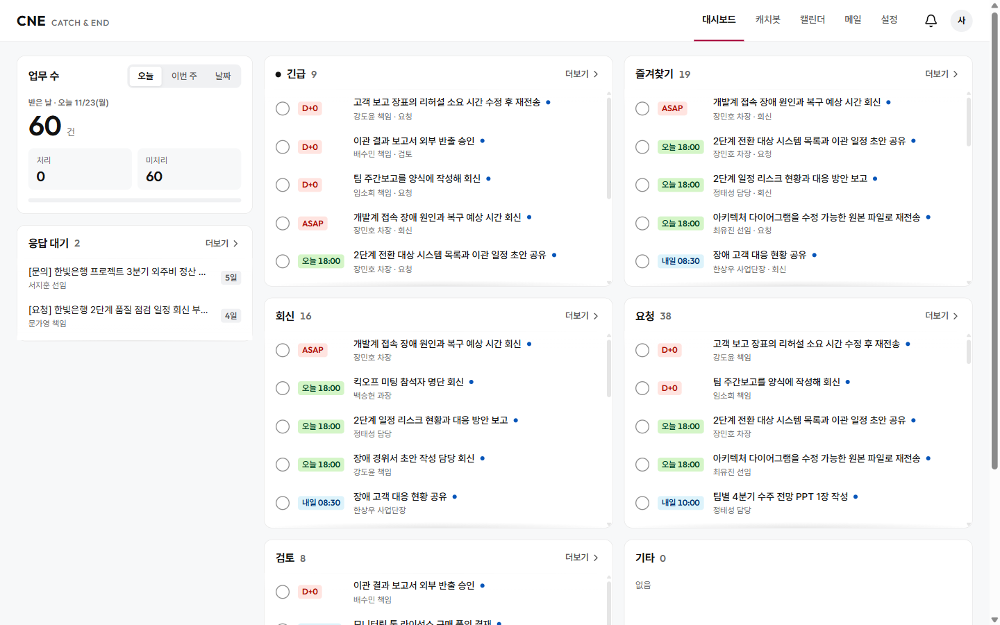
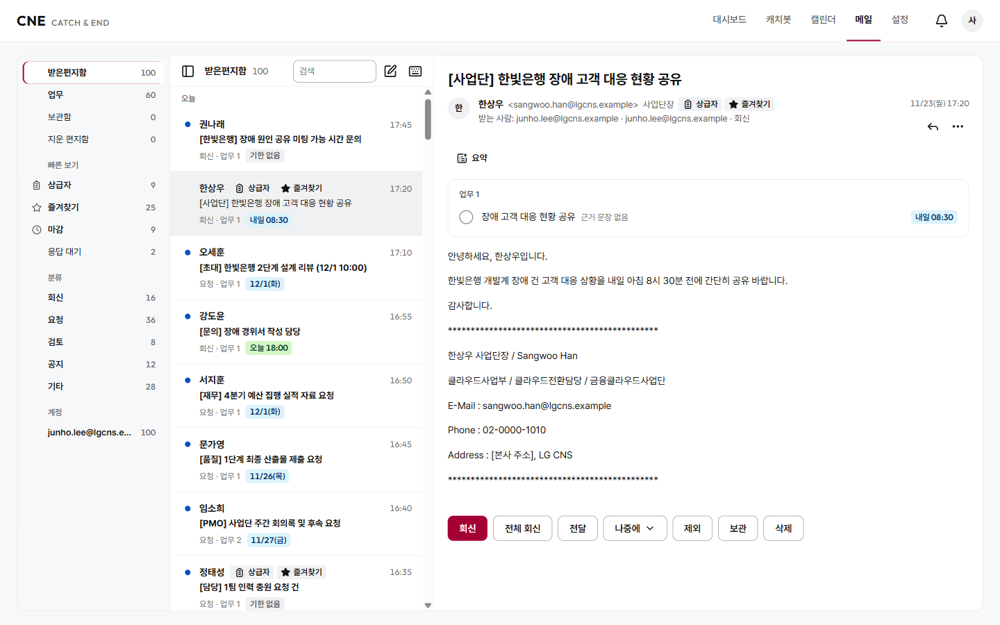
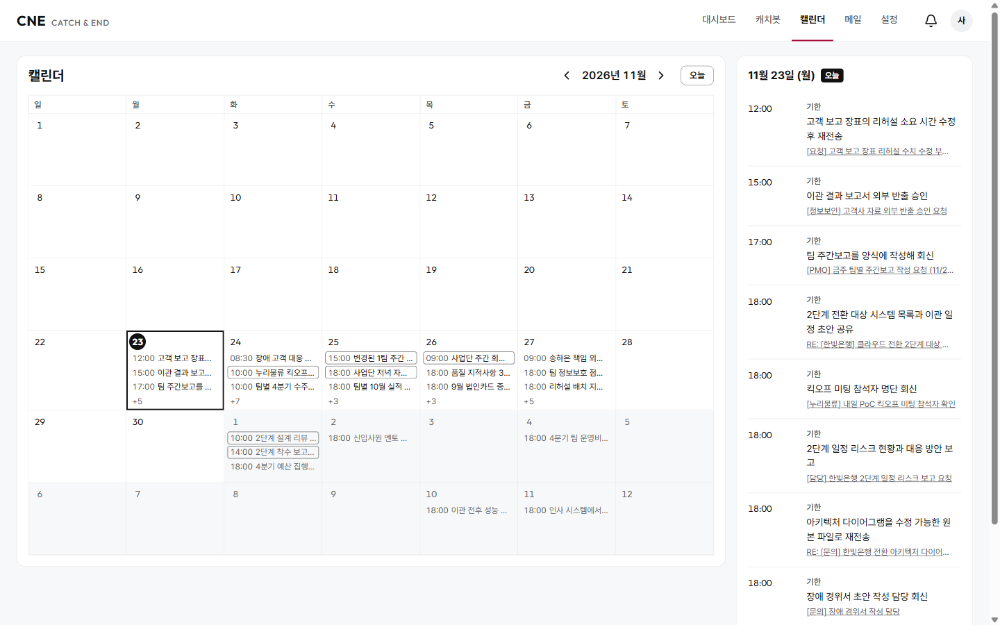
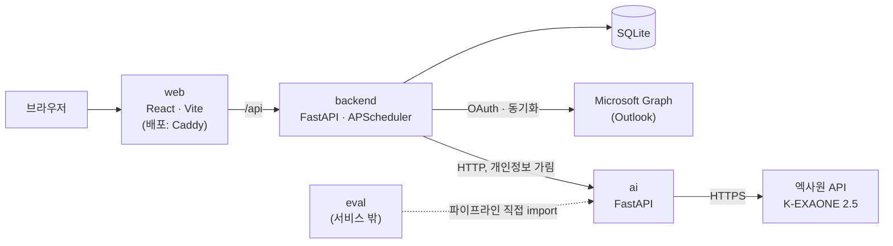

<div align="center">

# CNE

**Catch & End — 메일 속 할 일을 잡아서, 끝날 때까지 챙깁니다.**

하루 100~200통의 업무 메일에서 할 일과 기한을 자동으로 뽑아 대시보드에 모으고,<br>
완료할 때까지 리마인더와 캐치봇(에이전트)이 대신 챙기는 업무 메일 비서입니다.

6조 실리콘밸리 발사대 · 2026 천안형 글로벌 인재육성사업 AX 액션러닝 · LG CNS 기업 과제 04

[**빠른 시작**](#빠른-시작) · [기술 스택](#기술-스택) · [API](#api) · [성능](#얼마나-맞는지-어떻게-확인했나) · [문서](#문서)

</div>

<p align="center">
  
</p>

## 왜 만들었나

팀장은 하루 100~200통의 업무 메일을 받습니다. 하나씩 열어 확인하는 방식으로는 회신 요청, 자료 제출 기한, 회의 참석 요청이 메일함 아래로 밀려 놓치게 됩니다.

CNE는 이 **누락을 막는 것**을 첫 번째 목표로 합니다. 성공 기준은 세 가지입니다.

| 기준 | 목표 |
| --- | --- |
| 할 일 메일 누락 | 0건 (더미 · 봉인 테스트셋 기준) |
| 리마인더 | 중복 · 누락 0건, 보내기 직전에 아직 미처리인지 다시 확인 |
| 외부 LLM 호출 | 서비스 경로에서 엑사원(LG AI연구원) 밖 모델 호출 0건 |

## 사용 흐름

1. **메일 연결**: 설정 → 메일 계정에서 Outlook을 연결합니다. 받은편지함 · 보낸편지함 · 일정을 Microsoft Graph로 가져옵니다. 배포 주소에서는 브라우저마다 자기 Outlook을 연결합니다(D58).
2. **업무 추출**: 메일이 들어오면 엑사원이 할 일 · 유형(회신 · 요청 · 검토 · 공지 · 기타) · 기한 · 본인 지목 · 긴급 여부를 판단하고, 기한 날짜 계산과 우선순위는 코드가 정합니다.
3. **대시보드에서 확인**: 긴급(기한 지남 · ASAP · 오늘 마감) · 즐겨찾기 · 유형별 칸과 응답 대기 목록으로 오늘 할 일을 봅니다.
4. **처리**: 메일 화면에서 근거 문장 · 요약 · 번역을 보고 답장합니다. 업무는 완료 · 나중에 · 제외로 바꾸고, 모든 변경은 되돌릴 수 있습니다. 답장 뒤에는 완료할지 묻습니다(D48).
5. **챙기기**: 끝나지 않은 업무는 리마인더(기한 임박 · 지남, 응답 대기, 약속, 끝난 것 같은 업무)와 아침 · 퇴근 · 주간 브리핑으로 다시 알립니다.
6. **말로 시키기**: 캐치봇에게 "김 팀장님 건 다 처리했어", "견적 건 내일 아침으로 미뤄"처럼 글이나 음성으로 지시합니다. 여러 건 변경 · 설정 · 발송은 먼저 확인을 받습니다.

| 메일 | 캘린더 |
| --- | --- |
|  |  |
| 메일마다 뽑은 업무와 기한이 본문 위에 붙고, 목록에서도 기한을 바로 봅니다. | 업무 기한 · 메일 속 회의 · 미룬 업무 · Outlook 일정을 날짜순으로 봅니다. |

화면은 저장소의 데모 메일 115통(`data/dummy/demo_mails.json`, 가상 LG CNS 조직)을 이번 주로 옮겨 시드하고, 서비스 시각을 메일이 도착한 날(11/23 17:50)로 맞춰 11-25에 찍었습니다. 엑사원은 연결하지 않아 업무는 정답 라벨로 채웠고, 캐치봇 화면은 넣지 않았습니다.

## 어떻게 동작하나



- **판단은 모델이, 계산은 코드가 합니다.** 할 일인지 · 무슨 유형인지 · 기한 표현이 뭔지는 엑사원이 정하고, 날짜 계산 · 우선순위 공식 · 칸 배치는 코드가 합니다. 모델 호출이 실패하면 규칙으로 메우지 않고 실패를 알린 뒤 다시 부릅니다([AI 결정 AI-D19](docs/40_ai/decisions.md)).
- **호출은 한 방향입니다.** `web → backend → ai`. ai는 DB에 접근하지 않고 backend를 부르지 않습니다(D34). 화면은 ai를 직접 부르지 않습니다.
- **상태 변경은 모두 기록합니다.** 버튼과 캐치봇이 같은 서비스 함수를 타고, 모든 변경이 `action_log`에 남아 되돌릴 수 있습니다(D37).
- **캐치봇은 등록된 행동만 합니다.** 행동 20개(T01~T20) 안에서만 실행하고, 확인이 필요한지는 backend 규칙이 정합니다. 자동 발송 · 자동 보관 · 묻지 않는 자동 완료는 하지 않습니다(D48).
- **외부 LLM은 평가에서만 씁니다.** Claude · OpenRouter 코드와 키는 `eval/`에만 둡니다. 커밋 전 훅과 CI가 서비스 경로를 검사합니다(D26 · D41).

자세한 구조 · 데이터 · 테스트는 [구조도 v3.1](docs/00_common/architecture.md)에 있습니다.

## 얼마나 맞는지 어떻게 확인했나

봉인한 FINAL TEST 200통(할 일 메일 90통 · 할 일 105개), 분류 프롬프트 `classify_v8.4`, 2026-11-23~24 측정입니다.

| 모델 | 할 일 메일 찾음 | 할 일 메일 정밀도 | 모든 칸 정답 | 주 유형 | 마감 맞음 | 1통 처리 시간(중앙) |
| --- | --- | --- | --- | --- | --- | --- |
| **K-EXAONE 2.5 (서비스 모델)** | **90/90 (놓침 0)** | 93.8% | 169/200 | 94.5% | 94/105 | 25.5초 |
| Claude Haiku 5.5 (비교용) | 89/90 | 98.9% | 180/200 | 98.5% | 95/105 | 4.8초 |
| DeepSeek V4.1 Flash (비교용) | 90/90 | 97.8% | 182/200 | 98.0% | 97/105 | 4.1초 |

- v8.4는 직전 측정(v8.3)의 약점 묶음을 본 뒤 고친 버전이라, 이 세트가 완전히 처음 보는 세트는 아닙니다. 평가 메일 작성과 재라벨을 모두 Claude가 해서 Haiku 수치는 이 점을 감안해 읽어야 합니다. 전체 표와 한계는 [scores.md 16절](docs/50_data_eval/scores.md)에 있습니다.
- 코드 검증: PR마다 CI가 경계 · 비밀값 검사, ai · backend pytest, frontend 빌드 · 테스트를 돌립니다.

## 빠른 시작

필요한 것: Python 3.12, [uv](https://docs.astral.sh/uv/), Node.js 22.22 이상. 엑사원을 쓰려면 엑사원 API 키가 필요합니다.

```bash
git clone https://github.com/dlwodns/Teamproject_6.git
cd Teamproject_6
cp .env.example .env                    # 값을 채웁니다. .env는 커밋하지 않습니다
git config core.hooksPath .githooks     # 커밋 전 경계 · 비밀값 검사 (클론마다 한 번)

python scripts/run_dev.py --no-llm      # ai · backend · frontend를 한 번에 띄웁니다. Ctrl+C로 한 번에 끕니다
```

- `--no-llm`은 엑사원 없이 띄웁니다. 화면 · 메일 · 상태 변경은 되고 분류 · 캐치봇 명령은 실패를 알립니다. 엑사원을 쓰려면 `.env`에 `EXAONE_API_KEY`를 넣고 `--no-llm`을 뺍니다.
- 화면은 기본이 모의 데이터(`VITE_API_MODE=mock`)입니다. backend에 붙이려면 `frontend/.env`에 `VITE_API_MODE=http`를 넣습니다([frontend README](frontend/README.md#설정)).
- 더미 메일이 채워진 시연 화면은 [backend README의 시연 데이터](backend/README.md#시연-데이터)로 만듭니다.
- 각 서비스를 따로 띄우거나 테스트하는 방법은 서비스별 README에 있습니다.

### 환경 변수

루트 `.env` 하나를 `run_dev.py`가 세 서비스에 넘깁니다. 코드가 읽는 변수는 모두 `.env.example`에 있어야 하고, 빠지면 CI가 막습니다(INF-4). 필수는 비어 있으면 서비스가 뜨지 않거나 그 기능이 동작하지 않는 값입니다.

| 이름 | 쓰는 곳 | 필수 | 기본값 · 뜻 |
| --- | --- | --- | --- |
| `EXAONE_API_KEY` | ai | 엑사원을 쓰면 예 | 엑사원 API 키. 쉼표로 여러 개(한도 소진 · 거절 시 다음 키) |
| `LLM_BACKEND` | ai | 아니요 | `exaone_api` |
| `LLM_ENABLED` | ai | 아니요 | `true`. `false`면 모델을 부르지 않음 |
| `AI_SERVICE_URL` | backend | 아니요 | `http://localhost:8001` |
| `DATABASE_URL` | backend | 아니요 | `sqlite:///./ax.db` |
| `APP_MODE` | backend | 아니요 | `dev`. 배포는 `prod` |
| `AUTH_MODE` | backend | 아니요 | `header`(개발 · 테스트, `X-User-Id`). 배포는 `session`(브라우저 쿠키) |
| `MAIL_SOURCE` | backend | 아니요 | `dummy`. Outlook은 `outlook_graph` |
| `MS_GRAPH_CLIENT_ID`, `_CLIENT_SECRET`, `_REDIRECT_URI` | backend | `outlook_graph`면 예 | Microsoft Entra 앱 정보 |
| `MS_GRAPH_TENANT` | backend | 아니요 | `consumers`. 회사 · 학교 계정도 받으려면 `common` |
| `TOKEN_ENCRYPTION_KEY` | backend | `outlook_graph`면 예 | 메일 토큰 암호화 Fernet 키 |
| `CLASSIFY_WORKER`, `REMINDER_SCHEDULER`, `REMINDER_SIGNALS`, `MEMORY_EXTRACT` | backend | 아니요 | 꺼짐. `1`이면 분류 작업자 · 리마인더 1분 틱 · 신호 · 문맥 기억을 켬 |
| `VITE_API_MODE` | frontend | 아니요 | `mock`. backend에 붙이려면 `http` |
| `ANTHROPIC_API_KEY`, `OPENROUTER_API_KEY` | eval만 | 아니요 | 모델 비교용. `run_dev.py`는 서비스에 넘기지 않음 |

서비스별 전체 목록은 [backend](backend/README.md#설정) · [ai](ai/README.md#설정) · [frontend](frontend/README.md#설정) README에 있습니다.

## 기능과 진행 상태

2026-11-25 `main` 코드 기준입니다.

| 기능 | 우선순위 | 서버 | 화면 |
| --- | --- | --- | --- |
| 업무 추출 (할 일 · 유형 · 기한 · 지목 · 근거 문장) | P0 | 완료 | 완료 |
| 대시보드 (업무 수 · 응답 대기 · 긴급 · 유형별 칸) | P0 | 완료 | 완료 |
| 메일 (3단 화면 · 여러 계정 · 답장 · 전달 · 예약 발송 · 상태 버튼) | P0 | 완료 | 완료 |
| 처리 추적 · 되돌리기 (`action_log`) | P0 | 완료 | 완료 |
| 리마인더 · 알림 센터 · 아침 / 퇴근 / 주간 브리핑 | P0 | 완료 | 완료 |
| 캐치봇 (행동 T01~T20, 미리보기 → 확인) | P0 · P1 | 완료 | 완료 |
| 음성 입력 | P0 | 해당 없음 | 완료 (브라우저 Web Speech API) |
| 요약 · 번역 · 회신 초안 · 답장 다듬기 | P0 | 완료 | 완료 |
| Outlook 연결 (Graph, 브라우저별 세션) | P0 | 완료 | 완료 |
| 캘린더 (기한 · 회의 · 미룬 업무 · Outlook 일정 읽기) | P1 | 완료 | 완료 |
| 템플릿 전송 (T14, 미리보기 + 확인) | P1 · P2 | 완료 | 완료 |
| 웹 푸시 알림 | P1 | 진행 전 (구독 표만 있음) | 진행 전 |
| MCP 서버 (같은 행동을 MCP 도구로) | P2 | 진행 전 | 해당 없음 |

일정: 11/27(금) 발표자료 + 코드 제출(**코드 수정 마감**) · 11/28(토) IR Day.

## 기술 스택


| 영역 | 기술 | 쓰는 곳 |
| --- | --- | --- |
| 웹 | React 19.3, TypeScript 6.0, Vite 8.3, React Router 8 (해시 라우터), TanStack Query 5, Base UI, lucide-react | 화면 · 상태 · 서버 데이터 캐시 |
| 웹 디자인 | CSS Modules + 디자인 토큰(`tokens.css`), Pretendard · Outfit 글꼴 | LG Heritage Red 포인트 색, 대비 테스트 |
| 웹 테스트 | Node 내장 `node --test` (TS 타입 제거) | 집계 · 기한 · 응답 변환 · 색 대비 |
| 백엔드 | Python 3.12, FastAPI 0.162, Uvicorn, Pydantic 2, SQLAlchemy 2.1, APScheduler 3.11, httpx, cryptography(Fernet) | API · 업무 상태 · 리마인더 1분 틱 · 토큰 암호화 |
| DB | SQLite (파일 하나, 배포는 Railway 볼륨) | 메일 · 업무 · 리마인더 · `action_log` |
| 메일 연동 | Microsoft Graph v1.0, OAuth 2.0 인증 코드 + PKCE, 변경 알림 구독 | Outlook 메일 · 일정 |
| AI 서비스 | Python 3.12, FastAPI, httpx | 분류 · 근거 · 명령 해석 · 요약 · 초안 · 번역 · 신호 |
| 모델 | 엑사원 API `k-exaone_v2.5` (LG AI연구원) | 서비스의 유일한 LLM |
| 평가 | Python 표준 라이브러리 채점기, Claude · OpenRouter(비교 · 보조 채점) | `eval/`에서만 |
| 패키지 | uv + `uv.lock`(Python), npm + `package-lock.json` | 잠근 버전 그대로 설치 |
| 배포 | Railway 서비스 3개, Docker(uv python3.12 · node 22), Caddy 2.10 | HTTPS · `/api` 프록시 |
| CI · 품질 | GitHub Actions, ruff, pytest, 커밋 전 훅(`check_boundaries.py`) | 경계 · 비밀값 · 테스트 · 빌드 |

## API

브라우저는 `/api`로 backend만 부르고, backend가 내부 ai를 부릅니다. 형식은 [구조도 8절](docs/00_common/architecture.md)과 각 서비스의 `app/schemas/`가 기준입니다.

| 영역 | 대표 경로 | 문서 |
| --- | --- | --- |
| 대시보드 · 응답 대기 | `/api/dashboard`, `/api/awaiting` | [backend API](backend/README.md#api) |
| 메일 · 답장 · 요약 · 번역 | `/api/mails/*`, `/api/uploads` | [backend API](backend/README.md#api) |
| 업무 상태 · 되돌리기 | `/api/tasks/*`, `/api/actions/*` | [backend API](backend/README.md#api) |
| 캐치봇 | `/api/agent/command`, `/api/suggestions`, `/api/agent/memory` | [AI 명세](docs/40_ai/detail.md) |
| 리마인더 · 알림 · 브리핑 | `/api/reminders/*`, `/api/notifications/*`, `/api/briefings/*` | [리마인더 API](backend/README.md#리마인더), [명세](docs/10_planning/reminders.md) |
| 캘린더 | `/api/calendar`, `/api/events` | [backend API](backend/README.md#api) |
| 계정 · 세션 · 설정 | `/api/accounts/*`, `/api/session`, `/api/settings` | [backend API](backend/README.md#api) |
| ai 내부 (backend 전용) | `/classify`, `/evidence`, `/agent/plan`, `/summarize`, `/draft`, `/polish`, `/translate`, `/memory/extract`, `/signals` | [ai API](ai/README.md#api) |

## 문서

| 알고 싶은 것 | 문서 |
| --- | --- |
| 무엇을 만드나 | [PRD v3.1](docs/10_planning/refs/PRD.md), [기획 명세](docs/10_planning/detail.md) |
| 전체 구조 · 데이터 · 테스트 | [구조도 v3.1](docs/00_common/architecture.md) |
| 왜 이렇게 정했나 | [공통 결정 D1~D58](docs/00_common/decisions.md), 파트별 `docs/<파트>/decisions.md` |
| 화면 | [frontend README](frontend/README.md), [디자인 시스템](docs/20_frontend/design_system.md), [와이어프레임](docs/20_frontend/wireframe.md) |
| API · 리마인더 · 캐치봇 실행 | [backend README](backend/README.md), [BE 명세](docs/30_backend/detail.md), [리마인더 명세](docs/10_planning/reminders.md) |
| 분류 · 명령 해석 | [ai README](ai/README.md), [AI 명세](docs/40_ai/detail.md) |
| 평가 방법 · 점수 | [eval README](eval/README.md), [점수 기록](docs/50_data_eval/scores.md) |
| 더미 데이터 | [data README](data/README.md), [더미 메일](data/dummy/README.md) |
| 배포 | [infra README](infra/README.md), [Railway 설정](infra/railway_setup.md) |
| 작업 규칙 | [CONTRIBUTING](CONTRIBUTING.md), [작업 규칙](docs/00_common/work_rules.md), [문서 지도](docs/README.md) |

<details>
<summary>폴더 안내</summary>

| 경로 | 용도 | 서비스에 포함 |
| --- | --- | --- |
| `frontend/` | 웹 화면 (React + Vite), 배포용 Caddy 설정 | O |
| `backend/` | API · 메일 연동 · 업무 상태 · 캐치봇 실행기 · 리마인더 (FastAPI) | O |
| `ai/` | 엑사원 서비스 (FastAPI) | O |
| `eval/` | 채점 · 모델 비교. Claude · OpenRouter는 여기서만 | X |
| `data/` | 더미 메일 생성기 · 생성 데이터 (원본 raw는 레포 미포함) | X |
| `docs/` | 공통 규칙 · 결정 · 구조도, 파트별 계획 · 명세 · 트러블슈팅 | X |
| `scripts/` | 동시 실행(`run_dev.py`) · 경계 · 비밀값 검사 | X |
| `infra/` | 배포 문서 · 저장소 규칙 | X |

</details>

## 협업 규칙

- 브랜치: `feature/` · `fix/` · `docs/` + 작업 번호 (예: `feature/FE-3-dashboard`). 여러 파트가 함께 보는 문서는 main 기준으로 고칩니다.
- 커밋: `유형: 작업 번호 요약` (예: `feat: FE-3 업무 칸 렌더링`). 작성자 한 명, 공동 저자 줄 없음.
- PR: 작성자 외 1명 리뷰 승인과 CI 통과 뒤 병합합니다. main에 직접 push하지 않습니다.
- 결정은 `decisions.md`에 상태 · 제안 · 결정 · 리뷰 · 근거와 함께 남깁니다. 자세한 규칙은 [CONTRIBUTING](CONTRIBUTING.md).

## 팀

| 이름 | GitHub | 역할 | 파트 |
| --- | --- | --- | --- |
| 이재운 | [dlwodns](https://github.com/dlwodns) | 팀장 | 기획(팀장) · 프론트엔드 |
| 강예은 | [kangdms6603-hub](https://github.com/kangdms6603-hub) | 데이터 | AI · 데이터 · 평가 |
| 문규남 | [mungn0603-code](https://github.com/mungn0603-code) | 테크 · 커뮤니케이터 | 기획 · AI(팀장) · 인프라 |
| 임동하 | [Limdongha-7751](https://github.com/Limdongha-7751) | 테크팀장 | 프론트엔드 · 백엔드 |
| 최수호 | [sooho2638](https://github.com/sooho2638) | 테크 · 커뮤니케이터 | 백엔드 · 데이터 · 평가 |
| 홍태겸 | [Taegyeom03](https://github.com/Taegyeom03) | 테크 | 백엔드 · AI |

기여도는 [contribution.md](docs/00_common/contribution.md)에 있습니다.

## 데이터 · 라이선스

- 개발 · 평가는 가상 LG CNS 조직의 더미 메일로 합니다. 실제 사내 메일 · 개인 메일은 어떤 폴더에도 넣지 않습니다. 화면의 이름 · 회사 · 메일 주소는 모두 예시입니다.
- 공개 데이터셋 MailEx(Enron 기반, 실명 포함)는 원재료로만 쓰고 레포에 올리지 않습니다(D24). 라이선스 `[미확인]`.
- 엑사원 API는 LG AI연구원 약관을 따릅니다. 상업적 사용 조건 `[미확인]`.
- 글꼴 · 아이콘 고지는 [frontend/public/licenses](frontend/public/licenses). 이 레포는 비공개이며 레포 자체의 라이선스는 정하지 않았습니다.
