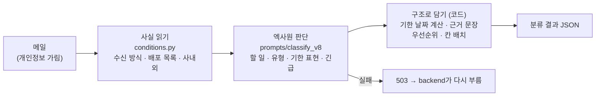

# CNE AI 서비스 (엑사원)

메일 분류 · 근거 문장 · 캐치봇 명령 해석 · 요약 · 초안 · 다듬기 · 번역 · 문맥 기억 · 리마인더 신호를 내주는 내부 FastAPI 서비스다. 모델은 **엑사원 API(K-EXAONE 2.5) 하나**만 쓴다. [backend](../backend/README.md)만 HTTP로 부르고(D34), DB에 접근하지 않으며 받은 입력으로 결과만 돌려준다. 서비스 전체 소개는 [저장소 README](../README.md)에 있다.

| 항목 | 내용 |
|---|---|
| 상태 | 엔드포인트 10개 완료. 서버 음성 인식(`/stt`)은 두지 않았다(브라우저에서 한다) |
| 정확도 | FINAL TEST 200통에서 할 일 메일 90/90 찾음(놓침 0) · 정밀도 93.8% · 모든 칸 정답 169/200 ([분류 성능](#분류-성능)) |
| 속도 · 비용 | 메일 1통 중앙 25.5초. 엑사원 API 키당 하루 호출 한도가 있어 키 여러 개를 돌려 쓴다 |
| 테스트 | pytest 21개 파일 · 589개(시험 함수 302개, parametrize 포함 — 11-27 `pytest --collect-only`). 가짜 모델로 돌아 엑사원이 필요 없다 |
| 번호 읽는 법 | D-숫자는 [공통 결정](../docs/00_common/decisions.md), AI-D-숫자는 [AI 결정](../docs/40_ai/decisions.md) |

## 기술 스택

| 영역 | 기술 | 버전(`uv.lock`) | 쓰는 곳 |
|---|---|---|---|
| 언어 | Python | 3.12 | 루트 `.python-version` |
| 웹 프레임워크 | FastAPI · Uvicorn | 0.162 · 0.54 | 엔드포인트 |
| 데이터 형식 | Pydantic | 2.14 | 요청 · 응답(`app/schemas/`), 모델 답 검증 |
| 모델 호출 | httpx → 엑사원 API `/v1/chat/completions` (OpenAI 호환) | httpx 0.28 | `app/llm/client.py`. `temperature 0`, JSON 스키마 응답, 출력 상한 16,384토큰 |
| 모델 | K-EXAONE 2.5 (`k-exaone_v2.5`, LG AI연구원) | — | 분류 · 명령 해석 · 요약 · 초안 · 번역 · 신호 모두 같은 모델 |
| 프롬프트 | 파이썬 모듈 + 예시 JSONL, 버전을 파일 이름에 | — | `app/prompts/` |
| 날짜 계산 | 표준 라이브러리(`datetime` · `zoneinfo`) | — | `pipeline/dates.py` — 한국어 · 영어 · 일본어 기한 표현, 시간대 |
| 테스트 | pytest | 9.2 | 가짜 모델 · 계약 · 시간 제한 · 외부 송신 |

외부 LLM SDK(anthropic · openai)는 넣지 않는다(D41). 엑사원 API도 SDK 없이 httpx로 부른다.

> 모델은 엑사원 API로만 부른다. 로컬 모델을 내려받거나 띄울 필요가 없다. 실제 기업 도입 때는 같은 호출부(`app/llm/client.py`)에 사내 엔터프라이즈 LLM을 끼워 바꾼다(D52 · D58).

## 실행

필요한 것: Python 3.12, uv, 엑사원 API 키(`EXAONE_API_KEY`).

```bash
cd ai
uv sync --locked --extra dev                   # uv.lock 그대로 설치(INF-3)
.venv/bin/uvicorn app.main:app --port 8001     # backend의 AI_SERVICE_URL과 맞춘다
curl localhost:8001/health                     # 키가 없어도 status: ok. 모델 상태는 llm.* 로 따로 본다
.venv/bin/python -m pytest                     # CI 'ai 테스트'와 같은 명령
```

- ai · backend · frontend를 한 번에: 루트에서 `python scripts/run_dev.py`.
- 모델 없이 띄우려면 `LLM_ENABLED=false`(또는 `run_dev.py --no-llm`). 분류 · 명령 해석은 503, 요약 · 초안은 코드 문장으로 답한다.

## API

| 경로 | 하는 일 | 부르는 곳(backend) |
|---|---|---|
| `GET /health` | 서비스 · 모델 상태(`llm.model_ready` · `llm.error` · `llm.key`) · 외부 송신 기록 | 상태 확인 |
| `POST /classify` | 메일 1통 → 할 일 · 유형 · 기한 · 우선순위 · 확인 칸 | 분류 작업자(백그라운드) |
| `POST /evidence` | 근거가 빈 할 일마다 메일 본문 속 근거 문장(모델이 고르고 코드가 검증, AI-D33) | 메일을 연 뒤 백그라운드(AI-46) |
| `POST /agent/plan` | 사용자 지시 글자 → 실행 계획 `{action, target, params, source}`. 실행 · 확인 판정은 backend가 한다(D37) | 캐치봇 |
| `POST /summarize` · `/draft` · `/polish` · `/translate` | 요약(오늘 · 회고 · 메일) · 회신 초안 · 답장 다듬기 · 번역 | 메일 화면 · 업무 요약 · 캐치봇. `/draft`는 backend가 지금 부르지 않는다(캐치봇 초안 없음, AI-D24) |
| `POST /memory/extract` | 메일에서 사람 · 나에 대한 문맥 기억 | `MEMORY_EXTRACT=1`일 때 |
| `POST /signals` | 약속 · 기한 변경 · 해결 · 나에게 온 질문 ([아래](#리마인더-신호-post-signals)) | `REMINDER_SIGNALS=1`일 때 |

- 요청 · 응답 형식은 `app/schemas/`. 바꿀 때는 backend `app/schemas/ai.py`와 함께 고친다.
- 모델 호출이 실패하면 **규칙으로 결과를 메우지 않고** 503(`model_failed`)으로 알린다. backend가 그 메일을 다시 부른다(AI-D19).
- 혼잡(429 · 5xx)은 제한 시간 안에서 다시 보내고, 하루 한도 소진 · 키 거절(401)이면 다음 키로 넘긴다(AI-47).

## 분류는 어떻게 하나



판단은 모두 모델이 하고, 코드는 모델 답을 바꾸지 않는다(AI-D19). 날짜 계산 · 우선순위 공식처럼 정답이 정해진 일만 코드가 한다. 메일에 없는 기한 문구는 지어낸 것으로 보고 지운다. 모델이 할 일을 비운 메일에 요청 문장이 있으면 '요청 문장 있음'으로 띄워 사람이 보게 한다(누락 안전망).

| 프롬프트 | 쓰는 곳 |
|---|---|
| `classify_v8` (v8.4) | `/classify` |
| `evidence_v1` | `/evidence` |
| `agent_v1` + `agent_examples_v1.jsonl` | `/agent/plan` |
| `assist_v4` | `/summarize` · `/draft` |
| `polish_v1` · `translate_v1` | `/polish` · `/translate` |
| `memory_v1` · `signals_v1` | `/memory/extract` · `/signals` |

### 분류 성능

봉인한 FINAL TEST 200통(할 일 메일 90통 · 할 일 105개), `classify_v8.4`, 추론 high, 2026-11-23~24.

| 지표 | K-EXAONE 2.5 |
|---|---|
| 할 일 메일 찾음 · 놓침 | 90/90 · 0 |
| 할 일 아닌 메일을 할 일로 잡음 | 6/110 |
| 할 일 메일 정밀도 | 93.8% |
| 모든 칸 정답 | 169/200 |
| 주 유형 · 우선순위 | 94.5% · 97.5% |
| 마감 맞음 | 94/105 |
| 1통 처리 시간 중앙 · 90% | 25.5초 · 81.6초 |

v8.4는 직전 측정(v8.3)의 약점 묶음을 본 뒤 고친 버전이라 이 세트가 완전히 처음 보는 세트는 아니다. 비교 모델(Claude Haiku · DeepSeek · Gemma)과 한계는 [scores.md 16절](../docs/50_data_eval/scores.md), 채점 방법은 [eval README](../eval/README.md).

## 설정

| 이름 | 기본값 | 뜻 |
|---|---|---|
| `EXAONE_API_KEY` | (빈 값) | `.env`에만 둔다. 쉼표로 여러 개(`키1,키2`) — 앞 키가 하루 한도 소진 · 거절(401)이면 다음 키로 같은 요청을 다시 보낸다(AI-47). 비어 있으면 서비스는 뜨고 모델 호출만 실패한다 |
| `EXAONE_API_MODEL` | `k-exaone_v2.5` | API 모델 이름 |
| `EXAONE_API_BASE_URL` | `https://api.exaone.ai/v1` | 바꾸지 않는다 |
| `EXAONE_REASONING_EFFORT` | (빈 값 = API 기본 max) | `low` · `high` · `max`. 추론은 끌 수 없다 |
| `LLM_BACKEND` | `exaone_api` | 바꾸지 않는다(위 안내 참고) |
| `LLM_ENABLED` | `true` | `false`면 모델을 부르지 않는다 |
| `LLM_TIMEOUT_S` | `120` | **대화형** 호출(명령 해석 · 다듬기 · 요약 · 초안) 제한 시간. backend 대화형 대기 130초보다 짧게 |
| `LLM_BACKGROUND_TIMEOUT_S` | `300` | **백그라운드** 호출(분류 · 기억 · 신호) 제한 시간. backend `AI_BACKGROUND_TIMEOUT_S`(310)보다 10초 이상 짧게 |

## 폴더

| 경로 | 역할 |
|---|---|
| `app/api/` | 엔드포인트 (위 표) |
| `app/core/` | 설정 · 요청 ID 로깅(본문을 남기지 않는다) · 외부 송신 허용 목록(`egress.py`) |
| `app/schemas/` | backend와 주고받는 요청 · 응답 형식 |
| `app/pipeline/` | 분류: 사실(`conditions`) · 날짜(`dates`) · 근거(`evidence`) · 우선순위(`priority`) · 확인 칸(`checks`) · 기억 · 신호 |
| `app/agent/` | 명령 해석(`plan`) · 요약 · 초안(`assist`) · 다듬기(`polish`) · 번역(`translate`) |
| `app/llm/` | 모델 호출(`client.py`). 엑사원 밖 LLM 호출 경로를 두지 않는다(D41) |
| `app/prompts/` | 프롬프트. 지금 쓰지 않는 예전 판(`classify_v6` · `v7`, `assist_v1`~`v3`)도 비교용으로 남겨 둔다 |
| `tests/` | 가짜 모델 테스트 · 계약 테스트 |

## 운영 점검 (엑사원 API)

- **키는 발급일부터 30일만 쓸 수 있다.** 만료되면 분류가 503으로 실패한다. 키를 발급한 사람이 만료 날짜를 팀 일정에 적고, 만료 전에 새 키로 바꾼다.
- **매일 한 번 `/health`를 본다.** `llm.error`는 셋 중 하나다: `EXAONE_API_KEY 없음` · `키 거절(HTTP 401) — …`(만료 · 틀린 키) · `하루 호출 한도 소진`(다음 날 풀린다). `/health`는 API를 부르지 않고 마지막 호출에서 본 상태만 알린다.
- **학습용 이용 기록 분석에는 동의하지 않는다.** 메일 본문이 API로 나가므로(D53) 엑사원 API 콘솔에서 학습 · 분석 동의 항목을 꺼 둔다. 키를 새로 발급할 때마다 다시 확인한다.

## 리마인더 신호 `POST /signals`

리마인더가 '내가 한 약속 · 상대 약속 지남 · 기한 바뀜 · 끝난 것 같아요 · 끊긴 대화'를 띄울 때 쓰는 신호를 메일 한 통에서 읽는다(AI-24 · AI-D20). 분류와 따로 둔 이유는 분류 프롬프트를 흔들지 않고 보낸 메일에도 부를 수 있게 하기 위해서다. 명세는 [reminders.md 8절](../docs/10_planning/reminders.md).

<details>
<summary>요청 · 응답 형식과 검증 규칙</summary>

무엇이 약속 · 기한 변경 · 해결 · 질문인지는 모델(`signals_v1`)이 판단한다. 코드는 모델 답을 다른 답으로 바꾸지 않고, 형식이 맞지 않는 신호만 버린다(버린 수는 `dropped`).

- 근거(`evidence`)가 이 메일 본문에 글자 그대로 없으면 그 신호를 버린다. 공백만 느슨하게 맞추고, 화면이 칠할 수 있게 본문 문장 그대로 돌려준다.
- 날짜는 `mail.sent_at` 기준으로 `pipeline/dates.py`가 계산한다. 문구로 날짜를 정할 수 없으면('다음 주') `due_at`은 null이다. 메일에 없는 기한 문구는 약속에서 지우고, 기한 변경은 버린다.
- `task_id`는 받은 `open_tasks` 안의 것만 돌려준다. 새 기한이 지금 기한과 같으면 버린다.
- 보낸 메일의 약속은 `me`, 받은 메일의 약속은 `them`만 받는다. 보낸 메일의 `asks_me_question`은 늘 false다.
- 모델이 판단하지 못해도 200으로 신호 없이 돌려준다. `fallback`이 `quota`면 한도가 풀린 뒤, `model_failed` · `bad_output`이면 시도로 세며 다시 부른다. `empty_body`는 다시 부르지 않는다.

요청(시각은 시간대가 없으면 KST. `thread`는 최근 5통 · 앞 400자만 쓴다)

```json
{
  "mail_id": 31,
  "mail": {"direction": "received", "sender": "minho.jang@hanbitbank.example",
           "recipients": ["junho.lee@lgcns.example"], "cc": [], "subject": "RE: 이관 일정",
           "body": "…이관 일정표는 11/20까지만 주셔도 됩니다.\n보안 점검 결과는 제가 내일 오전 중에 보내 드리겠습니다.\n…",
           "sent_at": "2026-11-12T10:00:00+09:00"},
  "me": {"email": "junho.lee@lgcns.example", "name": "이준호"},
  "thread": [{"sender": "junho.lee@lgcns.example", "sent_at": "2026-11-11T16:20:00+09:00",
              "subject": "이관 일정", "body": "(앞 400자)"}],
  "open_tasks": [{"task_id": 12, "text": "이관 일정표 보내기", "due_at": "2026-11-13T18:00:00+09:00"},
                 {"task_id": 13, "text": "계정 목록 보내기", "due_at": null}]
}
```

응답(시각은 시간대 없는 KST, id는 문자열)

```json
{
  "mail_id": "31",
  "commitments": [{"who": "them", "text": "보안 점검 결과 보내기", "due_raw": "내일 오전 중",
                   "due_at": "2026-11-13T12:00:00",
                   "evidence": "보안 점검 결과는 제가 내일 오전 중에 보내 드리겠습니다."}],
  "due_changes": [{"task_id": "12", "new_due_raw": "11/20까지", "new_due_at": "2026-11-20T18:00:00",
                   "evidence": "내부 보고가 미뤄져서 이관 일정표는 11/20까지만 주셔도 됩니다."}],
  "resolved": [{"task_id": "13", "reason": "done_by_other",
                "evidence": "계정 목록은 박 과장님이 어제 이미 보내 주셔서 따로 안 주셔도 됩니다."}],
  "asks_me_question": true,
  "source": "exaone", "model": "k-exaone_v2.5", "prompt_version": "signals_v1",
  "elapsed_ms": 9400, "dropped": 0, "fallback": null, "detail": null
}
```

- `reason`: `done_by_other`(다른 사람이 이미 처리) · `cancelled`(일 자체가 취소) · `not_needed`(필요 없어짐).
- 판단하지 못하면 `source: "none"` · 신호 목록은 모두 빈 값 · `fallback`(`quota` | `model_failed` | `bad_output` | `empty_body`) · `detail`(이유, 본문 · 키 없음).
- 개발 세트 채점: `ai/.venv/bin/python eval/runners/run_signals.py --llm`.

</details>

## 규칙

- **Claude · OpenRouter 등 엑사원 밖 LLM 호출 코드와 키를 넣지 않는다**(D41). 모델 비교는 `eval/`에서 한다.
- **의존 방향은 `eval → ai`** 다. eval은 `app/pipeline`을 직접 불러 채점하고, ai는 eval을 가져다 쓰지 않는다.
- **개인정보 가리기는 backend가 보내기 전에** 한다(`backend/app/privacy/`).
- **캐치봇 행동 이름은 backend `agent/tools/registry.py`와 맞춘다.** 목록에 없는 intent는 돌려주지 않는다.
- **로그에 메일 본문을 남기지 않는다.**
