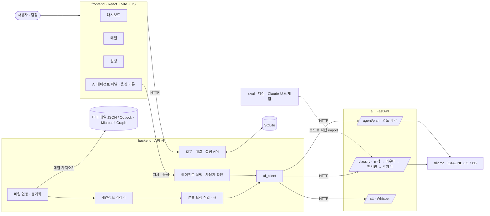
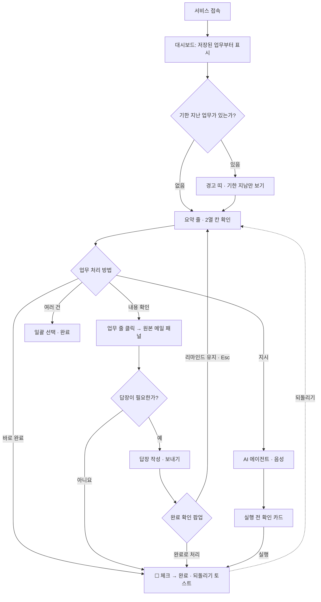
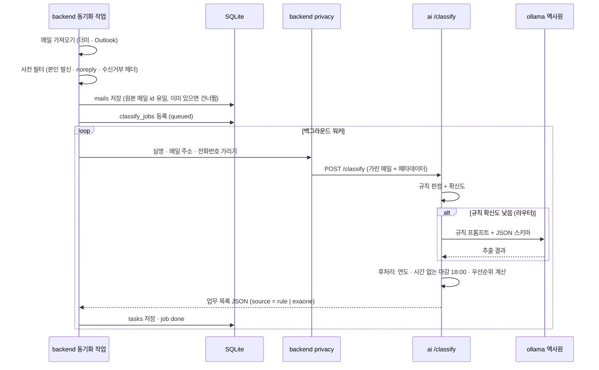
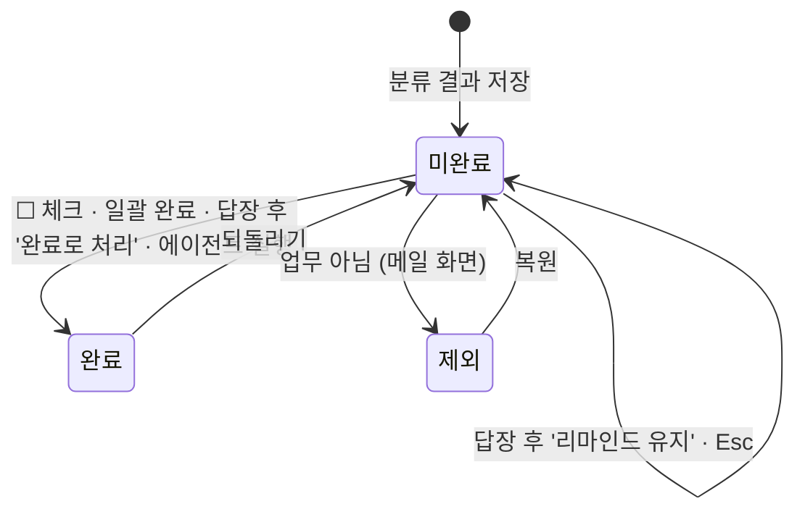
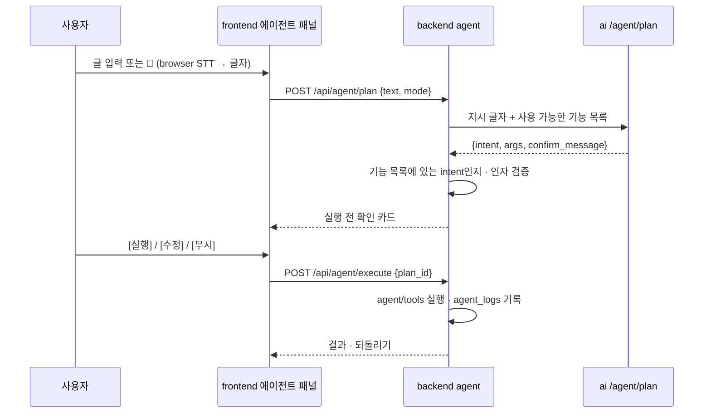

# 구조도 (architecture) · 업무 누락 방지 대시보드

> **버전:** v3 초안 (2026-10-31, 팀 검토 전) — v2(2026-10-10, 메일 단위 리마인더 봇)를 PRD v3에 맞춰 다시 썼다. v2 원본은 `.backup/architecture_v2_20261031.md`
> **근거:** PRD v3 · `decisions.md` D8 · D9 · D13~D16 · D20 · D23 · D24 · D26~D29 · D34 · `wireframe.md` 12절 · `eval/bench/exaone_20261024/결과_및_결정.md` · handoff '구조도 v3에 반영할 것'
> **표기:** `[결정]` 팀 확정 · `[제안]` 이 문서에서 새로 제안(팀 검토 필요) · `[가설]` 확인 전 가정 · `[미정]` 결정 필요
> **작업 번호:** PL-2

## 0. v2 → v3 변경 요약

| 항목 | v2 | v3 | 근거 |
|---|---|---|---|
| 화면 단위 | 메일 한 통 | 메일에서 추출한 **업무**(한 메일에 업무 여러 개 가능) | D20-6 |
| 첫 화면 | 메일 관리(미처리 목록) | **대시보드**(요약 줄 + 2열 업무 칸). 메뉴 `대시보드 \| 메일 \| 설정` | D20 |
| 분류 | 규칙만, AI 없음 | 규칙 → 라우터 → 모호한 것만 엑사원 → 코드 후처리 | D14 · 벤치 10/24 |
| AI 위치 | 없음 | `ai/` 독립 서비스(FastAPI). 백엔드가 HTTP로 부름 | D34 |
| 처리 완료 | 사용자 체크 | 체크 · 일괄 완료 · 되돌리기 + 서비스 안 답장 후 완료 확인 팝업 | D8 · D23 |
| 에이전트 · 음성 | 없음 | 명령형 에이전트(계획은 ai, 실행은 backend) · 음성은 글자로 바꿔 같은 길 | D27 · D29 · D34 |
| 보조 알림 | 주기 작업 · 기기 알림 설계 | 1단계 제외. 대시보드 안 '새 알림' 숫자만 | D16 · D20-1 |
| 기술 스택 | Python · FastAPI · SQLite, 프론트 미정 | 프론트 React + Vite + TS, 백엔드 FastAPI(Spring Boot 논의 중) · SQLite, ai FastAPI + ollama | D28 · D34 |
| 입력 | Outlook 연동만 | 더미 메일 적재(개발 · 평가) + Outlook 연동(실사용) | D10 |

## 1. 전체 구성

| 구성 요소 | 역할 | 기술 | 구분 |
|---|---|---|---|
| frontend | 대시보드 · 메일 · 설정 3화면, 에이전트 패널, 브라우저 음성인식 | React + Vite + TS | `[결정]` D28 |
| backend | 업무 · 메일 · 설정 API, 메일 연동, 개인정보 처리, 분류 요청 작업, 에이전트 실행 | 현재 FastAPI · APScheduler(1프로세스) | `[결정]` · Spring Boot 전환 `[미정]` |
| 저장소 | 사용자 · 계정 · 메일 · 업무 · 설정 · 실행 기록 | SQLite | `[결정]` |
| ai | 분류 파이프라인, 에이전트 의도 파악, 서버 음성인식. DB에 접근하지 않고 backend를 부르지 않는다 | FastAPI | `[결정]` D34 |
| LLM | 모호한 메일 추출 · 의도 파악 | ollama + EXAONE 3.5 7.8B (설정으로 openrouter 교체 가능) | `[제안]` AI-D3 |
| 메일 입력 | 개발 · 평가는 `data/dummy/dummy_mails.json`, 실사용은 Outlook | `MAIL_SOURCE=dummy \| outlook_graph \| imap` | `[결정]` D10 · 연결 방식 `[미정]` |
| eval | 분류 결과 채점(코드) + 코드로 어려운 항목만 Claude 보조 채점 | Python. 실서비스에 포함하지 않음 | `[결정]` D26 |

**경계 규칙**
- 호출 방향은 `frontend → backend → ai` 한 방향이다. frontend는 ai를 직접 부르지 않는다.
- Claude는 `eval/`에서만 쓴다. `frontend` · `backend` · `ai`에는 anthropic 패키지를 넣지 않는다(D26).
- 의존 방향은 `eval → ai`다. `ai` · `backend`는 `eval`을 가져다 쓰지 않는다(D34).

## 2. 기능 흐름

| 기능 | 화면 | 입력 | 처리 | 출력 |
|---|---|---|---|---|
| ① 메일 동기화 · 업무 추출 | 상단 바 동기화 시각 · 설정 › 메일 연동 | 계정 연결(실사용) 또는 더미 적재 · 새로고침 | 메일 가져오기 → 사전 필터 → 메일 저장 → 개인정보 가리기 → 분류 요청(백그라운드) → 업무 저장(4절) | 동기화 건수 · 분류 대기 건수 · 실패 사유 |
| ② 대시보드 | 대시보드 | 접속 · 요약 카드 · 칸 필터 | 미완료 업무 조회 → 기한 상태 · 발신자 등급 · 성격으로 칸 배정(중복 허용) | 요약 줄 · 기한 지남 경고 · 2열 칸 · 업무 줄 |
| ③ 처리 완료 · 되돌리기 | 대시보드 · 원본 메일 패널 · 메일 | ☐ 체크 · 일괄 선택 · 되돌리기 · 답장 보내기 | 상태 전이(5절) · 답장 후 확인 팝업(D23) | 칸 · 숫자 갱신 · 되돌리기 토스트 |
| ④ 원본 메일 확인 · 답장 | 원본 메일 패널(480px) · 메일 3단 | 업무 줄 클릭 · 답장 작성 | 메일 본문 조회(저장하지 않음, 9절) · 업무 문장 위치 강조 · 답장 발송 | 본문 · "이 메일에서 찾은 업무" · 완료 확인 팝업 |
| ⑤ 설정 | 설정 | 상급자 · 즐겨찾기 · 템플릿 · 대시보드 구성 · 본문 읽기 동의 | 저장 → 우선순위 · 칸 배정에 반영 | — |
| ⑥ AI 에이전트 · 음성 (확장) | 에이전트 패널(360px) | 글 · 음성 지시 | 6절 | 실행 전 확인 카드 → 실행 결과 |

## 3. 사용자 흐름

- 접속 시 동기화를 기다리지 않고 저장된 업무부터 보여 준다(v2 유지). 분류가 끝난 업무는 다음 조회 때 나타난다.
- 연결된 계정이 없으면 설정 › 메일 연동으로 안내한다. 개발 · 시연은 더미 메일을 적재해 쓴다.

## 4. 메일 처리 파이프라인

| 단계 | 담당 | 규칙 | 구분 |
|---|---|---|---|
| 사전 필터 | backend | 본인 발신 · noreply · 수신거부 헤더는 분류에 보내지 않는다. 기간은 최근 7일 | `[결정]` v2 · 기간 `[가설]` |
| 개인정보 가리기 | backend `privacy/` | ai로 보내기 전에 한다. 가린 값과 원래 값의 대응표는 backend에만 둔다 | `[제안]` D34 |
| 규칙 | ai `pipeline/rules/` | 요청 표현 · 공지 · 참조 · 지목 판별. 확신도를 함께 낸다 | `[결정]` D14 |
| 라우터 | ai | 규칙 확신도가 기준 미만인 메일만 엑사원으로. 기준값 `[미정]` | `[결정]` D14 |
| 엑사원 추출 | ai `llm/` · `prompts/` | 규칙 프롬프트 + JSON 스키마 강제. 프롬프트 버전을 파일명에 남긴다 | `[제안]` 벤치 조건 B |
| 후처리 | ai | 연도 없음 → 올해, 시간 없음 → 18:00, 우선순위는 코드로 계산 | `[제안]` 벤치 조건 C · AI-D4 |
| 우선순위 | ai | 상급자 · 즐겨찾기 · 마감 24h/72h · 긴급 · 재요청 · TO/CC 점수 → P1~P3. 가중치는 `data/dummy/README.md` 5절 초안 | 기준 `[결정]` D9 · 가중치 `[미정]` |
| 작업 처리 | backend `jobs/` | 메일 1통 약 25초(CPU). 동기 요청 안에서 기다리지 않는다. 실패는 3회까지 다시 시도 | `[제안]` |
| ai 장애 | backend | ai가 응답하지 않으면 메일은 저장하고 job을 대기로 둔다. 화면에는 '분류 대기 N건'을 보여 준다(누락 0: 대기 메일도 숨기지 않음) | `[제안]` |

**성격 매핑** `[제안]` — 정답 라벨의 행동 유형을 대시보드 2열 성격으로 묶는다.

| 대시보드 성격 | 행동 유형 (`data/dummy` 라벨) |
|---|---|
| 요청 | 자료제출요청 · 수정재전송요청 · 회신요청 · 검토승인요청 · 일정참석 |
| 보고 | 회신(내 요청에 대한 답) |
| 문의 | 라벨 없음 — wireframe 12-5 #1에서 결정 `[미정]` |
| 공지 | 공지 (본문에서 나를 지목하면 요청 업무도 함께 만든다) |
| 기타 | 참조 · 기타 |

## 5. 업무 상태 모델

| 상태 | 코드 값 | 대시보드 | 비고 |
|---|---|---|---|
| 미완료 | `pending` | 칸 · 미완료 수에 포함 | 기본 |
| 완료 | `done` | 완료 수 · 완료율에만 | `done_at` · `done_by`(`check` · `bulk` · `reply_confirm` · `agent`) 기록 |
| 제외 | `excluded` | 보이지 않음 | 오분류를 사용자가 바로잡는 수단. 메일 화면에서 복원 |

- 상태가 바뀔 때마다 `status_changed_at`을 기록한다. 되돌리기 · 복원 시 `done_at`을 비운다(v2 유지).
- 재동기화 · 재분류는 사용자가 바꾼 상태를 덮어쓰지 않는다. 같은 메일을 다시 분류해도 `status`는 유지한다(v2 핵심 규칙 유지).
- 답장 후 확인 팝업(D23): 같은 메일의 미완료 업무를 체크 목록으로 보여 주고, 답장을 시작한 업무만 미리 체크한다. 체크 없음 · Esc는 리마인드 유지. 메일의 업무가 모두 완료면 팝업 없이 토스트만.
- 서비스 밖(Outlook)에서 보낸 회신 감지는 `[미정]`. 조사 권장안: 같은 스레드의 내 회신 → 완료 후보 → 확신도에 따라 확인 요청.
- `새 업무` 표시: 업무를 처음 본 시각(`seen_at`)이 비어 있으면 새 업무다. 대시보드 '새 알림' 숫자는 이 값으로 센다 `[제안]`.

## 6. AI 에이전트 · 음성 흐름

- ai는 실행 계획만 돌려준다. 확인 · 실행 · 기록은 backend `agent/tools/`가 한다(D34). 목록에 없는 intent는 실행하지 않는다.
- 삭제 · 메일 발송은 반드시 사용자 확인을 받는다(D27).
- 서버 음성인식(`STT_MODE=server`)이면 frontend가 음성을 backend로 보내고 backend가 ai `/stt`를 부른다. 기본은 브라우저 방식이다(D29).
- 1차 기능 목록 `[미정]`(PL-5). 후보: 업무 완료 · 일괄 완료 · 칸 필터 · 메일 열기 · 답장 템플릿 넣기.
- 응답 시간: 엑사원 의도 파악도 수 초~수십 초가 걸릴 수 있다. 자주 쓰는 지시는 ai 규칙으로 먼저 처리하는 방안을 검토한다 `[제안]`.

## 7. API `[제안]` (BE · AI 담당 검토 필요)

**frontend → backend** (경로 앞 `/api`)

| 기능 | 엔드포인트 | 역할 |
|---|---|---|
| ② | `GET /dashboard` | 요약(완료율 · 미완료 · 기한 임박 · 완료 · 새 알림 · 분류 대기) + 칸별 `{key, count, overdue, new, task_ids(앞 3건)}` + 업무 사전 |
| ② | `GET /tasks?status=&column=&due=` | 업무 목록(칸 '+N건 더' · 필터) |
| ③ | `PATCH /tasks/{id}` | `{"status": "done" \| "pending" \| "excluded"}` |
| ③ | `POST /tasks/bulk` | `{ids, status}` 일괄 변경 |
| ④ | `GET /mails` · `GET /mails/{id}` | 메일 목록 · 원본(본문은 조회 시 가져옴) + 이 메일의 업무 |
| ④ | `POST /mails/{id}/reply` | 답장 발송 → 응답에 완료 확인 대상 업무 목록 |
| ① | `POST /accounts` · `GET /accounts` · `POST /accounts/{id}/sync` | 계정 연결 · 목록 · 동기화 |
| ① | `POST /dev/load-dummy` | 더미 메일 적재(개발 환경에서만) |
| ⑤ | `GET` · `PUT /settings` · `/contacts` · `/templates` | 내 정보 · 상급자 · 즐겨찾기 · 템플릿 · 대시보드 구성 |
| ⑥ | `POST /agent/plan` · `POST /agent/execute` · `POST /voice/stt` | 에이전트 · 서버 음성인식 |

**backend → ai**

| 엔드포인트 | 요청 | 응답 |
|---|---|---|
| `POST /classify` | `{mail_id, from, to, cc, subject, body(가림), received_at, owner_profile(상급자 · 즐겨찾기 여부)}` | `{tasks:[{action_type, category, text, due_raw, due_at, mentioned_me, priority, span}], source, confidence, model, prompt_version}` |
| `POST /agent/plan` | `{text, tools:[{name, args_schema}], context}` | `{intent, args, confirm_message}` 또는 `{intent: null, reason}` |
| `POST /stt` | 음성 파일 | `{text}` |
| `GET /health` | — | 모델 로딩 상태 |

- 요청 · 응답 형식은 `ai/app/schemas`와 `backend/app/schemas`를 함께 고친다(AI-9 · BE-9).

## 8. 데이터 `[제안]`

| 테이블 | 필드 | 비고 |
|---|---|---|
| `users` | id · 이름 · 부서 · 직급 · 근무 시간 · 생성 시각 | 로그인 방식 `[미정]` |
| `accounts` | id · user_id · 메일 서비스 · 이메일 · 토큰(암호화) · 갱신 토큰(암호화) · 만료 시각 · 마지막 동기화 시각 | 키는 `.env`(`TOKEN_ENCRYPTION_KEY`) |
| `contacts` | id · user_id · 이메일 · 이름 · 직급 · `is_superior` · `is_favorite` | 우선순위 · 1열 칸에 쓴다. 즐겨찾기 = 대상자 여부는 wireframe 12-5 #2 |
| `mails` | id · account_id · 원본 메일 id · thread_id · 발신자 · 수신자 · 참조 · 제목 · 수신 시각 · 원문 링크 | 본문 미저장(9절). `(account_id, 원본 메일 id)` 유일 |
| `classify_jobs` | id · mail_id · 상태(`queued` · `running` · `done` · `failed`) · 시도 횟수 · 오류 · 모델 · 프롬프트 버전 · 걸린 시간 | 분류 대기 숫자 · 평가 재현 |
| `tasks` | id · mail_id · 행동 유형 · 성격 · 할 일 · due_raw · due_at · mentioned_me · 우선순위 · source(`rule` · `exaone` · `user`) · 확신도 · span(본문 안 위치) · status · status_changed_at · done_at · done_by · seen_at | 화면 단위 |
| `settings` | user_id · 대시보드 구성(JSON: 칸 순서 · 표시) · 알림 · 본문 읽기 동의 · STT 방식 · 애니메이션 줄이기 | 사용자당 1행 |
| `templates` | id · user_id · 종류(`reply` · `rule`) · 이름 · 내용 | 업무 분류 규칙(조건 → 성격)은 `rule` |
| `agent_logs` | id · user_id · 입력 방식(글 · 음성) · 지시 글자 · 계획 JSON · 확인 여부 · 실행 결과 · 시각 | 실행 기록(D27) |

- 알림 테이블(`devices` · `notification_logs`)은 1단계에서 만들지 않는다(D16). v2 설계는 백업본 6절 · 9절에 있다.
- 칸 배정은 저장하지 않고 조회 때 계산한다. 기한 상태 = 지남 · 오늘 · 내일 · 이후 · 없음, 발신자 등급 = 상급자 · 즐겨찾기 · 일반.

## 9. 개인정보 · 보안

| 항목 | 규칙 | 구분 |
|---|---|---|
| 본문 저장 | 저장하지 않는다. 원본 메일 패널은 조회할 때 메일 서비스(더미는 JSON)에서 가져오고, 업무 문장은 `span` 위치로 강조한다 | `[제안]` (v2 '본문 미저장' 유지) |
| 본문 읽기 동의 | 설정 › 메일 연동. 꺼짐이면 제목 · 발신자 · 수신자로만 규칙 분류하고 엑사원으로 보내지 않는다 | `[결정]` v2 · 엑사원 연결 `[제안]` |
| ai로 보내는 값 | 개인정보를 가린 본문 · 메타데이터만. ai는 로그에 본문을 남기지 않는다 | `[제안]` D34 |
| 토큰 · 키 | 토큰은 암호화 저장, 키는 `.env`. 응답에 토큰을 넣지 않는다 | `[결정]` |
| 음성 | 브라우저 방식은 음성이 브라우저 제조사 서버로 갈 수 있다 `[불확실]`. 사내 적용 시 서버 방식 | `[결정]` D29 |
| 데이터 | 실제 사내 · 개인 메일, MailEx 원본은 레포에 넣지 않는다 | `[결정]` D24 |

## 10. 평가 연결

- `eval/runners/`가 `ai/app/pipeline`을 직접 불러 `predictions.json`을 만든다. HTTP를 거치지 않으므로 서버 없이 채점할 수 있다.
- 코드 채점(`data/dummy/eval.py`, 누락 건수 · 재현율) → md 보고서 → 사람 검수(D15). Claude는 할 일 문장 · 요약 품질만 보조 채점(D26).
- 성공 기준: 테스트셋 할 일 메일 누락 0건.

## 11. 합의 확인용 테스트 (입력 → 기대 결과) `[제안]`

v2 5절 10건을 업무 단위로 바꿨다. 백엔드 `tests/`의 기준이다.

| # | 대상 | 입력 | 기대 결과 |
|---|---|---|---|
| 1 | `POST /dev/load-dummy` | 더미 v1 100건 | 200 · mails 100건 · classify_jobs 100건(사전 필터 제외분 빼고) |
| 2 | 동기화 재실행 | 1번 직후 다시 적재 | 중복 저장 0건 |
| 3 | `/classify` | M-0006(수정재전송요청, 마감 없음) | 업무 1건 · due_at 없음 · 성격 '요청' |
| 4 | `/classify` | '내일까지 회신 부탁드립니다'(수신 10/24) | 업무 1건 · due_at 2026-10-25 18:00 |
| 5 | `/classify` | M-0009(공지 속 1팀 자료 제출 요청) | 업무 1건 · 성격 '요청' · mentioned_me true |
| 6 | `PATCH /tasks/{id}` | `{"status":"done"}` | 200 · done_at 기록 · `/dashboard` 미완료 −1 |
| 7 | `PATCH /tasks/{id}` | 6번 업무에 `{"status":"pending"}` | done_at 비움 · 숫자 원래대로 |
| 8 | 재분류 | 6번 업무의 메일 다시 분류 | status `done` 유지 |
| 9 | `POST /mails/{id}/reply` | 미완료 업무 2건 있는 메일에 답장 | 응답에 확인 대상 업무 2건 · 상태는 아직 `pending` |
| 10 | ai 중지 | ai 꺼진 상태로 동기화 | 메일 저장 · job `queued` · `/dashboard` 분류 대기 N건 · 500 없음 |
| 11 | `POST /agent/execute` | 목록에 없는 intent 계획 | 실행 거부 · agent_logs에 기록 |
| 12 | `PATCH /tasks/{id}` | `{"status":"archived"}` | 422 · 상태 변경 없음 |

## 12. 확정하지 않은 것

| 구분 | 질문 | 바뀌는 곳 | 담당 |
|---|---|---|---|
| 스택 | 백엔드를 Spring Boot로 바꾸는가 | 1절 · backend 폴더 | 팀 |
| 계정 연결 | OAuth(Microsoft Graph) / 앱 비밀번호 IMAP | 2절 ① · 8절 accounts | BE · PL-3 |
| 회신 감지 | 서비스 밖 회신을 어떻게 감지하는가 | 5절 | BE · AI · PL-3 |
| 우선순위 | 점수 가중치 · P 구간 | 4절 | AI · PL-3 |
| 라우터 | 엑사원으로 보낼 확신도 기준값 | 4절 | AI |
| 성격 | '문의' 판별 기준, 즐겨찾기 = 대상자인가 | 4절 매핑 · 8절 contacts | PL-4 |
| 에이전트 | 1차 기능 목록, 응답 시간 목표 | 6절 | PL-5 |
| 동기화 | 기간(최근 7일), 자동 동기화 주기 | 4절 | BE |
| 본문 | 본문 미저장 방식이 시연 · 평가에 충분한가 | 9절 | BE |
| 라이선스 | 엑사원 상업적 사용 | 1절 LLM | AI |
