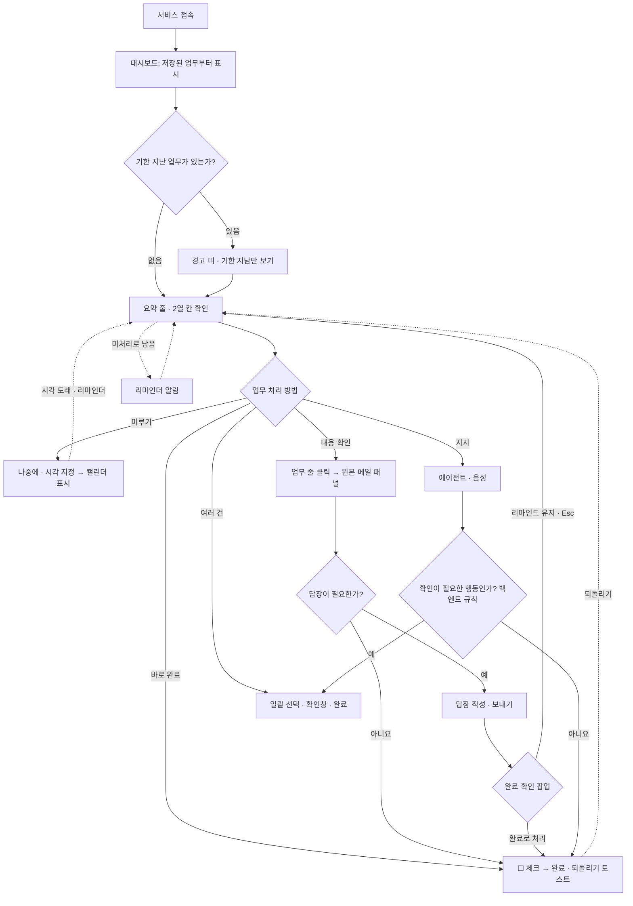
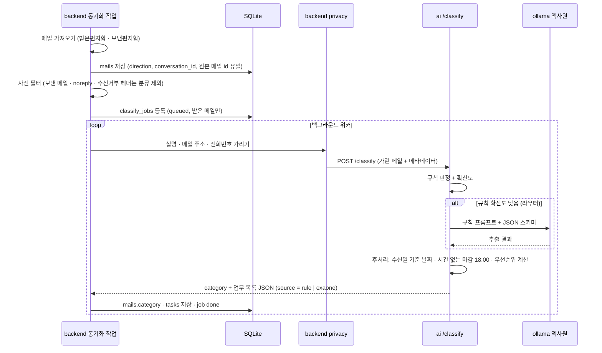
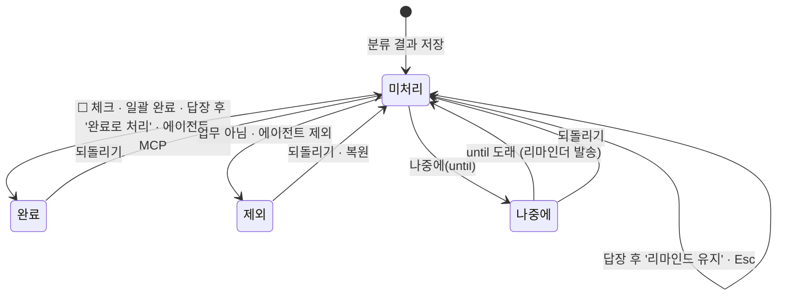
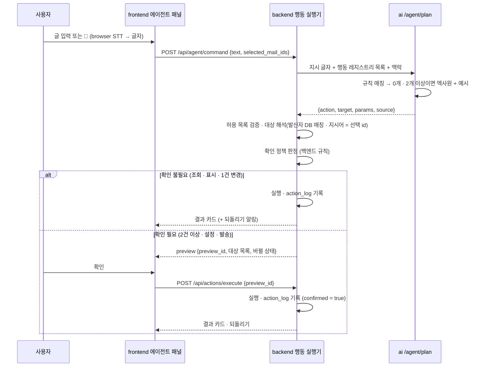

# 구조도 (architecture) · 업무 누락 방지 대시보드

> **버전:** v3.1 초안 (2026-11-02, 팀 검토 전) — v3(2026-10-31)에 11-02 범위 변경(처리 완료 추적 · 리마인더 · 무응답 · 캘린더 · 행동형 에이전트 · MCP)을 반영했다. v3 원본은 `.backup/architecture_v3_20261102.md`, v2 원본은 `.backup/architecture_v2_20261031.md`
> **근거:** PRD v3.1 · `decisions.md` D8 · D9 · D13~D15 · D20 · D23 · D24 · D26~D29 · D34~D44 · `wireframe.md` 12절 · `eval/bench/exaone_20261024/결과_및_결정.md` · 상세 명세 `docs/10_planning/detail.md` · `docs/40_ai/detail.md`
> **표기:** `[결정]` 팀 확정 · `[제안]` 이 문서에서 새로 제안(팀 검토 필요) · `[가설]` 확인 전 가정 · `[미정]` 결정 필요
> **작업 번호:** PL-2

## 0. 변경 요약

**v3 → v3.1 (2026-11-02)**

| 항목 | v3 | v3.1 | 근거 |
|---|---|---|---|
| 알림 | 1단계 제외, '새 알림' 숫자만 | 리마인더 스케줄러 + 알림 센터 · 웹 푸시(채널 `[미정]`) | D35 |
| 업무 상태 | 미완료 · 완료 · 제외 | 미완료 · 완료 · 제외 · **나중에**(`snoozed_until`) | D43 · 10-10 결정 |
| 완료 | 자동 처리 추구(D8) | 사용자의 완료 체크 · 제외로만 끝냄 | D36 |
| 분류 | 행동 유형 + 성격(요청 · 보고 · 문의 · 공지 · 기타) | 분류 5개(회신 · 요청 · 검토 · 공지 · 기타), 공지 · 참조는 업무 없음 | D39 · D40 |
| 보낸 메일 | 사전 필터로 저장 전에 거름 | 저장하고(`direction=sent`) 분류만 하지 않음 → 무응답 확인 | D43 |
| 에이전트 | 모든 실행 전 확인, `/agent/plan` · `/agent/execute` | 행동 레지스트리 + 확인 정책(어려운 것만 확인), `preview` · `execute` | D37 · D44 |
| 실행 기록 | `agent_logs`(에이전트만) | `action_log`(UI · 에이전트 · MCP 공용, 되돌리기 근거) | D37 |
| LLM | ollama · openrouter 교체 | ollama(엑사원)만. 외부 LLM 호출 경로 없음 | D41 |
| 백엔드 | FastAPI(Spring Boot 논의 중) | FastAPI 확정 | D38 |
| 추가 화면 | — | 캘린더(P1) · 응답 대기 · 알림 센터 | D43 |
| 외부 연동 | — | MCP 서버(P2, 같은 레지스트리) | D43 |

**v2 → v3 (2026-10-31)**: 화면 단위를 메일 → 업무로(D20-6), 첫 화면 대시보드(D20), 규칙 → 라우터 → 엑사원 분류(D14), `ai/` 독립 서비스(D34), 답장 후 완료 확인 팝업(D23), 명령형 에이전트 · 음성(D27 · D29), 더미 메일 적재(D10). 상세는 v3 백업본 0절.

## 1. 전체 구성

| 구성 요소 | 역할 | 기술 | 구분 |
|---|---|---|---|
| frontend | 대시보드 · 메일(응답 대기 포함) · 캘린더 · 설정, 에이전트 패널, 알림 센터, 웹 푸시 구독, 브라우저 음성인식 | React + Vite + TS, PWA | `[결정]` D28 · PWA 10-10 |
| backend | 업무 · 메일 · 설정 API, 메일 연동, 개인정보 처리, 분류 요청 작업, 행동 레지스트리 · 실행기, 리마인더 스케줄러, 알림 발송, MCP 서버 | FastAPI · APScheduler(1프로세스) · Apprise(확장용) | `[결정]` D38 |
| 저장소 | 사용자 · 계정 · 메일 · 업무 · 리마인더 · 실행 기록 · 설정 | SQLite | `[결정]` |
| ai | 분류 파이프라인, 명령 해석, 요약 · 초안, 서버 음성인식. DB에 접근하지 않고 backend를 부르지 않는다 | FastAPI | `[결정]` D34 |
| LLM | 모호한 메일 추출 · 명령 해석 · 요약 · 초안 | ollama + `EXAONE-3.5-7.8B-Instruct-GGUF:Q4_K_M` 하나. 외부 LLM 교체 경로 없음 | `[결정]` D41 · D44 |
| 메일 입력 | 개발 · 평가는 `data/dummy/dummy_mails.json`, 연동 테스트는 새 Outlook 테스트 계정 | `MAIL_SOURCE=dummy \| outlook_graph \| imap` | `[결정]` D10 · 10-10 · 연결 방식 `[미정]` |
| eval | 분류 · 명령 해석 채점(코드), 코드로 어려운 항목만 Claude 보조 채점, 모델 비교(OpenRouter) | Python. 실서비스에 포함하지 않음 | `[결정]` D26 · D41 |

**경계 규칙**
- 호출 방향은 `frontend → backend → ai` 한 방향이다. frontend는 ai를 직접 부르지 않는다. MCP 클라이언트도 backend의 MCP 서버만 부른다.
- Claude · OpenRouter는 `eval/`에서만 쓴다. `frontend` · `backend` · `ai`에는 anthropic · openrouter 호출 코드와 키를 넣지 않는다(D26 · D41).
- 의존 방향은 `eval → ai`다. `ai` · `backend`는 `eval`을 가져다 쓰지 않는다(D34).
- 행동 정의는 backend 행동 레지스트리 한 곳에만 둔다. 웹 에이전트 · REST 버튼 · MCP가 같은 정의를 쓴다(D37 · D43).

## 2. 기능 흐름

| 기능 | 화면 | 입력 | 처리 | 출력 |
|---|---|---|---|---|
| ① 메일 동기화 · 업무 추출 | 상단 바 동기화 시각 · 설정 › 메일 연동 | 계정 연결 또는 더미 적재 · 새로고침 | 받은 · 보낸편지함 가져오기 → 메일 저장 → 사전 필터(분류 대상만) → 개인정보 가리기 → 분류 요청(백그라운드) → 업무 저장(4절) | 동기화 건수 · 분류 대기 건수 · 실패 사유 |
| ② 대시보드 | 대시보드 | 접속 · 요약 카드 · 칸 필터 | 미처리 업무 조회 → 기한 상태 · 발신자 등급 · 분류로 칸 배정(중복 허용) | 요약 줄(응답 대기 · 최근 행동 포함) · 기한 지남 경고 · 2열 칸 |
| ③ 처리 · 되돌리기 | 대시보드 · 원본 메일 패널 · 메일 | ☐ 체크 · 일괄 · 완료 · 나중에 · 제외 · 되돌리기 · 답장 | 상태 전이(5절) · `action_log` 기록 · 답장 후 확인 팝업(D23) | 칸 · 숫자 갱신 · 되돌리기 토스트 |
| ④ 원본 메일 · 답장 | 원본 메일 패널(480px) · 메일 3단 | 업무 줄 클릭 · 답장 작성 | 본문 조회(저장하지 않음, 9절) · 업무 문장 강조 · 답장 발송 | 본문 · "이 메일에서 찾은 업무" · 완료 확인 팝업 |
| ⑤ 설정 | 설정 | 상급자 · 즐겨찾기 · 리마인드 주기 · 조용한 시간 · 무응답 기준일 · 본문 읽기 | 저장 → 우선순위 · 칸 배정 · 스케줄에 반영 | — |
| ⑥ 에이전트 · 음성 | 에이전트 패널(360px) | 글 · 음성 지시 + 선택 메일 id | 6절 | 결과 카드 · 확인창(필요할 때만) · 되돌리기 알림 |
| ⑦ 리마인더 | 알림 센터 · 웹 푸시 | 스케줄 · '나중에' 시각 도래 | 7절 | 알림 1건(중복 없음) |
| ⑧ 응답 대기 | 메일 › 응답 대기 · 대시보드 숫자 | 보낸 메일 · 같은 대화의 회신 | 기준일(기본 3일) 넘은 미회신 발신 메일 계산. 조치 없음 | 목록 + 경과일 |
| ⑨ 캘린더 (P1) | 캘린더 | 월 · 주 이동 · 날짜 클릭 | 기간별 업무 조회(기한 · 나중에) | 날짜별 업무 · 메일 미리보기 이동 |

## 3. 사용자 흐름

- 접속 시 동기화를 기다리지 않고 저장된 업무부터 보여 준다. 분류가 끝난 업무는 다음 조회 때 나타난다.
- 연결된 계정이 없으면 설정 › 메일 연동으로 안내한다. 개발 · 시연은 더미 메일을 적재해 쓴다.

## 4. 메일 처리 파이프라인

| 단계 | 담당 | 규칙 | 구분 |
|---|---|---|---|
| 저장 | backend | 받은 · 보낸 메일 모두 저장한다. 보낸 메일은 무응답 계산에만 쓴다 | `[결정]` D43 |
| 사전 필터 | backend | 보낸 메일 · noreply · 수신거부 헤더는 분류에 보내지 않는다. 기간은 최근 7일 | `[결정]` · 기간 `[가설]` |
| 개인정보 가리기 | backend `privacy/` | ai로 보내기 전에 한다. 대응표는 backend에만 둔다 | `[제안]` D34 |
| 규칙 | ai `pipeline/rules/` | 요청 표현 · 공지 · 참조 · 지목 판별. 확신도를 함께 낸다 | `[결정]` D14 |
| 라우터 | ai | 규칙 확신도가 기준 미만인 메일만 엑사원으로. 기준값 `[미정]` | `[결정]` D14 |
| 엑사원 추출 | ai `llm/` · `prompts/` | 규칙 프롬프트 + JSON 스키마 강제. 프롬프트 버전을 파일명에 남긴다 | `[제안]` 벤치 조건 B |
| 후처리 | ai | 날짜는 수신일 기준(상대 기한 환산), 기한이 없으면 만들지 않음, 시간 없음 → 18:00, 우선순위는 코드 | `[결정]` 10-24 · `[제안]` AI-D4 |
| 분류 | ai | 회신 · 요청 · 검토 · 공지 · 기타. 공지 · 참조는 업무를 만들지 않는다(공지 속 나를 지목한 요청은 '요청' 업무) | `[결정]` D39 · D40 |
| 우선순위 | ai | 상급자 · 즐겨찾기 · 마감 24h/72h · 긴급 · 재요청 · TO/CC 점수 → P1~P3 | 기준 `[결정]` D9 · 가중치 `[미정]` |
| 작업 처리 | backend `jobs/` | 메일 1통 약 25초(CPU). 동기 요청 안에서 기다리지 않는다. 실패는 3회까지 다시 시도 | `[제안]` |
| ai 장애 | backend | 메일은 저장하고 job을 대기로 둔다. 화면에 '분류 대기 N건'(누락 0: 숨기지 않음) | `[제안]` |

**분류 묶음** `[제안]` (D39) — 더미 정답 라벨의 행동 유형을 다섯 분류로 묶는다.

| 분류 | 행동 유형 (`data/dummy` 라벨) | 업무 생성 |
|---|---|---|
| 회신 | 회신요청 | 예 |
| 요청 | 자료제출요청 · 수정재전송요청 · 일정참석 | 예 |
| 검토 | 검토승인요청 | 예 |
| 공지 | 공지 | 아니오 (나를 지목한 요청만 '요청' 업무) |
| 기타 | 참조 · 회신(내 요청에 대한 답) · 기타 | 참조는 아니오, 나머지는 할 일이 있을 때만 |

## 5. 업무 상태 모델

| 상태 | 코드 값 | 대시보드 | 비고 |
|---|---|---|---|
| 미처리 | `pending` | 칸 · 미처리 수에 포함 | 기본 |
| 완료 | `done` | 완료 수 · 완료율에만 | `done_at` 기록 |
| 제외 | `excluded` | 보이지 않음 | 오분류 바로잡기. 메일 화면에서 복원 |
| 나중에 | `snoozed` | 칸에서 빠지고 캘린더에 표시 | `snoozed_until` 필수. 도래 시 `pending`으로 돌아가고 리마인더 1건 |

- 추적 종료 조건은 사용자의 완료 체크 또는 제외뿐이다. 회신 · 템플릿 발송으로 자동 완료하지 않는다 `[결정]` (D36).
- 모든 전이는 `action_log`에 기록한다(누가 · 언제 · 어디서: `ui` · `agent_rule` · `agent_model` · `mcp`). 되돌리기는 `action_log`의 이전 상태로 돌린다. v3의 `done_by`는 `action_log.source`로 대체한다.
- 재동기화 · 재분류는 사용자가 바꾼 상태를 덮어쓰지 않는다(v2 핵심 규칙 유지).
- 답장 후 확인 팝업(D23): 같은 메일의 미처리 업무를 체크 목록으로 보여 주고, 답장을 시작한 업무만 미리 체크한다. 체크 없음 · Esc는 리마인드 유지.
- `새 업무` 표시: `seen_at`이 비어 있으면 새 업무다 `[제안]`.

## 6. 행동형 에이전트 · 음성 흐름

- ai는 행동과 대상만 고른다. 검증 · 확인 판정 · 실행 · 기록은 backend가 한다(D34 · D37). 허용 목록에 없는 행동은 "지원하지 않는 요청"이다.
- 행동 목록(T01~T14) · 확인 정책 · 출력 형식 · 명령 해석 규칙은 `docs/40_ai/detail.md`가 기준이다.
- 서버 음성인식(`STT_MODE=server`)이면 frontend가 음성을 backend로 보내고 backend가 ai `/stt`를 부른다. 기본은 브라우저 방식이다(D29).
- MCP 서버(P2)는 같은 레지스트리를 MCP 도구로 노출하고, 상태 변경은 반드시 `preview → execute` 2단계다. 메일 본문은 반환하지 않고 발송 도구는 노출하지 않는다 `[제안]`.

## 7. 리마인더 · 알림 `[제안]` (D35, 상세 `docs/10_planning/detail.md` 4절)

| 규칙 | 조건 | 기본값 |
|---|---|---|
| R-기한 | 기한이 있는 미처리 | 기한 전날 + 당일 오전 |
| R-경과 | 기한이 없는 미처리 | 수신 후 N일마다 (N `[미정]`, 권장 2일) |
| R-나중에 | `snoozed_until` 도래 | 해당 시각 |
| R-요약 | 사용자 설정 주기 | 매일 1회 미처리 개수 요약 |

- 스케줄러는 APScheduler **단일 프로세스**로 돌리고, 시작할 때 DB에서 예약을 다시 만든다.
- 발송 직전에 업무가 아직 미처리인지 다시 조회한다. 완료 · 제외면 보내지 않는다.
- 중복 방지: `reminders`의 `(task_id, rule, slot)` 유일 제약.
- 조용한 시간에는 보류했다가 다음 허용 시각에 보낸다.
- 채널 `[미정]`: 권장은 앱 내 알림 센터 + 웹 푸시(PWA, HTTPS 필요). iOS는 홈 화면 설치 시에만 동작. Apprise는 다른 채널 확장용.
- 데모용 시간 이동 · 리마인더 강제 실행 엔드포인트는 개발 모드에서만 켠다.

## 8. API `[제안]` (BE · AI 담당 검토 필요)

**frontend → backend** (경로 앞 `/api`)

| 기능 | 엔드포인트 | 역할 |
|---|---|---|
| ② | `GET /dashboard` | 요약(완료율 · 미처리 · 기한 임박 · 완료 · 응답 대기 · 새 알림 · 분류 대기 · 최근 행동) + 칸별 `{key, count, overdue, new, task_ids}` |
| ② | `GET /tasks?status=&column=&due=` | 업무 목록 |
| ③ | `PATCH /tasks/{id}` | `{"status": "done" \| "pending" \| "excluded" \| "snoozed", "snoozed_until"?}` → `action_id` |
| ③ | `POST /tasks/bulk/preview` · `POST /actions/execute` | 일괄 변경은 preview → execute |
| ③ | `POST /actions/{id}/undo` | 되돌리기 |
| ④ | `GET /mails` · `GET /mails/{id}` | 메일 목록 · 원본 + 이 메일의 업무 |
| ④ | `POST /mails/{id}/reply` | 답장 발송 → 응답에 완료 확인 대상 업무 목록 |
| ⑧ | `GET /mails/awaiting-reply` | 응답 대기 목록 + 경과일 |
| ⑨ | `GET /calendar?from=&to=` | 기간별 업무(기한 · 나중에) |
| ⑦ | `GET /notifications` · `POST /push/subscribe` | 알림 센터 · 웹 푸시 구독 |
| ① | `POST /accounts` · `GET /accounts` · `POST /accounts/{id}/sync` | 계정 연결 · 목록 · 동기화 |
| ⑤ | `GET` · `PUT /settings` · `/contacts` · `/templates` | 설정 · 상급자 · 즐겨찾기 · 템플릿 |
| ⑥ | `POST /agent/command` · `POST /voice/stt` | 에이전트 명령 · 서버 음성인식 |
| 개발 | `POST /dev/load-dummy` · `POST /dev/clock` · `POST /dev/reminders/run` | 더미 적재 · 시간 이동 · 리마인더 강제 실행 (개발 모드에서만) |

**backend → ai**

| 엔드포인트 | 요청 | 응답 |
|---|---|---|
| `POST /classify` | `{mail_id, from, to, cc, subject, body(가림), received_at, owner_profile}` | `{category, tasks:[{text, due_raw, due_at, mentioned_me, priority, span}], source, confidence, model, prompt_version}` |
| `POST /agent/plan` | `{text, actions:[{id, name, args_schema}], context:{selected_mail_ids, now}}` | `{action, target, params, source}` 또는 `{action: null, reason}` |
| `POST /summarize` | `{items(가린 메일 · 업무 메타), mode: today \| mail}` | `{text}` |
| `POST /draft` | `{mail(가림), instruction}` | `{subject, body}` (표시용) |
| `POST /stt` | 음성 파일 | `{text}` |
| `GET /health` | — | 모델 로딩 상태 |

- 요청 · 응답 형식은 `ai/app/schemas`와 `backend/app/schemas`를 함께 고친다(AI-9 · BE-9).

## 9. 데이터 `[제안]`

| 테이블 | 필드 | 비고 |
|---|---|---|
| `users` | id · 이름 · 부서 · 직급 · 근무 시간 · 생성 시각 | 로그인 방식 `[미정]` |
| `accounts` | id · user_id · 메일 서비스 · 이메일 · 토큰(암호화) · 갱신 토큰(암호화) · 만료 시각 · 마지막 동기화 시각 | 키는 `.env`(`TOKEN_ENCRYPTION_KEY`) |
| `contacts` | id · user_id · 이메일 · 이름 · 직급 · `is_superior` · `is_favorite` | 우선순위 · 1열 칸 · T11 중요 발신자 지정 |
| `mails` | id · account_id · 원본 메일 id · `conversation_id`(v3 `thread_id`) · **`direction`(`received` · `sent`)** · 발신자 · 수신자 · 참조 · 제목 · 수신(발신) 시각 · **`category` · `category_source`** · 원문 링크 | 본문 미저장(10절). `(account_id, 원본 메일 id)` 유일 |
| `classify_jobs` | id · mail_id · 상태 · 시도 횟수 · 오류 · 모델 · 프롬프트 버전 · 걸린 시간 | 받은 메일만 |
| `tasks` | id · mail_id · 할 일 · due_raw · due_at · **`due_source`(`rule` · `model` · `none`)** · mentioned_me · 우선순위 · source · 확신도 · span · **`evidence_text`**(`[미정]` 10절) · status(`pending` · `done` · `excluded` · **`snoozed`**) · **`snoozed_until`** · status_changed_at · done_at · seen_at | 화면 단위. v3의 `done_by`는 `action_log`로 |
| **`reminders`** | id · task_id · rule · slot · scheduled_at · sent_at · channel · skipped_reason | 유일 `(task_id, rule, slot)` |
| **`notifications`** | id · user_id · reminder_id · 제목 · 읽은 시각 | 알림 센터 |
| **`push_subscriptions`** | id · user_id · endpoint · 키(암호화) · 생성 시각 | 웹 푸시 |
| **`action_log`** | id · user_id · action · params_json · affected_ids · before_json · source(`ui` · `agent_rule` · `agent_model` · `mcp`) · preview_id · confirmed · input_mode(글 · 음성) · created_at · undone_at | v3 `agent_logs`를 대체 |
| **`action_previews`** | preview_id · action · target_ids · params_json · expires_at · used_at | 확인 전 미리보기. 한 번만 실행 |
| `settings` | user_id · 대시보드 구성 · **리마인드 주기 · 조용한 시간 · 무응답 기준일(기본 3)** · 본문 읽기 · STT 방식 · 애니메이션 줄이기 | 사용자당 1행 |
| `templates` | id · user_id · 종류(`reply` · `rule` · **`send`**) · 이름 · **제목** · 내용(자리표시자 `{수신자명}` · `{원메일제목}`) | `send`는 P2 템플릿 전송 |

- 칸 배정은 저장하지 않고 조회 때 계산한다. 응답 대기도 `mails`(`direction`, `conversation_id`)로 조회 때 계산한다.

## 10. 개인정보 · 보안

| 항목 | 규칙 | 구분 |
|---|---|---|
| 서비스 모델 | 엑사원 자체 운영만. 외부 LLM API 호출 코드 경로 없음. "외부 LLM 호출 0건" 테스트 | `[결정]` D41 |
| 외부 송신 | 서비스 서버의 외부 송신은 허용 목록(메일 API 등)만, 송신 로그 기록 | `[제안]` D41 |
| 본문 저장 | 저장하지 않고 조회할 때 가져온다. 근거 문장(`evidence_text`)만 저장할지는 `[미정]` (권장: 근거 문장만 저장, 본문은 처리 후 폐기) | `[미정]` |
| 본문 읽기 | 설정 on/off. 꺼짐이면 제목 · 발신자로만 규칙 분류하고 엑사원으로 보내지 않는다 | `[결정]` |
| ai로 보내는 값 | 개인정보를 가린 본문 · 메타데이터만. 로그에 본문 · 토큰을 남기지 않는다 | `[제안]` D34 |
| MCP | 접근 토큰 필수 · 사용자 단위 권한 · 상태 변경 2단계 · 본문 미반환 · 발송 도구 미노출 | `[제안]` |
| 토큰 · 키 | 토큰은 암호화 저장, 키는 `.env` 자리표시자 | `[결정]` |
| 음성 | 브라우저 방식은 음성이 브라우저 제조사 서버로 갈 수 있다 `[불확실]`. 사내 적용 시 서버 방식 | `[결정]` D29 |
| 데이터 | 실제 사내 · 개인 메일, MailEx 원본은 레포에 넣지 않는다 | `[결정]` D24 |

## 11. 평가 연결

- `eval/runners/`가 `ai/app/pipeline`을 직접 불러 `predictions.json`을 만든다. 서버 없이 채점할 수 있다.
- 코드 채점(`data/dummy/eval.py`, 누락 건수 · 재현율 · 분류) → md 보고서 → 사람 검수(D15). Claude는 할 일 문장 · 요약 품질만 보조 채점(D26).
- 명령 선택 정확도 · 리마인더 정확성(시간 시뮬레이션)도 평가한다. 지표와 테스트 세트는 `docs/40_ai/detail.md`.
- 성공 기준: 테스트셋 할 일 메일 누락 0건 · 리마인더 중복 · 누락 0건 · 서비스 경로 외부 LLM 호출 0건.

## 12. 합의 확인용 테스트 (입력 → 기대 결과) `[제안]`

| # | 대상 | 입력 | 기대 결과 |
|---|---|---|---|
| 1 | `POST /dev/load-dummy` | 더미 v1 100건 | 200 · mails 100건 · classify_jobs(사전 필터 제외분 빼고) |
| 2 | 동기화 재실행 | 1번 직후 다시 적재 | 중복 저장 0건 |
| 3 | `/classify` | M-0006(수정재전송요청, 마감 없음) | 업무 1건 · due_at 없음 · 분류 '요청' |
| 4 | `/classify` | '내일까지 회신 부탁드립니다'(수신 10/24) | 업무 1건 · due_at 2026-10-25 18:00 · 분류 '회신' |
| 5 | `/classify` | M-0009(공지 속 1팀 자료 제출 요청) | 업무 1건 · 분류 '요청' · mentioned_me true |
| 6 | `/classify` | 지목 없는 전사 공지 | category '공지' · 업무 0건 |
| 7 | `PATCH /tasks/{id}` | `{"status":"done"}` | 200 · done_at · action_log 1건 · `/dashboard` 미처리 −1 |
| 8 | `POST /actions/{id}/undo` | 7번 action | status `pending` · done_at 비움 · undone_at 기록 |
| 9 | 재분류 | 7번 업무의 메일 다시 분류 | status `done` 유지 |
| 10 | `PATCH /tasks/{id}` | `{"status":"snoozed","snoozed_until":"금요일 09:00"}` | 칸에서 빠짐 · 캘린더에 표시 · reminders 1건 |
| 11 | `POST /mails/{id}/reply` | 미처리 업무 2건 있는 메일에 답장 | 응답에 확인 대상 2건 · 상태는 `pending` 유지(자동 완료 없음) |
| 12 | 리마인더 | 같은 task · rule · slot 2회 예약 | 1건만 저장 |
| 13 | 리마인더 | 발송 직전 완료된 업무 | 발송 안 함 · skipped_reason 기록 |
| 14 | `GET /mails/awaiting-reply` | 4일 전 보낸 메일, 같은 대화에 회신 없음 | 목록에 1건 · 경과 4일 · 상태 변경 없음 |
| 15 | `POST /agent/command` | 대상 3건 일괄 완료 지시 | preview 반환 · 상태 변경 없음 → execute 후 3건 완료 |
| 16 | `POST /agent/command` | 허용 목록 밖 행동 | 실행 거부 · "지원하지 않는 요청" |
| 17 | ai 중지 | ai 꺼진 상태로 동기화 | 메일 저장 · job `queued` · 분류 대기 N건 · 500 없음 |
| 18 | `PATCH /tasks/{id}` | `{"status":"archived"}` | 422 · 상태 변경 없음 |
| 19 | 외부 송신 | 서비스 경로 전체 테스트 | 외부 LLM 호출 0건 |

## 13. 확정하지 않은 것

| 구분 | 질문 | 바뀌는 곳 | 담당 |
|---|---|---|---|
| 계정 연결 | OAuth(Microsoft Graph) / 앱 비밀번호 IMAP | 2절 ① · 9절 accounts | BE · PL-3 |
| 알림 채널 | 앱 내 알림 + 웹 푸시로 제한하는가 | 7절 | BE · FE |
| 리마인드 간격 | 기한 없는 미처리 N일 | 7절 | 팀 |
| 무응답 범위 | 전체 발신 메일 vs 요청성 메일만 | 2절 ⑧ | 팀 · AI |
| 본문 | 근거 문장만 저장할지 | 9 · 10절 | BE · AI |
| 템플릿 전송 | 포함 여부 · 발송 권한(Graph `Mail.Send` `[미확인]`) | 8 · 9절 | 팀 |
| 근거 표시 | 판별 근거 보류 해제(T08) | 6절 · wireframe R5 | 팀 · FE |
| 우선순위 | 점수 가중치 · P 구간 | 4절 | AI · PL-3 |
| 라우터 | 엑사원으로 보낼 확신도 기준값 | 4절 | AI |
| 서빙 | 엑사원 서빙 위치 · 하드웨어 | 1절 LLM | 인프라 |
| 동기화 | 기간(최근 7일), 자동 동기화 주기 | 4절 | BE |
| 라이선스 | 엑사원 상업적 사용 | 1절 LLM | AI |
