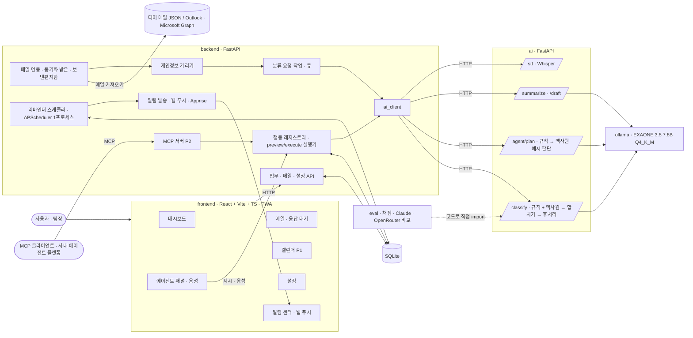
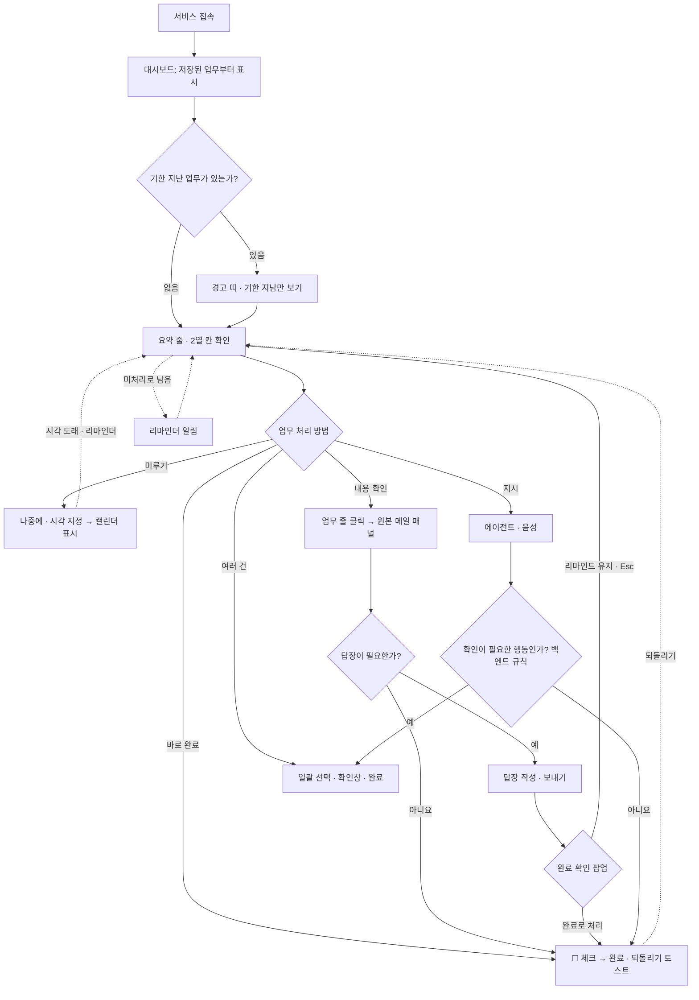
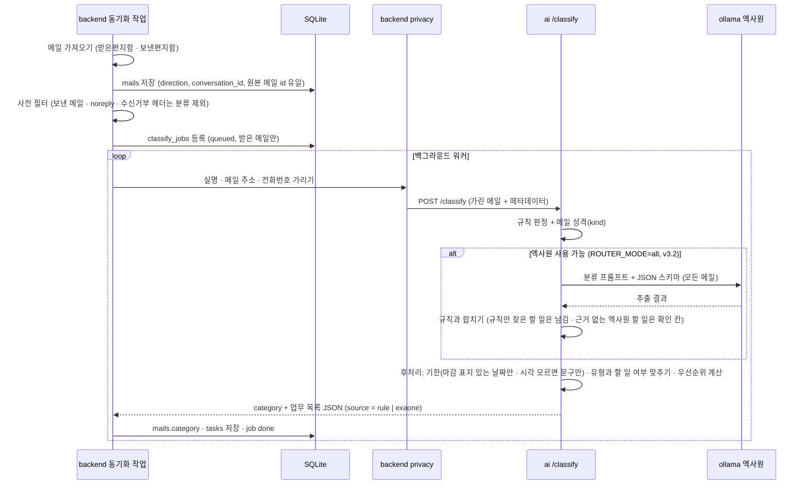
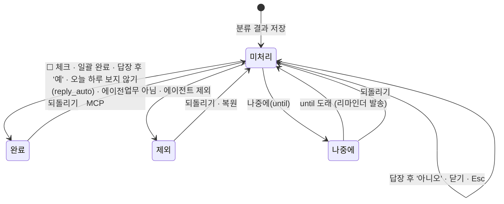
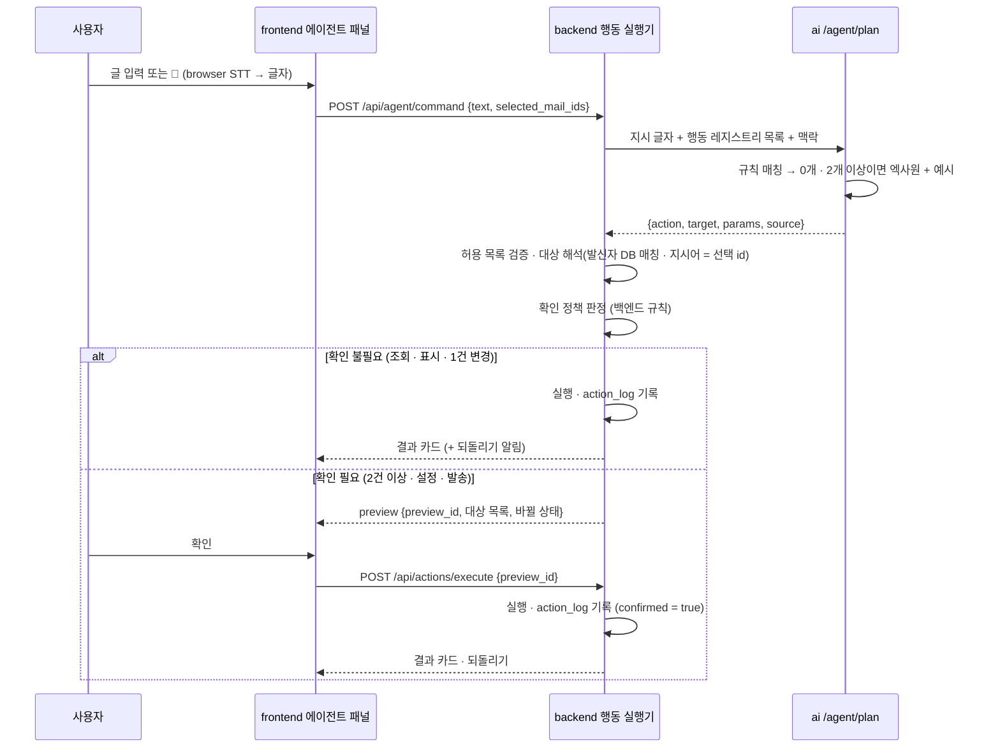

# 구조도 (architecture) · 업무 누락 방지 대시보드

> **버전:** v3.2 초안 (2026-11-06, 팀 검토 전) — v3.1(2026-11-02)에 11-05 AI 분류 변경(모든 메일 엑사원 + 규칙 보완 · 기한 구분 · 확인 칸 · 시험 세트 교체)을 반영했다. v3.1은 v3(2026-10-31)에 11-02 범위 변경(처리 완료 추적 · 리마인더 · 무응답 · 캘린더 · 행동형 에이전트 · MCP)을 반영한 것이다. v3 원본은 `.backup/architecture_v3_20261102.md`, v2 원본은 `.backup/architecture_v2_20261031.md`
> **근거:** PRD v3.1 · `decisions.md` D8 · D9 · D13~D15 · D20 · D23 · D24 · D26~D29 · D34~D48 · `docs/40_ai/decisions.md` AI-D9~D12 · `wireframe.md` 12절 · `eval/bench/exaone_20261024/결과_및_결정.md` · 상세 명세 `docs/10_planning/detail.md` · `docs/40_ai/detail.md`
> **표기:** `[결정]` 팀 확정 · `[제안]` 이 문서에서 새로 제안(팀 검토 필요) · `[가설]` 확인 전 가정 · `[미정]` 결정 필요
> **작업 번호:** PL-2
> **그림:** `img/architecture/`의 SVG(라이트 · 다크 대응). 같은 내용의 mermaid 텍스트 판은 각 그림 아래에 접어 두었다. 흐름을 바꾸면 둘을 함께 고친다.

## 0. 변경 요약

**v3.1 → v3.2 (2026-11-06, AI-18)**

| 항목 | v3.1 | v3.2 | 근거 |
|---|---|---|---|
| 엑사원 호출 | 규칙 확신도가 낮은 메일만(라우터) | 엑사원을 쓸 수 있으면 **모든 메일**을 묻고 규칙과 서로 보완해 합친다(`ROUTER_MODE=all`). 문지기 방식(`gate`)은 비교용 | AI-D10 |
| 기한 | 날짜가 보이면 기한, 시각 없으면 18:00 | 마감 표지가 붙은 날짜만 기한(일정 · 지난 일 · 그 밖의 날짜는 아님). 시각을 모르는 '미팅 전에'는 `due_raw`만 · `due_at` 비움. 즉시 · 최대한 빨리 · ASAP는 `due_raw` "ASAP"(시각 없음) | AI-D11 |
| 화면 칸 | 할 일 · 공지 | `lane` 할 일 · 확인 · 참고. 엑사원이 근거 없이 만든 할 일은 버리지 않고 확인 칸으로 | 4 · 8절 |
| 처리 시간 | 메일 1통 약 25초(추정) | PC CPU 실측 약 28초(모든 메일). 5~10분 늦어도 된다(사용자 11/5) → 대기열 1개로 순서대로 처리, 화면에는 엑사원까지 끝난 결과만 한 번(AI-D13). P0 감지는 1~2분 폴링, 배포(11/14) 뒤 변경 알림 · 서버 밀어 주기(#21 리뷰). GPU 서빙 측정 예정 | 4절 · 13절 |
| 분류 결과 저장 | `lane` · `checks`는 응답에만 있었다 | `mails`에 `kind` · `lane`, 확인 항목은 `mail_checks`, 업무에 `urgent` · `is_follow_up` 복사(#21 BE 리뷰) | 9절 |
| 평가 세트 | 레포 안 test · test3 | test · test3는 개발 세트(dev5 · dev6). 처음 보는 메일 성능은 레포 밖 봉인 테스트 A(버전마다) · B(최종) | AI-D12 · 11절 |

**v3 → v3.1 (2026-11-02)**

| 항목 | v3 | v3.1 | 근거 |
|---|---|---|---|
| 알림 | 1단계 제외, '새 알림' 숫자만 | 리마인더 스케줄러 + 알림 센터 · 앱 안 알림 창 · 운영체제 알림 · 웹 푸시 | D35 |
| 업무 상태 | 미완료 · 완료 · 제외 | 미완료 · 완료 · 제외 · **나중에**(`snoozed_until`) | D43 · 10-10 결정 |
| 완료 | 자동 처리 추구(D8) | 사용자의 완료 체크 · 제외 · 답장 후 완료 확인으로 끝냄 | D36 · D48 |
| 분류 | 행동 유형 + 성격(요청 · 보고 · 문의 · 공지 · 기타) | 분류 5개(회신 · 요청 · 검토 · 공지 · 기타), 공지 · 참조는 업무 없음 | D39 · D40 |
| 보낸 메일 | 사전 필터로 저장 전에 거름 | 저장하고(`direction=sent`) 분류만 하지 않음 → 무응답 확인 | D43 |
| 에이전트 | 모든 실행 전 확인, `/agent/plan` · `/agent/execute` | 행동 레지스트리 + 확인 정책(어려운 것만 확인), `preview` · `execute` | D37 · D44 |
| 실행 기록 | `agent_logs`(에이전트만) | `action_log`(UI · 에이전트 · MCP 공용, 되돌리기 근거) | D37 |
| LLM | ollama · openrouter 교체 | ollama(엑사원)만. 외부 LLM 호출 경로 없음 | D41 |
| 백엔드 | FastAPI(Spring Boot 논의 중) | FastAPI 확정 | D38 |
| 추가 화면 | — | 캘린더(P1) · 응답 대기 · 알림 센터 | D43 |
| 외부 연동 | — | MCP 서버(P2, 같은 레지스트리) | D43 |

**v2 → v3 (2026-10-31)**: 화면 단위를 메일 → 업무로(D20-6), 첫 화면 대시보드(D20), 규칙 → 라우터 → 엑사원 분류(D14), `ai/` 독립 서비스(D34), 답장 후 완료 확인 팝업(D23), 명령형 에이전트 · 음성(D27 · D29), 더미 메일 적재(D10). 상세는 v3 백업본 0절.

## 1. 전체 구성

호출은 frontend → backend → ai 한 방향이다. 엑사원을 부르는 곳은 ai뿐이고, eval은 서비스 밖에서 ai 파이프라인을 코드로 import한다.

mermaid 텍스트 판

| 구성 요소 | 역할 | 기술 | 구분 |
|---|---|---|---|
| frontend | 대시보드 · 메일(응답 대기 포함) · 캘린더 · 설정, 에이전트 패널, 알림 센터, 웹 푸시 구독, 브라우저 음성인식 | React + Vite + TS, PWA | `[결정]` D28 · PWA 10-10 |
| backend | 업무 · 메일 · 설정 API, 메일 연동, 개인정보 처리, 분류 요청 작업, 행동 레지스트리 · 실행기, 리마인더 스케줄러, 알림 발송, MCP 서버 | FastAPI · APScheduler(1프로세스) · Apprise(확장용) | `[결정]` D38 |
| 저장소 | 사용자 · 계정 · 메일 · 업무 · 리마인더 · 실행 기록 · 설정 | SQLite | `[결정]` |
| ai | 분류 파이프라인, 명령 해석, 요약 · 초안, 서버 음성인식. DB에 접근하지 않고 backend를 부르지 않는다 | FastAPI | `[결정]` D34 |
| LLM | 모호한 메일 추출 · 명령 해석 · 요약 · 초안 | 엑사원 하나. 기본은 엑사원 API(`k-exaone_v2.5`), 옵션은 로컬 ollama + `EXAONE-3.5-7.8B-Instruct-GGUF:Q4_K_M`(설정 하나로 교체). 엑사원 외의 외부 모델 경로 없음 | `[결정]` D51 · D52 · D53 · D55(D41 · D44 대체) |
| 메일 입력 | 개발 · 평가는 `data/dummy/dummy_mails.json`, 연동 테스트는 새 Outlook 테스트 계정 | `MAIL_SOURCE=dummy \| outlook_graph \| imap` | `[결정]` D10 · 10-10 · 연결 방식 `[미정]` |
| eval | 분류 · 명령 해석 채점(코드), 코드로 어려운 항목만 Claude 보조 채점, 모델 비교(OpenRouter) | Python. 실서비스에 포함하지 않음 | `[결정]` D26 · D41 |

**경계 규칙**
- 호출 방향은 `frontend → backend → ai` 한 방향이다. frontend는 ai를 직접 부르지 않는다. MCP 클라이언트도 backend의 MCP 서버만 부른다.
- Claude · OpenRouter는 `eval/`에서만 쓴다. `frontend` · `backend` · `ai`에는 anthropic · openrouter 호출 코드와 키를 넣지 않는다(D26 · D41).
- 의존 방향은 `eval → ai`다. `ai` · `backend`는 `eval`을 가져다 쓰지 않는다(D34).
- 행동 정의는 backend 행동 레지스트리 한 곳에만 둔다. 웹 에이전트 · REST 버튼 · MCP가 같은 정의를 쓴다(D37 · D43).

## 2. 기능 흐름

| 기능 | 화면 | 입력 | 처리 | 출력 |
|---|---|---|---|---|
| ① 메일 동기화 · 업무 추출 | 상단 바 동기화 시각 · 설정 › 메일 연동 | 계정 연결 또는 더미 적재 · 새로고침 | 받은 · 보낸편지함 가져오기 → 메일 저장 → 사전 필터(분류 대상만) → 개인정보 가리기 → 분류 요청(백그라운드) → 업무 저장(4절) | 동기화 건수 · 분류 대기 건수 · 실패 사유 |
| ② 대시보드 | 대시보드 | 접속 · 요약 카드 · 칸 필터 | 미처리 업무 조회 → 기한 상태 · 발신자 등급 · 분류로 칸 배정(중복 허용) | 요약 줄(응답 대기 · 최근 행동 포함) · 기한 지남 경고 · 2열 칸 |
| ③ 처리 · 되돌리기 | 대시보드 · 원본 메일 패널 · 메일 | ☐ 체크 · 일괄 · 완료 · 나중에 · 제외 · 되돌리기 · 답장 | 상태 전이(5절) · `action_log` 기록 · 답장 후 확인 팝업(D23) | 칸 · 숫자 갱신 · 되돌리기 토스트 |
| ④ 원본 메일 · 답장 | 원본 메일 패널(480px) · 메일 3단 | 업무 줄 클릭 · 답장 작성 | 본문 조회(저장하지 않음, 9절) · 업무 문장 강조 · 답장 발송 | 본문 · "이 메일에서 찾은 업무" · 완료 확인 팝업 |
| ⑤ 설정 | 설정 | 상급자 · 즐겨찾기 · 리마인드 주기 · 조용한 시간 · 무응답 기준일 · 본문 읽기 | 저장 → 우선순위 · 칸 배정 · 스케줄에 반영 | — |
| ⑥ 에이전트 · 음성 | 에이전트 패널(360px) | 글 · 음성 지시 + 선택 메일 id | 6절 | 결과 카드 · 확인창(필요할 때만) · 되돌리기 알림 |
| ⑦ 리마인더 | 알림 센터 · 웹 푸시 | 스케줄 · '나중에' 시각 도래 | 7절 | 알림 1건(중복 없음) |
| ⑧ 응답 대기 | 메일 › 응답 대기 · 대시보드 숫자 | 보낸 메일 · 같은 대화의 회신 | 기준일(기본 3일) 넘은 미회신 요청 발신 메일 계산(대상은 요청한 메일만, 문규남 11-04). 조치 없음 | 목록 + 경과일 |
| ⑨ 캘린더 (P1) | 캘린더 | 월 · 주 이동 · 날짜 클릭 | 기간별 업무 조회(기한 · 나중에) | 날짜별 업무 · 메일 미리보기 이동 |

## 3. 사용자 흐름

성공한 경로는 모두 완료로 모이고, 미룬 업무와 남은 업무는 리마인더로 대시보드에 돌아온다(점선). 답장만으로는 완료되지 않고 팝업에서 '예'를 눌러야 완료된다(D48).

mermaid 텍스트 판

- 접속 시 동기화를 기다리지 않고 저장된 업무부터 보여 준다. 분류가 끝난 업무는 다음 조회 때 나타난다.
- 연결된 계정이 없으면 설정 › 메일 연동으로 안내한다. 개발 · 시연은 더미 메일을 적재해 쓴다.

## 4. 메일 처리 파이프라인

메일 1통은 규칙과 엑사원을 모두 거쳐 합치기 · 후처리가 끝난 뒤 화면에 한 번만 뜬다. 규칙 결과를 먼저 띄우는 경로(점선)는 철회했다(AI-D13).

두 방식의 차이는 '확신도 높음 → 엑사원 생략' 화살표 하나다. gate는 거기서 test 놓침 1통이 생겼고, all은 그 길을 없앴다(AI-D10).

엑사원이 근거 없이 만든 할 일은 지우지 않고 확인 칸으로 보낸다. 할 일이 하나라도 있으면 `checks`는 비우므로 한 메일은 한 칸에만 뜬다.

mermaid 텍스트 판

| 단계 | 담당 | 규칙 | 구분 |
|---|---|---|---|
| 저장 | backend | 받은 · 보낸 메일 모두 저장한다. 보낸 메일은 무응답 계산에만 쓴다 | `[결정]` D43 |
| 사전 필터 | backend | 보낸 메일 · noreply · 수신거부 헤더는 분류에 보내지 않는다. 기간은 최근 7일 | `[결정]` · 기간 `[가설]` |
| 개인정보 가리기 | backend `privacy/` | ai로 보내기 전에 한다. 대응표는 backend에만 둔다 | `[제안]` D34 |
| 규칙 | ai `pipeline/rules/` | 요청 표현 · 공지 · 참조 · 지목 판별. 확신도를 함께 낸다 | `[결정]` D14 |
| 엑사원 호출 | ai | 엑사원을 쓸 수 있으면 모든 메일을 묻는다(`ROUTER_MODE=all`). 꺼져 있으면 규칙 결과만. `gate`는 v3.2 문지기(애매한 메일만) | `[결정]` AI-D10 (D14 대체) |
| 엑사원 추출 | ai `llm/` · `prompts/` | 분류 프롬프트(`classify_v3`) + JSON 스키마 강제. 프롬프트 버전을 파일명에 남긴다 | `[제안]` 벤치 조건 B |
| 합치기 | ai `pipeline/classify.py` | 규칙만 찾은 할 일은 남긴다(D15). 나를 향하지 않은 문장 · 대상자 당부 공지 · '참고만 해 주세요' · 선택 요청에서 엑사원만 만든 할 일은 확인 칸으로. 유형은 문장 단서 > 메일 성격 > 엑사원, 마지막에 할 일 여부와 맞춘다 | `[결정]` AI-D10 |
| 후처리 | ai `pipeline/dates.py` | 날짜는 수신일 기준. 마감 표지가 붙은 날짜만 기한, '그 전에 · 마감 전까지'는 앞 일시. 시각 없음 → 18:00, 시각을 모르는 일의 '전'은 `due_at` 비움, 즉시 · 최대한 빨리 · ASAP → "ASAP"(시각 없음). 우선순위는 코드 | `[결정]` 10-24 · AI-D4 · AI-D11 |
| 분류 | ai | 회신 · 요청 · 검토 · 공지 · 기타. 공지 · 참조는 업무를 만들지 않는다(공지 속 나를 지목한 요청은 '요청' 업무) | `[결정]` D39 · D40 |
| 우선순위 | ai | 상급자 · 즐겨찾기 · 마감 24h/72h · 긴급 · 재요청 · TO/CC 점수 → P1~P3 | 기준 `[결정]` D9 · 가중치 `[미정]` |
| 작업 처리 | backend `jobs/` | 메일 1통 약 28초(PC CPU, 모든 메일 엑사원, 11/5 실측). 동기 요청 안에서 기다리지 않고 `classify_jobs` 대기열 1개로 순서대로 처리한다. 5~10분 지연은 괜찮다(사용자 11/5). backend `ai_client` 타임아웃은 130초 이상(ai는 엑사원을 120초(`LLM_TIMEOUT_S`) 기다린 뒤 규칙 결과로 돌려주므로 그보다 길어야 한다). 실패는 3회까지 다시 시도 | `[결정]` #21 리뷰(BE · AI) |
| 화면 반영 | backend · frontend | 규칙 + 엑사원 합치기까지 끝난 결과를 한 번만 띄운다(규칙 먼저 → 고쳐 쓰기 없음). 메일 1통 기준 약 30~40초 `[추정]` + 폴링 간격. P0(시연은 더미 메일)는 1~2분 폴링으로 감지하고 분류가 끝난 결과만 반영한다. 배포(11/14)로 HTTPS 주소가 생긴 뒤 Graph 변경 알림(구독 갱신 포함) · 서버 밀어 주기(SSE · 웹소켓)로 바꾼다 | `[결정]` AI-D13 · #21 리뷰(BE 제안) |
| ai 장애 | backend | 메일은 저장하고 job을 대기로 둔다. 화면에 '분류 대기 N건'(누락 0: 숨기지 않음) | `[제안]` |

**분류 묶음** `[제안]` (D39) — 더미 정답 라벨의 행동 유형을 다섯 분류로 묶는다.

| 분류 | 행동 유형 (`data/dummy` 라벨) | 업무 생성 |
|---|---|---|
| 회신 | 회신요청 | 예 |
| 요청 | 자료제출요청 · 수정재전송요청 · 일정참석 | 예 |
| 검토 | 검토승인요청 | 예 |
| 공지 | 공지 | 아니오 (나를 지목한 요청만 '요청' 업무) |
| 기타 | 참조 · 회신(내 요청에 대한 답) · 기타 | 참조는 아니오, 나머지는 할 일이 있을 때만 |

## 5. 업무 상태 모델

모든 전이는 되돌릴 수 있고 `action_log` 한 줄로 남는다. 묻지 않고 자동 완료하지 않는다(D48).

mermaid 텍스트 판

| 상태 | 코드 값 | 대시보드 | 비고 |
|---|---|---|---|
| 미처리 | `pending` | 칸 · 미처리 수에 포함 | 기본 |
| 완료 | `done` | 완료 수 · 완료율에만 | `done_at` 기록 |
| 제외 | `excluded` | 보이지 않음 | 오분류 바로잡기. 메일 화면에서 복원 |
| 나중에 | `snoozed` | 칸에서 빠지고 캘린더에 표시 | `snoozed_until` 필수. 시각이 지나도 DB 상태는 `snoozed` 그대로이고, 조회(리마인더 · 기한 몰림 · 캘린더)에서 미처리로 다룬다(리마인더 1건). 캘린더는 그 업무를 기한 날짜에 기한 · 회의 · 일정 분류대로 보이고, 기한이 없으면 지난 다시 알림 표시를 남긴다(BE-D24 보완) |

- 추적 종료 조건은 사용자의 완료 체크, 제외, 답장 후 완료 확인(팝업 '예', 사용자가 켠 '오늘 하루 보지 않기' 포함)이다. 묻지 않고 자동 완료하지 않는다 `[결정]` (D48, D36 대체).
- 모든 전이는 `action_log`에 기록한다(누가 · 언제 · 어디서: `ui` · `agent_rule` · `agent_model` · `mcp` · `reply_auto`). 되돌리기는 `action_log`의 이전 상태로 돌린다. v3의 `done_by`는 `action_log.source`로 대체한다.
- 재동기화 · 재분류는 사용자가 바꾼 상태를 덮어쓰지 않는다(v2 핵심 규칙 유지).
- 답장 후 확인 팝업(D23 · D48): 같은 메일의 미처리 업무를 체크 목록으로 보여 주고, 답장을 시작한 업무만 미리 체크한다. '아니오' · 닫기 · Esc는 리마인드 유지.
  - 경로: (가) 서비스 안 발송 직후 팝업, (나) 보낸편지함 동기화로 Outlook 답장을 감지하면 알림 센터에 "완료할까요?"(`notifications.kind = reply_confirm`). (가)로 이미 물은 업무는 (나)에서 다시 묻지 않는다.
  - '오늘 하루 보지 않기': `settings.reply_confirm_skip_until`(다음 R-아침 시각)까지 (가) · (나) 모두 묻지 않고 완료하고 `source = reply_auto`로 기록한다. 템플릿 답장도 같고, 무응답 재촉(`nudge`)은 대상이 아니다.
- `새 업무` 표시: `seen_at`이 비어 있으면 새 업무다 `[제안]`.

## 6. 행동형 에이전트 · 음성 흐름

ai는 행동과 대상만 고르고, 검증 · 확인 판정 · 실행 · 기록은 backend가 한다. 확인이 필요하면 preview를 거쳐 실행한다.

mermaid 텍스트 판

- ai는 행동과 대상만 고른다. 검증 · 확인 판정 · 실행 · 기록은 backend가 한다(D34 · D37). 허용 목록에 없는 행동은 "지원하지 않는 요청"이다.
- 행동 목록(T01~T14) · 확인 정책 · 출력 형식 · 명령 해석 규칙은 `docs/40_ai/detail.md`가 기준이다.
- 서버 음성인식(`STT_MODE=server`)이면 frontend가 음성을 backend로 보내고 backend가 ai `/stt`를 부른다. 기본은 브라우저 방식이다(D29).
- MCP 서버(P2)는 같은 레지스트리를 MCP 도구로 노출하고, 상태 변경은 반드시 `preview → execute` 2단계다. 메일 본문은 반환하지 않고 발송 도구는 노출하지 않는다 `[제안]`.

## 7. 리마인더 · 알림 `[제안]` (D35, 상세 `docs/10_planning/detail.md` 4절)

중복은 `(task_id, rule, slot)` 유일 제약이, 이미 끝난 업무 알림은 발송 직전 재조회가 막는다. 조용한 시간이면 다음 허용 시각까지 보류한다.

| 규칙 | 조건 | 기본값 |
|---|---|---|
| R-아침 | ① 미처리 전체(기한 없는 업무 포함) ② 지난 R-아침 이후 `reply_auto` 완료 업무(되돌리기) | 매일 1회, 사용자가 고른 시각(기본 08:30). ① · ② 모두 0건이면 보내지 않음 |
| R-기한 | 기한이 있는 미처리 | 기한 3시간 전 (생길 때 이미 3시간 안이면 바로 1회 `[제안]`) |
| R-나중에 | `snoozed_until` 도래 | 해당 시각 |

- R-아침이 v3.1 초안의 R-경과(N일마다) · R-요약을 대신한다(기획 detail 4.2절).

- 스케줄러는 APScheduler **단일 프로세스**로 돌리고, 시작할 때 DB에서 예약을 다시 만든다.
- 발송 직전에 업무가 아직 미처리인지 다시 조회한다. 완료 · 제외면 보내지 않는다(R-아침 ② 바로 완료 목록은 예외).
- 중복 방지: `reminders`의 `(task_id, rule, slot)` 유일 제약.
- 조용한 시간에는 보류했다가 다음 허용 시각에 보낸다.
- 채널(기획 detail 4.3절): PC는 앱 안 알림 창 + 운영체제 알림(웹 푸시 · Notification API), 휴대폰은 웹 푸시(PWA, HTTPS 필요). 모두 알림 센터에 남긴다. iOS는 홈 화면 설치 시에만 동작. Apprise는 다른 채널 확장용.
- 데모용 시간 이동 · 리마인더 강제 실행 엔드포인트는 개발 모드에서만 켠다.

## 8. API `[제안]` (BE · AI 담당 검토 필요)

**frontend → backend** (경로 앞 `/api`)

| 기능 | 엔드포인트 | 역할 |
|---|---|---|
| ② | `GET /dashboard` | 요약(완료율 · 미처리 · 기한 임박 · 완료 · 응답 대기 · 새 알림 · 분류 대기 · 최근 행동) + 칸별 `{key, count, overdue, new, task_ids}` |
| ② | `GET /tasks?status=&column=&due=` | 업무 목록 |
| ③ | `PATCH /tasks/{id}` | `{"status": "done" \| "pending" \| "excluded" \| "snoozed", "snoozed_until"?}` → `action_id` |
| ③ | `POST /tasks/bulk/preview` · `POST /actions/execute` | 일괄 변경은 preview → execute |
| ③ | `POST /actions/{id}/undo` | 되돌리기 |
| ④ | `GET /mails` · `GET /mails/{id}` | 메일 목록 · 원본 + 이 메일의 업무 |
| ④ | `PATCH /mails/{id}` · `POST /mails/{id}/move` | `{read?, pinned?}` 읽음 · 고정 / `{folder: inbox \| archive \| deleteditems}` 옮기기(삭제 = 지운 편지함). Outlook 계정은 Graph에 먼저 쓴다. 연결이 끊긴 Outlook 계정은 우리 앱에서만 바꾼다(옮기기 = `hidden_at`으로 숨김, 다시 연결해도 숨긴 채). 응답은 대시보드 메일 한 통(BE-7, 11-19) |
| ④ | `GET /mails/hidden` | 보관함 · 지운 편지함 보기: 대시보드가 빼는 내 받은 메일(`folder` archive · deleteditems 또는 `hidden_at`), 최근 받은 순, 대시보드 메일 모양 목록. 다른 사용자 메일은 섞지 않는다. 되돌리기는 `POST /mails/{id}/move {folder: inbox}`(BE-7, 11-19) |
| ④ | `POST /mails/{id}/reply-all` · `POST /mails/{id}/forward` · `POST /mails` | 전체 답장 `{subject, content, cc?, bcc?}` · 전달 `{…, to}` · 새 메일 `{…, to, account_id?}` → `{id, sent_at}`. 사용자가 [보내기]를 눌렀을 때만(D48). Outlook 연결이 끊겼으면 409, Graph가 거절하면 502, 답이 없어 보내졌는지 모르면 504(다시 보내지 말고 보낸 편지함 확인) (BE-7, 11-19) |
| ④ | `POST /mails/{id}/reply` | 답장 발송(Graph `Mail.Send`, 권한 없으면 기능 숨김) → 응답에 완료 확인 대상 업무 목록. `reply_confirm_skip_until` 안이면 바로 완료하고 완료된 목록을 돌려준다(D48) |
| ④ | `POST /tasks/reply-confirm` | `{task_ids, answer: "yes" \| "no", skip_today?: bool}` → (가) 팝업 · (나) 알림 센터 답. `skip_today`면 `reply_confirm_skip_until` 저장 `[제안]` |
| ⑧ | `GET /mails/awaiting-reply` | 응답 대기 목록 + 경과일 |
| ⑨ | `GET /calendar?start=&end=` | 기간별 업무(기한 · 나중에 · 회의) + 넣은 일정 + 연결한 Outlook 일정(`kind: event`, `outlook_id` · `web_link`, 읽기만) |
| ⑦ | `GET /notifications` · `POST /push/subscribe` | 알림 센터(리마인더 · (나) 완료 확인 `reply_confirm`) · 웹 푸시 구독 |
| ① | `GET /accounts` · `POST /accounts/outlook/connect` → `{url}` · `GET /accounts/outlook/callback` · `POST /accounts/{id}/sync` · `POST /accounts/{id}/disconnect` | 계정 목록 `{outlook_enabled, items:[{id, provider, email, connected, last_synced_at}]}` · Outlook 로그인 시작(브라우저에 nonce 쿠키, 로그인 CSRF 방지) · 로그인 복귀(브라우저, `#/settings/accounts?outlook=connected \| error`) · 지금 동기화 `{added, updated, removed}` · 연결 끊기(토큰만 지움, 메일 · 업무는 남김). 구현(BE-7, 11-19) |
| ⑤ | `GET` · `PUT /settings` · `/contacts` · `/templates` | 설정 · 상급자 · 즐겨찾기 · 템플릿 |
| ⑥ | `POST /agent/command` · `POST /voice/stt` | 에이전트 명령 · 서버 음성인식 |
| 개발 | `POST /dev/load-dummy` · `POST /dev/clock` · `POST /dev/reminders/run` | 더미 적재 · 시간 이동 · 리마인더 강제 실행 (개발 모드에서만) |

**backend → ai** (구현 기준 갱신 11-04, PR #4 리뷰 반영, D47. 형식 정의는 `ai/app/schemas`)

| 엔드포인트 | 요청 | 응답 |
|---|---|---|
| `POST /classify` | `{mail_id, from, to, cc, subject, body(가림), attachments, received_at, owner:{email, name, position, team, member_of}, sender:{is_superior, is_favorite}}` | `{mail_id, category, action_types, tasks:[{text, format, due_raw, due_at, evidence}], checks:[{text, reason, evidence, source}], kind, kind_name, kind_sure, lane, mentioned_me, urgent, is_follow_up, priority, source, confidence, model, prompt_version, rules_version, fallback}` |
| `POST /agent/plan` | `{text, actions:[{id, name, description}], context:{now, selected_mail_ids, last_result_ids}}` | `{action, action_name, target:{sender, category, date_range, keyword, mail_ids, awaiting_reply}, params, source, reason, candidates, prompt_version, rules_version, fallback}`. 지원하지 않거나 되묻기면 `action: null` + `reason`(`unsupported` · `ambiguous`) |
| `POST /summarize` | `{mode: today \| mail, now, items:[{task_id, text, sender, category, due_at, priority, status}], awaiting_reply_count, mail:{subject, body(가림), sender}, use_model}` | `{text, source(code \| exaone), prompt_version, fallback}` |
| `POST /draft` | `{kind: reply \| new, mail(가림, reply일 때), recipient(new일 때), topic, tone: polite \| short, signer}` | `{subject, body, source(template \| exaone), prompt_version, fallback}` (표시용, 발송하지 않음) |
| `POST /memory/extract` | `{mail_id, from, sender_name, subject, body(가림), owner:{email, name, position, team}}` | `{mail_id, facts:[{kind: works_on \| org, value, evidence}], source(exaone \| none), model, prompt_version, fallback}` (문맥 기억, PL-16 · BE-D21. 근거 문장이 본문에 없으면 버림) |
| `POST /stt` | 음성 파일 | `{text}` `[미구현]` |
| `GET /health` | — | `{status, model, llm:{reachable, model_ready, …}}`. 모델이 없어도 `status: ok`(규칙 결과만 낸다) |

- **바뀐 점(제안 → 구현)**: `/classify`의 `owner_profile` → `owner`(+ 발신자 플래그 `sender`). `mentioned_me` · `priority`는 할 일 단위가 아니라 **메일 단위**다 — backend는 이 값을 그 메일의 할 일마다 복사해 `tasks`에 저장한다(9절 `tasks` 열은 그대로). `span` → `evidence`(근거 문장). 할 일이 아닌 확인 항목은 `checks`, 화면 칸은 `lane`(할 일 · 확인 · 참고)으로 따로 준다(아래 `tasks` · `checks` · `lane`). `/draft`의 `instruction` → `kind` · `topic` · `tone` · `signer`. `/agent/plan`의 `args_schema`는 쓰지 않는다 — params 키는 아래 공동 계약으로 고정한다.
- **`due_raw` · `due_at`** (v3.2, AI-D11): 둘 다 있으면 보통 기한. `due_raw`만 있고 `due_at`이 비면 시각을 모르는 기한('내일 미팅 전에') → 화면은 `due_raw`를 그대로 보여 주고 정렬 · 리마인더는 기한 없음으로 다룬다. 최대한 빨리는 `due_raw` "ASAP"만, `due_at`은 비운다(정렬 · 리마인더는 긴급 표시로 앞에 둔다 `[제안]`). 둘 다 비면 기한 없음.
- **`tasks` · `checks` · `lane`**: 한 메일에 `tasks`와 `checks`가 같이 나오지 않는다 — 할 일이 하나라도 있으면 `checks`는 빈 배열이다(`ai/app/pipeline/checks.py` `build`). `checks`는 메일 1통에 최대 1개다. `lane`은 이 둘에서 정해지는 메일 단위 값이다: `tasks`가 있으면 `할 일`, `checks`가 있으면 `확인`, 둘 다 없으면 `참고`. 따라서 할 일 카드는 항목(`tasks` 행) 단위, 확인 칸은 메일 단위로 그려도 같은 메일이 두 칸에 뜨지 않는다.
- **`category` · `action_types` · `kind`**: `category`는 D39 다섯 분류(회신 · 요청 · 검토 · 공지 · 기타)로 `mails.category`에 저장하고 메일 화면 분류 · 대시보드 2열 칸 배정에 쓴다. `action_types`는 세부 행동 유형 9개(첫 번째가 주 유형)로 더미 라벨 · 채점과 맞추는 값이다. `kind`(K01~K21, `kind_name`)는 메일 성격으로 ai 안에서 유형 · 칸 결정과 엑사원으로 보낼지 판단에 쓴다. backend는 저장하지 않아도 되고, 남기면 표시 · 로그용이다(`kind_sure: false`면 참고만).
- **시각**: ai 안에서는 시간대 없는 KST만 쓴다. 요청 시각(`received_at` · `now` · `due_at`)은 시간대가 붙은 값(`+09:00` · `Z`)도 받아 ai 입구에서 KST로 바꾼 뒤 시간대를 떼고, 시간대 없는 값은 KST로 본다. 응답 시각(`tasks[].due_at` · `params.until`)은 **시간대 없는 KST**이므로 backend ai 클라이언트가 KST를 붙여 읽는다. backend → frontend 응답 시각에는 항상 `+09:00`을 붙인다.
- **ID**: `mail_id` · `selected_mail_ids` · `last_result_ids` · `task_id`는 backend DB id(정수)를 그대로 보내도 된다. ai는 문자열로 바꿔 쓰고 응답(`mail_id` · `target.mail_ids`)에도 문자열로 돌려준다. backend ai 클라이언트가 정수로 되돌린다. `selected_mail_ids` · `last_result_ids`는 **메일 id**다(업무 id 아님). ai는 이 값을 `target.mail_ids`에 넣어 돌려주므로, 프론트는 에이전트 결과의 `targets[].mail_id`를 직전 결과로 보낸다(#31 리뷰).
- **행동 ID · params 키는 공동 계약이다.** T01~T14의 뜻과 params 키(`date` · `until` · `min_days` · `tone` · `rule` · `time` · `hours` · `level` · `topic` · `template_kind` · `template_name`)는 고정하며, 바꾸면 backend 레지스트리와 `ai/app/agent/rules_v1.py`를 함께 고친다. 행동별 키는 `docs/40_ai/detail.md` 2.1절.
- 요청 · 응답 형식은 `ai/app/schemas`와 `backend/app/schemas`를 함께 고친다(AI-9 · BE-9).

## 9. 데이터 `[제안]`

사용자 아래로 계정 → 메일 → 업무 → 리마인더 → 알림이 1:N으로 이어진다. 분류 작업은 받은 메일에만 붙고, `action_log`는 업무 상태 변경을 남긴다.

| 테이블 | 필드 | 비고 |
|---|---|---|
| `users` | id · 이름 · 부서 · 직급 · 근무 시간 · 생성 시각 | 로그인 방식 `[미정]` |
| `accounts` | id · user_id · 메일 서비스 · 이메일 · 토큰(암호화) · 갱신 토큰(암호화) · 만료 시각 · 마지막 동기화 시각 | 키는 `.env`(`TOKEN_ENCRYPTION_KEY`, Fernet). 갱신 토큰이 비면 연결 끊김 |
| **`mail_sync`** | account_id · folder(`inbox` · `sentitems`) · delta_link | Outlook 델타 동기화 위치(BE-7). 만료(410)되면 비우고 처음부터 |
| `contacts` | id · user_id · 이메일 · 이름 · 직급 · `is_superior` · `is_favorite` | 우선순위 · 1열 칸 · T11 중요 발신자 지정 |
| `mails` | id · account_id · 원본 메일 id · `conversation_id`(v3 `thread_id`) · **`direction`(`received` · `sent`)** · 발신자 · 수신자 · 참조 · 제목 · 수신(발신) 시각 · **`category` · `category_source`** · **`kind` · `lane`(`할 일` · `확인` · `참고`)** · 원문 링크 · **`folder`(Outlook 메일함, 더미는 비어 있음) · `read_at` · `pinned_at` · `hidden_at`(우리 앱에서만 숨김)**(BE-7). 보관 · 지운 편지함 · 숨긴 메일과 그 업무는 대시보드 · 리마인더 · 브리핑 · 캘린더 · 응답 대기 · 캐치봇 검색 어디에도 보이지 않는다(`models/mail.visible_mail`, 11-19) | 본문 미저장(10절). `(account_id, 원본 메일 id)` 유일. `kind` · `lane`은 분류 응답 값 그대로(받은 메일만, #21) |
| **`mail_checks`** | id · mail_id · 문구 · reason(`결과 회신` · `완료 보고` · `해당 여부 확인` · `시스템 알림` · `읽고 확인`) · source(`rule` · `exaone`) · `evidence_text`(`[미정]` 10절) · seen_at | 확인 칸 항목(분류 응답 `checks`). 할 일이 없는 메일에만, 메일 1통에 최대 1개 → `mail_id` 유일. 업무가 아니라 Task 지표 · 리마인더에 넣지 않는다(#21) |
| `classify_jobs` | id · mail_id · 상태 · 시도 횟수 · 오류 · 모델 · 프롬프트 버전 · 걸린 시간 · 마지막으로 꺼낸 시각(`started_at`, 오래된 running 되살리기 · 오래 기다린 대기 작업부터 꺼내기) · 규칙 결과만 저장한 이유(`fallback`, 엑사원 재분류 대상) | 받은 메일만. ai 꺼짐 · 제한 시간은 시도 횟수에 세지 않는다(#44) |
| `tasks` | id · mail_id · 할 일 · due_raw · due_at · **`due_source`(`rule` · `model` · `none`)** · mentioned_me · **`urgent` · `is_follow_up`** · 우선순위 · source · 확신도 · span · **`evidence_text`**(`[미정]` 10절) · status(`pending` · `done` · `excluded` · **`snoozed`**) · **`snoozed_until`** · status_changed_at · done_at · seen_at | 화면 단위. v3의 `done_by`는 `action_log`로. `mentioned_me` · `urgent` · `is_follow_up`은 메일 단위 분류 값을 업무마다 복사한다(정렬 · 필터용, #21) |
| **`reminders`** | id · task_id · rule · slot · scheduled_at · sent_at · channel · skipped_reason | 유일 `(task_id, rule, slot)` |
| **`notifications`** | id · user_id · **kind(`reminder` · `reply_confirm`)** · reminder_id · task_ids · 제목 · 읽은 시각 · 답한 시각 | 알림 센터. `reply_confirm`은 (나) 경로 완료 확인(D48) |
| **`push_subscriptions`** | id · user_id · endpoint · 키(암호화) · 생성 시각 | 웹 푸시 |
| **`action_log`** | id · user_id · action · params_json · affected_ids · before_json · source(`ui` · `agent_rule` · `agent_model` · `mcp` · **`reply_auto`**) · preview_id · confirmed · input_mode(글 · 음성) · created_at · undone_at | v3 `agent_logs`를 대체 |
| **`action_previews`** | preview_id · action · target_ids · params_json · expires_at · used_at | 확인 전 미리보기. 한 번만 실행 |
| `settings` | user_id · 대시보드 구성 · **리마인드 주기 · 조용한 시간 · 무응답 기준일(기본 3)** · 본문 읽기 · STT 방식 · 애니메이션 줄이기 · **R-아침 시각(기본 08:30) · `reply_confirm_skip_until`**(D48) | 사용자당 1행 |
| `templates` | id · user_id · 종류(`reply` · **`send`**, `rule`은 11-11 뺌 BE-D20) · 이름 · **제목** · 내용(자리표시자 `{수신자명}` · `{원메일제목}`) | `send`는 P2 템플릿 전송 |

- 칸(`lane`)은 ai 분류 응답 값을 `mails.lane`에 저장하고 화면은 그 값을 쓴다(할 일 → 업무 카드, 확인 → `mail_checks`, 참고 → 읽고 넘김). 응답 대기는 `mails`(`direction`, `conversation_id`)로 조회 때 계산한다.

## 10. 개인정보 · 보안

| 항목 | 규칙 | 구분 |
|---|---|---|
| 서비스 모델 | 기본은 엑사원 API, 옵션은 로컬 엑사원(설정 하나로 교체). 엑사원 외의 외부 모델은 부르지 않는다. 실제 메일(Outlook 연동)도 엑사원 API로 처리한다(D53 덧붙임 11-19, 개인정보 가리기는 그대로). "외부 LLM 호출 0건" 테스트는 로컬 모드에서 한다 | `[결정]` D52 · D53(D41 대체) |
| 외부 송신 | 서비스 서버의 외부 송신은 허용 목록만, 송신 로그 기록. 구현: ai · backend `app/core/egress.py`(httpx hook). ai 허용 목록은 `LLM_BACKEND=exaone_api`일 때 엑사원 API 호스트 하나, 로컬 모드는 없음. backend는 ai 서비스 주소만, `MAIL_SOURCE=outlook_graph`면 Graph 클라이언트에 한해 `graph.microsoft.com` · `login.microsoftonline.com`(건수는 `egress.graph`). 허용 밖은 보내기 전에 막고 WARNING, 건수는 `/health`의 `egress`(시연 ⑧) | 구현(11-17) · D41 → D53 |
| 본문 저장 | 저장하지 않고 조회할 때 가져온다. 근거 문장(`evidence_text`)만 저장할지는 `[미정]` (권장: 근거 문장만 저장, 본문은 처리 후 폐기) | `[미정]` |
| 번역문 저장(예외) | 사용자가 [번역]을 누른 메일만 번역문을 `mails.translation`에 둔다 — 다시 누를 때 엑사원을 또 부르지 않게(하루 100회). 본문 읽기가 꺼져 있으면 주지 않고, 끄는 순간 모두 지운다(AI-32, #268 리뷰) | `[결정]` 11-20 |
| 본문 읽기 | 설정 on/off. 꺼짐이면 제목 · 발신자로만 규칙 분류하고 엑사원으로 보내지 않는다 | `[결정]` |
| ai로 보내는 값 | 개인정보를 가린 본문 · 메타데이터만. 로그에 본문 · 토큰을 남기지 않는다. 이름 · 메일 주소 앞부분 · 전화번호 · 주민등록번호 · 카드번호를 요청마다 만든 대응표로 가려 보내고 응답은 되돌린다(BE-6, #94, `backend/app/privacy/`). 대응표는 메모리에만 둔다. 이름만 부른 경우 · 연락처에 없는 이름은 가리지 못한다 | `[제안]` D34 |
| MCP | 접근 토큰 필수 · 사용자 단위 권한 · 상태 변경 2단계 · 본문 미반환 · 발송 도구 미노출 | `[제안]` |
| 토큰 · 키 | 토큰은 암호화 저장, 키는 `.env` 자리표시자 | `[결정]` |
| 음성 | 브라우저 방식은 음성이 브라우저 제조사 서버로 갈 수 있다 `[불확실]`. 사내 적용 시 서버 방식 | `[결정]` D29 |
| 데이터 | 실제 사내 · 개인 메일, MailEx 원본은 레포에 넣지 않는다 | `[결정]` D24 |

## 11. 평가 연결

개발 세트와 봉인 테스트 A · B는 같은 실행기 · 채점 경로를 탄다. 봉인 세트만 레포 밖에 둔다.

- `eval/runners/`가 `ai/app/pipeline`을 직접 불러 `predictions.json`을 만든다. 서버 없이 채점할 수 있다.
- 코드 채점(`data/dummy/eval.py`, 누락 건수 · 재현율 · 분류) → md 보고서 → 사람 검수(D15). Claude는 할 일 문장 · 요약 품질만 보조 채점(D26).
- 명령 선택 정확도 · 리마인더 정확성(시간 시뮬레이션)도 평가한다. 지표와 테스트 세트는 `docs/40_ai/detail.md`.
- 세트(v3.2, AI-D12): 개발 dev · dev2 · dev3 · dev5(구 test) · dev6(구 test3)는 레포 안. 처음 보는 메일 성능은 레포 밖 봉인 테스트 A(버전마다 1회) · B(데이터 · 평가 검수 · 봉인, 최종 확인만)로 잰다(`docs/50_data_eval/sealed_sets.md`).
- 성공 기준: 봉인 테스트 할 일 메일 누락 0건 · 할 일 메일 정밀도 95% 이상 `[잠정]`(DE-D13) · 리마인더 중복 · 누락 0건 · 로컬 모드에서 서비스 경로 외부 LLM 호출 0건(D53).

## 12. 합의 확인용 테스트 (입력 → 기대 결과) `[제안]`

| # | 대상 | 입력 | 기대 결과 |
|---|---|---|---|
| 1 | `POST /dev/load-dummy` | 더미 v1 100건 | 200 · mails 100건 · classify_jobs(사전 필터 제외분 빼고) |
| 2 | 동기화 재실행 | 1번 직후 다시 적재 | 중복 저장 0건 |
| 3 | `/classify` | M-0006(수정재전송요청, 마감 없음) | 업무 1건 · due_at 없음 · 분류 '요청' |
| 4 | `/classify` | '내일까지 회신 부탁드립니다'(수신 10/24) | 업무 1건 · due_at 2026-10-25 18:00 · 분류 '회신' |
| 5 | `/classify` | M-0009(공지 속 1팀 자료 제출 요청) | 업무 1건 · 분류 '요청' · mentioned_me true |
| 6 | `/classify` | 지목 없는 전사 공지 | category '공지' · 업무 0건 |
| 7 | `PATCH /tasks/{id}` | `{"status":"done"}` | 200 · done_at · action_log 1건 · `/dashboard` 미처리 −1 |
| 8 | `POST /actions/{id}/undo` | 7번 action | status `pending` · done_at 비움 · undone_at 기록 |
| 9 | 재분류 | 7번 업무의 메일 다시 분류 | status `done` 유지 |
| 10 | `PATCH /tasks/{id}` | `{"status":"snoozed","snoozed_until":"금요일 09:00"}` | 칸에서 빠짐 · 캘린더에 표시 · reminders 1건 |
| 11 | `POST /mails/{id}/reply` | 미처리 업무 2건 있는 메일에 답장('오늘 하루 보지 않기' 꺼짐) | 응답에 확인 대상 2건 · 상태는 `pending` 유지(묻기 전 자동 완료 없음) |
| 11-1 | `POST /tasks/reply-confirm` | 11번 2건 · `answer: yes` · `skip_today: true` | 2건 `done` · `source ui` · `reply_confirm_skip_until` = 다음 R-아침 시각 |
| 11-2 | `POST /mails/{id}/reply` | 11-1 직후 다른 메일(업무 1건)에 답장 | 팝업 대상 없음 · 1건 `done` · `source reply_auto` |
| 11-3 | 동기화 (나) | 11-1 직후 Outlook에서 답장한 메일 감지 | 알림 없이 `done` · `source reply_auto` / 설정 꺼짐이면 `notifications` `reply_confirm` 1건 |
| 11-4 | 리마인더 R-아침 | 11-2 · 11-3 다음 날 08:30, 미처리 0건 | 알림 1건(바로 완료 2건 + 되돌리기) / 둘 다 0건이면 발송 안 함 |
| 11-5 | 에이전트 T14 → `POST /api/actions/execute` | 무응답 재촉 템플릿(`nudge`) 미리보기 확인 뒤 발송 | 완료 확인 대상 없음 · 업무 상태 변경 없음 · `action_log` T14 한 줄(되돌리기 없음) |
| 12 | 리마인더 | 같은 task · rule · slot 2회 예약 | 1건만 저장 |
| 13 | 리마인더 | 발송 직전 완료된 업무 | 발송 안 함 · skipped_reason 기록 |
| 14 | `GET /mails/awaiting-reply` | 4일 전 보낸 메일, 같은 대화에 회신 없음 | 목록에 1건 · 경과 4일 · 상태 변경 없음 |
| 15 | `POST /agent/command` | 대상 3건 일괄 완료 지시 | preview 반환 · 상태 변경 없음 → execute 후 3건 완료 |
| 16 | `POST /agent/command` | 허용 목록 밖 행동 | 실행 거부 · "지원하지 않는 요청" |
| 17 | ai 중지 | ai 꺼진 상태로 동기화 | 메일 저장 · job `queued` · 분류 대기 N건 · 500 없음 |
| 18 | `PATCH /tasks/{id}` | `{"status":"archived"}` | 422 · 상태 변경 없음 |
| 19 | 외부 송신 | 로컬 모드로 서비스 경로 전체 테스트 | 외부 LLM 호출 0건 |

## 13. 확정하지 않은 것

| 구분 | 질문 | 바뀌는 곳 | 담당 |
|---|---|---|---|
| 계정 연결 | OAuth(Microsoft Graph) / 앱 비밀번호 IMAP | 2절 ① · 9절 accounts | BE · PL-3 |
| 보낸 메일 요청 판정 | 무응답 범위는 요청한 메일만으로 정했다(문규남 11-04). 요청 여부를 규칙으로 볼지 엑사원으로 볼지(AI-17, 지금 P2) | 2절 ⑧ · 4절 사전 필터 | AI · BE |
| 본문 | 근거 문장만 저장할지 | 9 · 10절 | BE · AI |
| 발송 권한 | 서비스 안 답장 · 템플릿 발송은 만든다(D48). 테스트 계정에서 Graph `Mail.Send`를 받을 수 있는지 `[미확인]`, 없으면 발송 기능 숨김 | 8 · 9절 | BE |
| 근거 표시 | 판별 근거 보류 해제(T08) | 6절 · wireframe R5 | 팀 · FE |
| 우선순위 | 점수 가중치 · P 구간 | 4절 | AI · PL-3 |
| 실시간 반영 | P0는 1~2분 폴링 + 끝난 결과만 반영으로 정했다(#21). 남은 것: 배포 뒤 Graph 변경 알림 · 구독 갱신 · 서버 밀어 주기 전환 시점, `OLLAMA_KEEP_ALIVE` 하루 이상. 2단계 표시는 하지 않는다(AI-D13) | 4절 | BE (11/14 배포 뒤) |
| 서빙 | 엑사원 서빙 위치 · 하드웨어. GPU 시간 대여로 측정 예정(동시 처리 `OLLAMA_NUM_PARALLEL` 1 · 2 · 4 함께). PC CPU는 동시 처리 이득이 작다 `[추정]` | 1 · 4절 | AI · 인프라 |
| 라벨 기준 | 요청 2개일 때 주 유형(나온 순서 / 산출물 먼저) · 단체 메일 회의 변경의 지목 · 사외 단체 안내(공지 / 기타) · 사실 정보 요청(회신 / 자료 제출) · 2명에게 보낸 공유(공지 / 참조) | 4절 분류 | 데이터 · 평가 · AI |
| 동기화 | 기간(최근 7일), 자동 동기화 주기 | 4절 | BE |
| 라이선스 | 엑사원 상업적 사용 | 1절 LLM | AI |

## 변경 이력

- 2026-11-11: 엑사원 API 전환에 맞춰 10절 서비스 모델 행, 성공 기준, 테스트 19번을 로컬 모드 기준으로, 1절 LLM 행을 엑사원 API 기본 · 로컬 옵션으로 고쳤다(D51~D55, D41 · D44 대체).
- 2026-11-12: 10절 서비스 모델 행에 실제 메일은 로컬 모드만 쓴다는 조건을 더했다(D53, PR #46 기획 리뷰).
