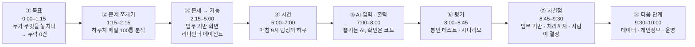
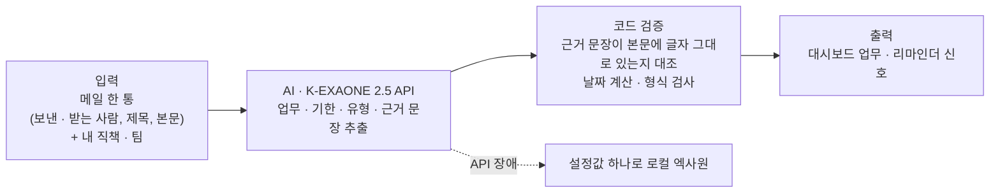

# IR 발표 초안 (PL-19, 10분)

> 상태: 초안 · 작성: 이재운(기획) · 갱신: 2026-11-14 · 리뷰: [팀 전체]
> 근거: 기술 멘토링 11-13(IR 순서 · 문구 지적) · 기업 담당자 인터뷰 10-16(`refs/interview.md`) · 리마인더 명세 D57(#82) · 공통 결정 D13 · D15 · D48 · D51 · D52
> 일정: 11/20(금) 발표자료 초안 → 11/21 리뷰 → 11/27(금) 제출 → **11/28(토) IR Day, 조별 10분 이내**
> 슬라이드 초안: Claude 아티팩트 「CNE IR 발표」(12장, 비공개 · 공유 전). 이 문서와 같은 내용이다. 이 문서가 기준이다.

## 1. 한 문장 메시지

**"알림에서 그치지 않고, 놓친 업무를 처리까지 챙겨 주는 업무 비서"**

멘토 의견 그대로다: "단순히 알림에서 그치지 않는 게 제일 중요하다", "업무 기반 UI라는 점도 같이 설명해야 차이점을 말할 수 있다".

## 2. 내용 흐름도

멘토가 정해 준 순서(목표 → 문제 쪼개기 → 문제별 기능 → AI 입력 · 출력 → 평가 → 차별점)에 시연과 다음 단계를 끼웠다.

| 흐름 | 듣는 사람이 가져갈 한 가지 | 슬라이드 |
|---|---|---|
| ① 목표 | 팀장은 메일을 읽고도 업무를 놓친다. 우리 목표는 누락 0건이다 | 1 · 2 · 3 |
| ② 문제 쪼개기 | 메일 절반 이상이 '해야 할 일'인데 공지 · 참조 사이에 섞여 온다 | 4 |
| ③ 문제 → 기능 | 놓치는 순간 4가지마다 기능이 하나씩 붙어 있다 | 5 · 6 · 7 |
| ④ 시연 | 실제로 알림 → 근거 → 처리 → 되돌리기가 이어진다 | 8 |
| ⑤ AI 입력 · 출력 | AI가 뽑고, 코드가 근거를 대조해 지어낸 것을 거른다 | 9 |
| ⑥ 평가 | 개발에 쓰지 않은 테스트로 놓침 · 정밀도를 쟀다 | 10 |
| ⑦ 차별점 | Outlook · Gmail은 알리고 끝, CNE는 처리까지 | 11 |
| ⑧ 다음 단계 | 한계를 알고 있고, 도입까지 무엇이 남았는지 안다 | 12 |

## 3. 슬라이드별 내용 · 대본

시간은 누적이다. 대본은 그대로 읽는 문장이 아니라 말할 내용의 기준이다.

### 1. 표지 (0:00–0:15)
- 화면: "CNE — 놓친 업무까지 처리하게 돕는 업무 비서" · 6조 실리콘밸리 발사대 · Catch & End, LG CNS 기업 과제 「미처리 메일 리마인더 봇」에서 출발
- 대본: 안녕하세요, 6조입니다. 저희는 메일 속 업무를 놓치지 않고 끝까지 처리하게 돕는 업무 비서 CNE를 만들었습니다. Catch & End, 잡아서 끝낸다는 뜻입니다.

### 2. 목표 · 누가 무엇을 놓치나 (0:15–1:00)
- 화면: "하루 100–200통, 요청은 한두 건씩 빠집니다" + 실제 사례 카드 2장
  - ① "나중에 금방 하지": 다른 팀장의 엑셀 취합 회신 요청을 미루다 기한(어제)을 넘겨 다음 날 아침에 보냄
  - ② 인터뷰 도중에 알아챔: 팀원이 이미지로 보낸 '편집 가능한 원본 파일' 요청을 흘려 넘겼다가 인터뷰하던 중에 알아챔
- 대본: 사용자는 LG CNS 팀장님입니다. 하루 100–200통을 받고 참조가 많습니다. 메일을 안 읽어서가 아니라, 읽었는데도 빠집니다.
- 출처: `refs/interview.md` 1회차(2026-10-16). 담당자 실명은 쓰지 않는다.

### 3. 목표 문장 (1:00–1:15)
- 화면: "메일 속 업무 누락 0건" / "알림을 더 보내는 것이 아니라, 놓친 업무를 끝까지 처리하게 돕습니다"
- 출처: D13(1순위 목표는 업무 누락 방지)

### 4. 문제 쪼개기 (1:15–2:15)
- 화면: 팀장 하루치 메일 100통 중
  - 업무가 들어 있는 메일 **60통**(업무 62건)
  - 기한이 적힌 업무 **45건**
  - 참조로만 받은 메일 **16통**
  - 상급자 등 중요 발신자 메일 **25통**
  - 많이 오는 유형: 회신 요청 18 · 자료 제출 요청 17 · 공지 16 · 참조 16 · 수정 재전송 요청 10
- 대본: 메일 절반 이상이 '해야 할 일'이고, 그게 공지와 참조 사이에 섞여 옵니다.
- 출처: `data/dummy/dummy_mails.json`(v1.1, 정답 라벨 기준, 2026-11-14 집계). **가상 데이터임을 화면에 밝힌다**(사내 메일은 보안상 받을 수 없음).

### 5. 문제 → 기능 (2:15–3:00)

| 놓치는 순간 | CNE의 기능 |
|---|---|
| ① 메일 사이에 묻혀 못 봄 | 메일이 아니라 업무를 모아 보여 주는 대시보드 |
| ② 보고도 미루다 기한을 넘김 | 리마인더 에이전트: 기한 전에 먼저 알리고, 그 자리에서 처리 |
| ③ 내가 보낸 요청의 답을 못 챙김 | 답 없음 · 상대 약속 리마인더 + 재촉 초안 |
| ④ 참조로 왔지만 나를 부른 요청 | 참조 속 지목 리마인더 |

- 공통 원칙: 근거 문장을 보여 주고, 메일을 보내는 일은 언제나 사람이 직접 한다(D48).

### 6. 기능 ① 업무 기반 화면 (3:00–3:45)
- 화면: 대시보드 캡처 `[FE-14 캡처로 교체]` + 세 줄
  - 메일 100통 → 업무 목록 한 장(급한 것 · 기한 순, 메일은 맥락으로만)
  - 업무를 누르면 원문의 그 문장으로(근거 문장 형광펜)
  - 체크 한 번으로 완료, 바로 되돌리기
- 멘토 의견: "메일이 아니라 업무를 보여 준다는 게 좋았다"

### 7. 기능 ② 리마인더 에이전트 · 핵심 (3:45–5:00)
- 화면: 세 단계 + 리마인더 한 줄 예시
  - 01 먼저 알림: 기한 3시간 전, 아침 8:30 브리핑
  - 02 이유와 근거: 왜 지금인지 한 문장 + 메일 속 근거 문장
  - 03 바로 처리: [완료] [미루기] [초안 보기], 되돌리기 가능
  - 예시: "계약서 수정본 검토 · 승인 / 기한 지남 / '오늘(11/6) 18시까지 검토 후 승인 부탁드립니다.'"
  - 귀찮지 않게: 같은 항목 최대 3번 · 근무 시간에만 · 여러 건은 묶어서
- 대본 핵심: 담당자님 말씀처럼 알림만으로는 결국 또 놓칩니다. 그리고 너무 잦으면 무시하게 됩니다(인터뷰).
- 출처: D57 · BE-D28 · 예시는 모의 데이터 v2

### 8. 시연 (5:00–7:00)

| 순서 | 장면 | 시간 | 필요한 것 |
|---|---|---|---|
| 1 | 아침 브리핑: 오늘 기한 · 기한 지남 · 답 기다림 | 0:30 | 시연 DB |
| 2 | 리마인더 열기 → 근거 문장 → [초안 보기] | 0:30 | 근거 문장이 저장된 시연 DB |
| 3 | "견적 건 금요일로 미뤄" → 확인 카드 → 실행 → 되돌리기 | 0:40 | 에이전트 명령(BE-11 #50 머지됨) |
| 4 | 답 없는 요청 → 재촉 초안 | 0:20 | **보낸 메일이 들어간 시연 DB**(지금 0통) |

- 운영: 멘토 조언대로 **미리 분류해 둔 데이터로 시연**하고, 현장 직접 입력은 1–2개만 한다. 실패 대비 화면 녹화를 따로 둔다.

### 9. AI 입력 · 출력 (7:00–8:00)

- 멘토 지적 반영: "입력 · 출력과 AI의 역할을 그림으로", "환각은 업무 내용에도 있다" → 근거 문장 대조(AI-15)로 **지어낸 근거를 거른다**고 말한다. 업무 자체의 환각을 완전히 막는다고 말하지 않는다.
- 개인정보: "지금은 가상 데이터라 메일 전체를 보낸다. 실제 도입 때 개인정보 가리기를 넣는다"(11-13 정정, `ai_client/payload.py`).
- 로컬: "로컬은 버렸다"가 아니라 **"설정 하나로 로컬로 바꿀 수 있다"**(D52)로 통일한다.
- 그림: AI 파트(규남 님)에게 위 그림의 정식 버전을 부탁한다.

### 10. 평가 (8:00–8:45)
- 방법: 만든 사람과 개발한 사람을 나눈 봉인 테스트, SHA-256으로 고정(`50_data_eval/sealed_sets.md`). 기준은 놓침 0 · 정밀도 95% 이상(D15 · DE-D13).
- 숫자: `[놓침 _/_통]` `[할 일 메일 정밀도 _%]` `[에이전트 시나리오 성공 _/_]`
  - **K-EXAONE 2.5 기준 측정은 아직 없다**(D51 "결과는 아직 없다"). 수호 님 최종 측정 뒤 채운다. 측정 전 숫자나 옛 모델 숫자를 쓰지 않는다.
- 에이전트 시나리오 평가: 멘토 의견("대화는 시나리오에서 효능을 줬는지로 평가") → 기획이 시나리오 3개를 정한다(아래 6절).

### 11. 차별점 (8:45–9:30)
- 01 업무 기반: 첫 화면이 업무, 메일은 맥락
- 02 처리까지: 알림 → 이유 · 근거 → 버튼 한 번, 되돌리기
- 03 사람이 결정: 근거를 보여 주고 보내기는 직접, 에이전트가 하지 않는 일을 화면에 밝힘(명세 5.1)

### 12. 한계와 다음 단계 (9:30–10:00)
- 데이터: 사내 메일 연동 불가 → 가상 데이터로 개발 · 평가
- 개인정보: 실제 도입 때 가리기 적용
- 운영: 발표 뒤 한 달 공개 운영 `[운영 담당 확정 필요]`
- 맺음: "놓친 업무까지 처리하게 돕는 업무 비서, CNE였습니다. 감사합니다."

## 4. 빼거나 고친 문구 (멘토 지적)

| 전 | 후 | 이유 |
|---|---|---|
| 메일 확인부터 답장까지 5분 → 10초 | 삭제 | 근거 없음(멘토: "실제로 그런가요?") |
| 오작동 제로 | 삭제, 놓침 · 정밀도 숫자로 | 너무 공격적, 환각이 있을 수 있음 |
| 개인정보를 지웠다 · 본문만 들어간다 | 지금은 가상 데이터라 전체를 보내고, 도입 때 가리기를 넣는다 | 코드와 다름(11-13 확인) |
| 로컬은 버리고 API로 갔다 | 설정 하나로 로컬로 바꿀 수 있다 | D52 · #64와 맞춤 |

## 5. 예상 질문과 답 (Q&A용)

| 질문 | 답의 뼈대 | 근거 |
|---|---|---|
| Outlook 플래그 · 알림과 뭐가 다른가요? | 플래그는 사람이 걸어야 하고 알림에서 끝난다. CNE는 메일에서 업무를 뽑아 먼저 알리고, 그 자리에서 처리까지 잇는다 | 11번 슬라이드 |
| AI가 틀리면요? | 근거 문장을 같이 보여 주고, 실행한 것은 되돌릴 수 있다. 메일 발송은 사람만 한다 | D48 · AI-15 |
| 실제 메일로 써 봤나요? | 사내 메일은 보안상 받을 수 없어 가상 데이터로 개발 · 평가했다. 봉인 테스트는 개발에 쓰지 않았다 | 인터뷰 · sealed_sets |
| 비용 · 한도는요? | 엑사원 API 하루 한도가 있어 시연은 미리 계산한 값으로, 장애 때는 로컬로 바꾼다 | D51 · D52 |
| 알림이 많아지면 끄지 않나요? | 같은 항목 3번 상한, 근무 시간에만, 묶어 보내기, 유형별 끄기 | BE-D28 · D57 4.2 |

## 6. 채워야 할 것

| 필요한 것 | 누가 | 언제까지 | 상태 |
|---|---|---|---|
| 봉인 테스트 숫자(K-EXAONE 2.5) | 데이터 · 평가(최수호) | 11/20 초안 전 | `[미정]` 11/14 회의에서 날짜 확인 |
| 시연 DB(보낸 메일 + 분류 · 신호를 미리 돌린 값, 근거 문장 포함) | 데이터 · BE · AI | `[미정]` | 11/14 회의 안건 |
| AI 입력 · 출력 그림 정식 버전 | AI(문규남) | 11/20 | 멘토 지적 |
| 대시보드 · 리마인더 화면 캡처 | FE(FE-14 문규남) | 11/20 | 6 · 7번 슬라이드 |
| 에이전트 시나리오 평가 3개 정의 | 기획(이재운) | 11/18 | 시연 장면 1–3과 같게 |
| LG CNS 로고 사용 허락 | 기획 → 기업 담당자 | 11/20 | 요청 전. 허락 전에는 로고를 넣지 않는다 |
| 한 달 운영 담당 | 팀 | 11/14 회의 | `[미정]` |
| 발표자 · 시연 조작자 | 팀 | 11/21 리뷰 | `[미정]` |
