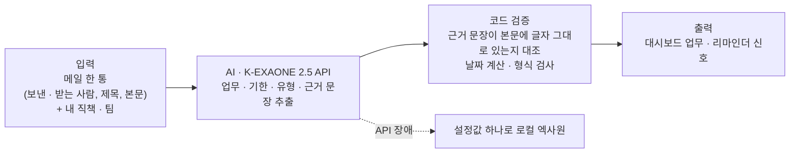

# IR 발표 초안 (PL-19, 10분)

> 상태: 초안 · 작성: 이재운(기획) · 갱신: 2026-11-19 · 리뷰: [팀 전체]
> 기준: **11/28 최종 발표에서 말할 내용**이다. 완성된 서비스를 보여 준다고 보고 썼다. 발표 전에 채우거나 준비할 것은 맨 끝 '부록: 발표 전 준비'에 따로 모았다.
> 근거: 기술 멘토링 11-13(IR 순서 · 문구 지적) · 기업 담당자 인터뷰 10-16(`refs/interview.md`) · 리마인더 명세 D57(#82) · 공통 결정 D13 · D15 · D48 · D51 · D52
> 일정: 11/20(금) 발표자료 초안 → 11/21 리뷰 → 11/27(금) 제출 → **11/28(토) IR Day, 조별 10분 이내**
> 슬라이드 초안: 구글 슬라이드 「CNE IR 발표」(15장, 11-17부터 기준본, 화면 캡처는 임시). 팀 작업본은 노션 「CNE IR 발표 흐름」 · 「IR 발표 대본」. 숫자 · 사실은 이 문서와 맞춘다.

## 1. 한 문장 메시지

**"알림에서 그치지 않고, 놓친 업무를 처리까지 챙겨 주는 업무 비서"**

멘토 의견 그대로다: "단순히 알림에서 그치지 않는 게 제일 중요하다", "업무 기반 UI라는 점도 같이 설명해야 차이점을 말할 수 있다".

## 2. 내용 흐름도

멘토가 정해 준 순서(목표 → 문제 쪼개기 → 문제별 기능 → AI 입력 · 출력 → 평가 → 차별점)에 배경 · 시연 · 다음 단계를 끼웠다. 목표 앞에 배경(누가 무엇을 놓치나)을 먼저 둔다.

- **'문제 쪼개기'란**: '업무 누락'이라는 큰 문제를, 하루치 메일 100통을 세어 **놓치는 원인 4가지**(묻힘 · 미룸 · 답 못 챙김 · 참조 속 지목)로 나누는 단계다. 발표 화면 제목은 '문제 나누기 — 업무가 빠지는 4가지 순간'으로 쓴다.
- **말하는 방식**: 각 장면은 결론을 먼저 말하고, 핵심을 문장 끝 명사로 강조한다(두괄식). 예) "메일을 읽고도 빠지는 것, 이것이 팀장님의 **업무 누락**입니다."

| 흐름 | 듣는 사람이 가져갈 한 가지 | 슬라이드 |
|---|---|---|
| ⓪ 배경 | 메일을 읽고도 빠지는 업무 — 팀장의 **업무 누락** | 1 · 2 |
| ① 목표 | 알림을 늘리는 것이 아니라 끝까지 처리하게 돕는 것 — **누락 0건** | 3 |
| ② 문제 나누기 | 메일 절반 이상이 공지 · 참조 사이에 섞여 오는 일 — **놓치는 순간 4가지** | 4 |
| ③ 문제 → 기능 | 놓치는 순간 4가지마다 기능이 하나씩 붙어 있다 | 5 · 6 · 7 |
| ④ 시연 | 실제로 알림 → 근거 → 처리 → 되돌리기가 이어진다 | 8 |
| ⑤ AI 입력 · 출력 | AI가 뽑고, 코드가 근거를 대조해 지어낸 것을 거른다 | 9 |
| ⑥ 평가 | 개발에 쓰지 않은 테스트로 놓침 · 정밀도를 쟀다 | 10 |
| ⑦ 차별점 | Outlook · Gmail은 알리고 끝, CNE는 처리까지 | 11 |
| ⑧ 다음 단계 | 한계를 알고 있고, 도입까지 무엇이 남았는지 안다 | 12 |

## 3. 슬라이드별 내용 · 대본

시간은 누적이다. 대본은 그대로 읽는 문장이 아니라 말할 내용의 기준이다.

### 1. 표지 (0:00–0:15)
- 화면: "CNE — 놓친 업무까지 처리하게 돕는 업무 비서" · 6조 실리콘밸리 발사대 · Catch & End, LG CNS 기업 과제 「미처리 메일 리마인더 봇」에서 출발
- 대본: 안녕하세요, 6조입니다. 저희는 메일 속 업무를 놓치지 않고 끝까지 처리하게 돕는 업무 비서 CNE를 만들었습니다. Catch & End, 잡아서 끝낸다는 뜻입니다.

### 2. 배경 · 누가 무엇을 놓치나 (0:15–1:00)
- 화면: "하루 100–200통, 요청은 한두 건씩 빠집니다" + 실제 사례 카드 2장
  - ① "나중에 금방 하지": 다른 팀장의 엑셀 취합 회신 요청을 미루다 기한(어제)을 넘겨 다음 날 아침에 보냄
  - ② 인터뷰 도중에 알아챔: 팀원이 이미지로 보낸 '편집 가능한 원본 파일' 요청을 흘려 넘겼다가 인터뷰하던 중에 알아챔
- 대본: 메일을 안 읽어서가 아니라 읽었는데도 빠지는 것, 이것이 팀장님의 **업무 누락**입니다. 사용자는 LG CNS 팀장님이고, 하루 100–200통을 받으며 참조가 많습니다.
- 출처: `refs/interview.md` 1회차(2026-10-16). 담당자 실명은 쓰지 않는다.

### 3. 목표 문장 (1:00–1:15)
- 화면: "메일 속 업무 누락 0건" / "알림을 더 보내는 것이 아니라, 놓친 업무를 끝까지 처리하게 돕습니다"
- 출처: D13(1순위 목표는 업무 누락 방지)

### 4. 문제 나누기 — 업무가 빠지는 4가지 순간 (1:15–2:15)
- 무엇을 나누나: '업무 누락'이라는 큰 문제를 메일 100통에서 센 숫자로 나눠, 다음 장의 **놓치는 순간 4가지**로 잇는다
- 화면: 팀장 하루치 메일 100통 중
  - 업무가 들어 있는 메일 **60통**(업무 62건)
  - 기한이 적힌 업무 **45건**
  - 참조로만 받은 메일 **16통**
  - 상급자 등 중요 발신자 메일 **25통**
  - 많이 오는 유형: 회신 요청 18 · 자료 제출 요청 17 · 공지 16 · 참조 16 · 수정 재전송 요청 10
- 대본: 메일 절반 이상이 해야 할 일인데 공지와 참조 사이에 섞여 오는 것, 이것이 놓침의 **출발점**입니다.
- 출처: `data/dummy/dummy_mails.json`(v1.1, 정답 라벨 기준, 2026-11-14 집계). **가상 데이터임을 화면에 밝힌다**(사내 메일은 보안상 받을 수 없음).

### 5. 문제 → 기능 (2:15–3:00)

| 놓치는 순간 | CNE의 기능 |
|---|---|
| ① 메일 사이에 묻혀 못 봄 | 메일이 아니라 업무를 모아 보여 주는 대시보드 |
| ② 보고도 미루다 기한을 넘김 | 리마인더 에이전트: 기한 전에 먼저 알리고, 그 자리에서 처리 |
| ③ 내가 보낸 요청의 답을 못 챙김 | 답 없음 · 상대 약속 리마인더 → 그 자리에서 원래 메일 열기 |
| ④ 참조로 왔지만 나를 부른 요청 | 참조 속 지목 리마인더 |

- 공통 원칙: 근거 문장을 보여 주고, 메일은 사람이 미리보기를 보고 확인했을 때만 보낸다(D37 · D48, 재촉 메일 T14 #205).

### 6. 기능 ① 업무 기반 화면 (3:00–3:45)
- 화면: 대시보드 캡처 + 메일 화면 캡처(근거 문장 형광펜)를 나란히
  - 메일 100통 → 업무 목록 한 장(급한 것 · 기한 순, 메일은 맥락으로만)
  - 업무를 누르면 원문의 그 문장으로(근거 문장 형광펜)
  - 체크 한 번으로 완료, 바로 되돌리기
- 멘토 의견: "메일이 아니라 업무를 보여 준다는 게 좋았다"

### 7. 기능 ② 리마인더 에이전트 · 핵심 (3:45–5:00)
- 화면: 에이전트 › 리마인더 캡처(상대 약속 지남 항목을 고른 상태) + 세 단계
  - 01 먼저 알림: 기한 3시간 전, 아침 8:30 브리핑
  - 02 이유와 근거: "한도윤 선임이 11/5까지 보내 준다고 했는데 아직 오지 않았어요" + 메일 속 그 약속 문장
  - 03 바로 처리: [회신 요청 작성] [메일 열기] [수신 확인], 되돌리기 가능. [회신 요청 작성]은 그 메일 답장 칸으로 바로 간다(캐치봇은 초안을 만들지 않는다, AI-D24 · reminders.md 12.7)
  - 귀찮지 않게: 같은 항목 최대 3번 · 근무 시간에만 · 여러 건은 묶어서
- 대본 핵심: 담당자님 말씀처럼 알림만으로는 결국 또 놓칩니다. 그리고 너무 잦으면 무시하게 됩니다(인터뷰).
- 출처: D57 · BE-D28 · 캡처는 시연 데이터

### 8. 시연 (5:00–7:00)

| 순서 | 장면 | 시간 |
|---|---|---|
| 1 | 아침 브리핑: 오늘 기한 · 기한 지남 · 답 기다림 | 0:30 |
| 2 | 리마인더 열기 → 이유 · 근거 문장 → [완료] → [실행 취소] | 0:30 |
| 3 | "한빛은행 견적 건 금요일로 미뤄" → 확인 카드 → 실행 → "방금 거 취소해" | 0:40 |
| 4 | 답 없는 요청 → 이유('며칠째') → [메일 열기] | 0:20 |

- 운영 방식은 맨 끝 부록(발표 전 준비)을 따른다.

### 9. AI 입력 · 출력 (7:00–8:00)

- 멘토 지적 반영: "입력 · 출력과 AI의 역할을 그림으로", "환각은 업무 내용에도 있다" → 근거 문장 대조(AI-15)로 **지어낸 근거를 거른다**고 말한다. 업무 자체의 환각을 완전히 막는다고 말하지 않는다.
- 개인정보: "모델에 보내기 전에 메일 주소 · 연락처에 있는 이름 · 전화번호를 가리고, 답을 받은 뒤 되돌린다. 개발 · 평가 · 시연은 가상 데이터로 했다."(BE-6 #94, 11-15 머지, `backend/app/privacy/mask.py`). 한계도 그대로 말한다: 연락처에 없는 이름이나 이름만 부르는 경우(민준님)는 가리지 못한다. '모든 개인정보를 가린다'고 말하지 않는다.
- 로컬: "로컬은 버렸다"가 아니라 **"설정 하나로 로컬로 바꿀 수 있다"**(D52)로 통일한다.
- 모델 비교(같은 봉인 A · 같은 코드 · 같은 날, scores.md 10절 표 2): K-EXAONE 2.5 놓침 0 · 잘못 잡음 0 · 모든 칸 69/80 · 1통 19.1초 / DeepSeek V4.1 Flash 0 · 1 · 71/80 · 2.8초 / Claude Haiku 5.5 1 · 3 · 62/80 · 1.3초(세 모델 모두 11/16 max 조건). 서비스 조건(high · 180초)으로 다시 잰 것은 엑사원뿐이라(11/19 모든 칸 70/80 · 중앙 17.5초) 비교표는 11/16 같은 조건 값을 그대로 쓰고, 표 아래에 이 한 줄을 적는다. "놓침 0과 잘못 잡음 0을 함께 지킨 건 엑사원, 대신 느리다"로 말하고, 모든 칸 정답은 DeepSeek이 조금 높다는 것도 숨기지 않는다.
- 라이선스: 엑사원은 API · 로컬(EXAONE 3.5 7.8B, `EXAONE AI Model License Agreement 1.1 - NC`) 모두 비상업 라이선스다. "회사에 엑사원을 그대로 설치해 쓴다"고 말하지 않고, "상용 도입 때는 LG AI연구원과 라이선스 협의, 또는 같은 호출부에 다른 모델"이라고 말한다(#64 리뷰).

### 10. 평가 (8:00–8:45)
- 방법: 만든 사람과 개발한 사람을 나눈 봉인 테스트, SHA-256으로 고정(`50_data_eval/sealed_sets.md`). 기준은 놓침 0 · 정밀도 95% 이상(D15 · DE-D13).
- 숫자(봉인 테스트 A v4, 받은 80통 · 할 일 메일 47통, 서비스 그대로: 분류 강도 high · 제한 시간 180초 · 가린 채, 11/19 최수호 · `50_data_eval/scores.md` 13절 표 4, #237):
  - 놓침: **할 일 메일 47통 중 놓친 메일 0통**
  - 정밀도: 할 일로 잡은 47통 중 47통이 실제 할 일(할 일 아닌 메일을 잡은 것 0통)
  - 80통 모두 모델이 직접 판단(규칙으로 대신한 메일 0통, 시간 초과 0회 · 다시 부른 것 0회). 모든 칸 정답 70/80통, 기한 48/50개. 1통 처리 시간 중앙 17.5초 · 최대 125.4초
  - 에이전트 시나리오 성공 `[_/_]`: 배포 뒤 시연 DB로 잰다(`agent_scenarios.md`)
  - 강도는 #210 측정(dev4 · dev9 × low · high · max × 2회)에서 놓침 0이면서 할 일로 잘못 잡은 것이 가장 적은 high로 정했다(2회 합 잘못 잡음 high 1 · max 2 · low 3, 놓침은 low만 1, 문규남 11/18). 봉인 A는 그 뒤 한 번만 쟀다. 11/16 max 값(모든 칸 69/80)과 놓침 · 정밀도는 같다
  - 말하는 법: '누락 0 달성'이 아니라 잰 범위를 함께 말한다. 코드 마감(11/27) 뒤 봉인 테스트 B로 한 번 더 잰다.
- 에이전트 시나리오 평가: 멘토 의견("대화는 시나리오에서 효능을 줬는지로 평가") → 시연 장면 1–4와 같은 시나리오로 잰다(부록).

### 11. 차별점 (8:45–9:30)
- 01 업무 기반: 첫 화면이 업무, 메일은 맥락
- 02 처리까지: 알림 → 이유 · 근거 → 버튼 한 번, 되돌리기
- 03 사람이 결정: 근거를 보여 주고, 보내기는 미리보기 + 확인 뒤에만, 에이전트가 하지 않는 일을 화면에 밝힘(명세 5.1)

### 12. 실제 도입을 위한 다음 단계 (9:30–10:00)
- 사내 메일 연동: 보안 승인을 받은 환경에서 Outlook 메일 연결
- 개인정보: 모델에 보내기 전 메일 주소 · 연락처에 있는 이름 · 전화번호 가리기(#94)
- 운영: 발표 뒤 한 달 공개 운영
- 맺음: "놓친 업무까지 처리하게 돕는 업무 비서, CNE였습니다. 감사합니다."

## 4. 빼거나 고친 문구 (멘토 지적)

표현 원칙: **단정 표현(100% · 완벽 · 항상 · 절대 · 제로)을 쓰지 않는다.** 측정한 숫자는 그대로 말하고, '누락 0'은 달성이 아니라 목표라고 말한다. 재지 않은 효과(시간 단축 등)는 말하지 않는다. 다른 서비스는 '못 한다'가 아니라 '우리는 이것을 선택했다'로 말한다.

| 전 | 후 | 이유 |
|---|---|---|
| 메일 확인부터 답장까지 5분 → 10초 | 삭제 | 근거 없음(멘토: "실제로 그런가요?") |
| 오작동 제로 | 삭제, 놓침 · 정밀도 숫자로 | 너무 공격적, 환각이 있을 수 있음 |
| 개인정보를 지웠다 · 본문만 들어간다 | 개발 · 평가 · 시연은 가상 데이터, 도입 때 모델에 보내기 전 가린다 | 코드와 다름(11-13 확인) |
| 로컬은 버리고 API로 갔다 | 설정 하나로 로컬로 바꿀 수 있다 | D52 · #64와 맞춤 |

## 5. 예상 질문과 답 (Q&A용)

| 질문 | 답의 뼈대 | 근거 |
|---|---|---|
| Outlook 플래그 · 알림과 뭐가 다른가요? | 플래그는 사람이 걸어야 하고 알림에서 끝난다. CNE는 메일에서 업무를 뽑아 먼저 알리고, 그 자리에서 처리까지 잇는다 | 11번 슬라이드 |
| AI가 틀리면요? | 근거 문장을 같이 보여 주고, 실행한 것은 되돌릴 수 있다. 메일은 미리보기를 보고 확인해야 보낸다 | D37 · D48 · AI-15 |
| 말로 시킨 명령을 잘못 알아들으면요? | 잘못 알아듣는 경우가 있다. 1건은 되돌리기, 여러 건 · 발송은 확인을 받는다. 명령 해석 숫자는 봉인 세트(v3 계열)로 잰 값만 쓰고, 넣을 때 버전(v3.1 · v3.2)을 같이 적는다 | D37 · #200 |
| 상급자는 어떻게 아나요? | 지금은 시연 데이터에 상급자 · 즐겨찾기를 지정해 두었다. 설정 화면에서 사람 칸은 뺐다(캐치봇에 물어보면 된다, 11-18) | FE-6 #231 |
| 실제 메일로 써 봤나요? | 사내 메일은 보안상 받을 수 없어 가상 데이터로 개발 · 평가했다. 봉인 테스트는 개발에 쓰지 않았다 | 인터뷰 · sealed_sets |
| 비용 · 한도는요? | 엑사원 API 하루 한도가 있어 시연은 미리 계산한 값으로, 장애 때는 로컬로 바꾼다 | D51 · D52 |
| 알림이 많아지면 끄지 않나요? | 같은 항목 3번 상한, 근무 시간에만, 묶어 보내기, 유형별 끄기 | BE-D28 · D57 4.2 |

## 부록: 발표 전 준비 (발표에서는 말하지 않음)

멘토 조언대로 시연은 **미리 분류해 둔 데이터**로 하고, 현장 직접 입력은 1–2개만 한다.

| 필요한 것 | 누가 | 언제까지 | 상태 |
|---|---|---|---|
| 봉인 테스트 숫자(K-EXAONE 2.5) | 데이터 · 평가(최수호) | 11/19 받음 | ✅ 10절에 넣음(high · 180초, scores.md 13절 표 4 · #237). 코드 마감(11/27) 뒤 봉인 B로 한 번 더 잰다. 명령 해석 숫자는 봉인 v3 계열로 잰 값만 쓰고 버전을 같이 적는다(v3.1 #249, #244 머지 뒤 v3.2) |
| 시연 DB: 보낸 메일은 준비됨(`demo_mails.json` 15통, `seed load --source`로 채움). 분류 · 신호를 미리 돌린 값(근거 문장 포함)만 남음. 시연 2 · 4번 장면에 필요 | 시연 조작(문규남) | 리허설(11/24) 전 | 문규남 노트북 · 키로, 모의 데이터 또는 미리 처리한 데이터로 시연(11-17 카톡). 근거 문장 · 신호가 칠해지는지 리허설에서 확인. 시연 시계 `/api/dev/clock`은 준비됨(#93) |
| 데모 주소 · QR(마지막 슬라이드) | 인프라(문규남) | 첫 배포 | Railway로 정함(INF-11, #176). 11-18 아직 배포 전 |
| AI 입력 · 출력 그림 정식 버전 | AI(문규남) | 11/20 | 슬라이드 11. 표는 `docs/40_ai/io_spec.md`(#214)에 있음, 그림은 아직 |
| 화면 캡처 최종본(지금은 #85 브랜치 모의 모드 캡처 3장) | FE(FE-14 문규남) | 11/27 | 기능이 머지된 뒤 다시 찍기 |
| 에이전트 시나리오 평가 정의 · 측정 | 기획(이재운) | 정의 완료 · 측정은 배포 뒤 | `agent_scenarios.md`. S3은 🔔 '답 기다림'에서 시작(#190) |
| 한 달 운영 담당 | 팀 | 11/21 리뷰 | `[미정]` (11/14 회의에서 못 정함) |
| 발표자 · 시연 조작자 | 팀 | 11/21 리뷰 | `[미정]` |
| Outlook 연결(다음 단계 문장) | BE-7 `[미정]` 담당 없음(#134) | 11/21 | 연결되면 '계정 연결은 되고 사내 메일은 보안 승인 뒤'로, 안 되면 지금 문장 그대로. 재촉 메일(T14)도 지금은 앱 안 기록만 남고 Outlook으로 나가지 않음(BE-7 `Mail.Send` 뒤) → 발표에서 '보낸다'고 할 때 이 범위를 밝힌다 |
