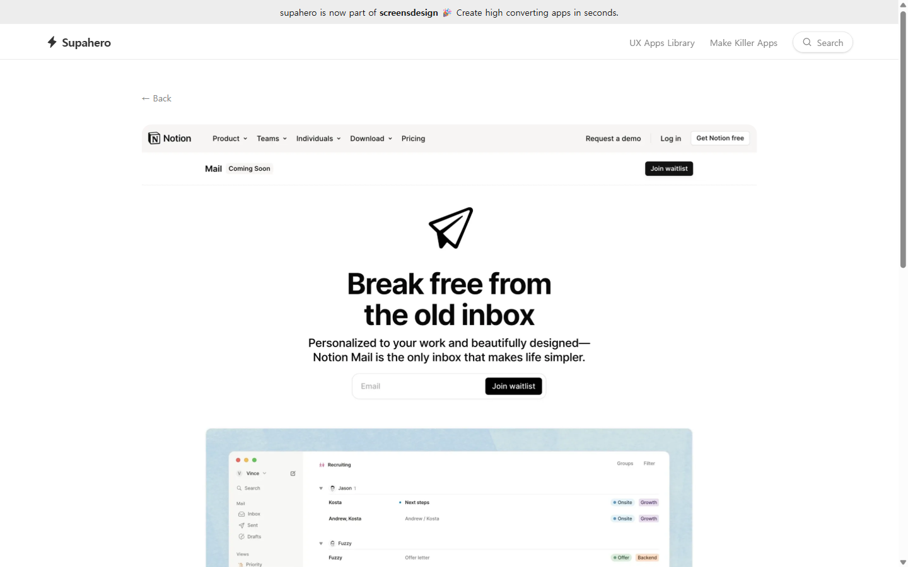
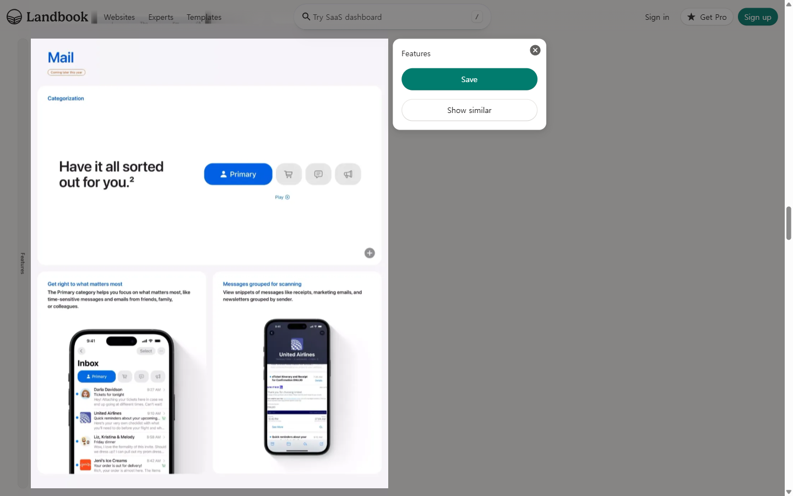
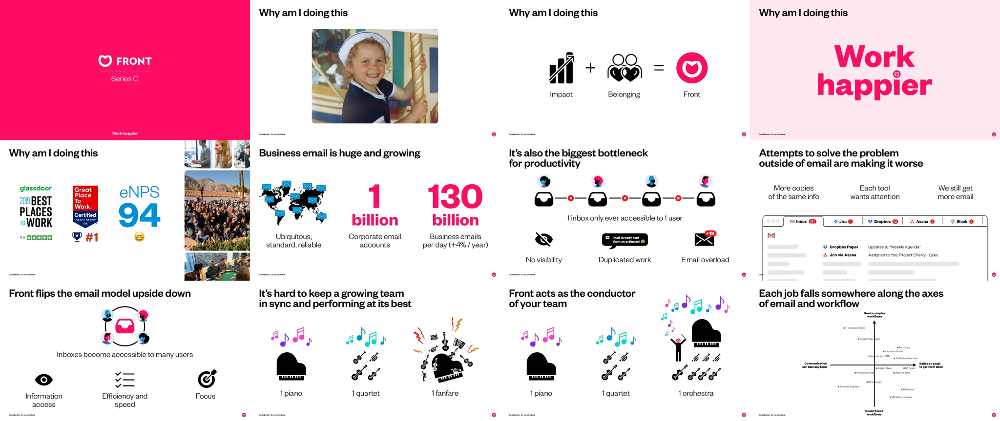

# IR 발표자료 디자인 레퍼런스 (PL-19)

> 성격: 기록 · 작성: 문규남 · 2026-11-21
> 쓰는 곳: 구글 슬라이드 「CNE IR 발표」(15장) · 내용 기준은 `../ir_draft.md`
> 고른 기준: **우리와 목적이 같은 것** — 메일함을 정리해 할 일에 집중하게 하는 서비스의 첫 화면 · 기능 소개 · 투자 발표 덱
> 캡처 이미지는 팀 내부 참고용이다. 슬라이드에 그대로 넣지 않는다.

## 1. 고른 레퍼런스 3개

| # | 출처 · 갤러리 | 무엇 | 가져올 것 |
|---|---|---|---|
| 1 | Supahero · Notion Mail 첫 화면 | AI 메일함 소개 첫 화면 | 흰 바탕 · 검은 굵은 제목 2줄 · 회색 부제 1–2줄 · 그 아래 제품 화면 하나 |
| 2 | Landbook · Apple Mail(iOS 18) 기능 소개 | 메일 자동 분류 기능 | 큰 카드 1 + 작은 카드 2 묶음, 카드마다 작은 라벨 → 한 줄 제목 → 2줄 설명 → 화면 |
| 3 | Best Pitch Decks · Front Series C 덱 | 업무 메일 협업 서비스 투자 발표 | 포인트색 1개 · 왼쪽 위 제목 · 큰 숫자 · 아이콘 + 짧은 캡션 · 2축 위치도 |

추가 3개(같은 날 문규남이 고름, 캡처는 노션 정리본):

| # | 출처 · 갤러리 | 무엇 | 가져올 것 |
|---|---|---|---|
| 4 | Landbook · Amie | 업무 비서 · AI 에이전트 첫 화면 | 왼쪽 정렬 큰 굵은 제목, 핵심 구절만 회색 바탕으로 강조, 제품 화면 카드 |
| 5 | Deck.Gallery · Superside No-Hype AI Report | AI 리포트 덱 | 숫자 띠(가로 줄에 큰 숫자 여러 개), 짙은 바탕 + 밝은 칩 |
| 6 | Really Good Emails · Slack "Never lose track of your to-dos again" | 할 일 · 리마인더 메일 | 둥근 아이콘 + 굵은 소제목 기능 줄, 구분선, 강한 버튼 하나 |

- 4 · 6은 1 · 3과 같은 방향이라 아래 규칙을 그대로 따른다. 4의 회색 바탕 강조는 C(한 문장 강조) 장에서 결론 낱말에 빨강 대신 쓸 수 있다.
- 5의 짙은 바탕은 쓰지 않는다(흰 바탕 하나로 맞춘다). 숫자 띠만 B(숫자 3개) 장의 다른 모양으로 가져온다.

세 개가 공통으로 하는 것: **바탕은 흰색, 글자는 검정, 색은 하나만 포인트로**. 한 장에 말하는 것은 하나이고, 설명 글은 두 줄을 넘지 않는다. Front는 분홍 하나로 표지 · 큰 숫자 · 결론 아이콘만 칠하고 나머지는 전부 검정 · 회색이다. 우리 앱의 60 · 35 · 5 규칙(`../../20_frontend/design_system.md` 1절)과 같은 구조라 앱 토큰을 그대로 쓴다.

## 2. 색

| 쓰임 | 값 | 근거 |
|---|---|---|
| 바탕 | #FFFFFF, 화면 캡처 뒤 옅은 면 #F7F8F9 | 레퍼런스 1 · 3 |
| 제목 · 본문 | #121212 | 앱 `--c-ink` |
| 부제 · 캡션 · 쪽 번호 | #6B6B6B | 앱 `--c-gray` |
| 구분선 · 카드 테두리 | #E5E5E5 | 앱 `--c-line` |
| **포인트** | **#A50034** | 앱 `--c-point`(LG Heritage Red) |

포인트 규칙(Front 덱 방식):
- 표지 · 맺음 장만 전면 #A50034 + 흰 글자.
- 본문 장에서는 **한 장에 한 곳**만 칠한다: 큰 숫자, 또는 결론 낱말 하나, 또는 '=' 뒤 결과 아이콘.
- 앱 화면은 빨강을 버튼에만 쓰지만, 발표에서는 큰 숫자 · 결론 낱말에도 쓴다. 발표장 화면에서 한눈에 잡혀야 해서다. 앱 토큰 규칙을 바꾸는 것은 아니다.
- 기한 라벨 색(빨강 · 초록 · 파랑)은 앱 화면을 보여 줄 때만 나온다. 장식으로 쓰지 않는다.

## 3. 글자

구글 슬라이드 기본 크기(16:9, 720 × 405pt) 기준이다.

| 쓰임 | 크기 · 굵기 | 글꼴 |
|---|---|---|
| 표지 한 문장 | 36–40pt · Bold | 국문 |
| 장 제목(왼쪽 위) | 28pt · Bold, 두 줄까지 | 국문 |
| 한 문장 강조 장 | 48–60pt · Bold · 가운데 | 국문 |
| 큰 숫자 | 80–96pt · SemiBold · #A50034 | Outfit |
| 본문 · 카드 제목 | 16–18pt · SemiBold | 국문 |
| 캡션 · 출처 | 11–12pt · Regular · #6B6B6B | 국문 |

- 앱은 국문 Pretendard · 숫자 Outfit이다. **Pretendard는 구글 슬라이드 글꼴 목록에 없을 가능성이 높다(확인 불가 — 슬라이드에서 글꼴 메뉴로 직접 확인 필요).** 없으면 국문은 Noto Sans KR, 숫자는 Outfit(구글 폰트에 있음)으로 한다.
- 제목은 줄 간격 1.1–1.2, 본문은 1.4. 레퍼런스 1 · 3처럼 제목 줄 간격을 좁혀야 덩어리로 읽힌다.

## 4. 여백

- 바깥 여백: 좌우 40pt, 위 32pt, 아래 24pt(쪽 번호 · 출처 자리).
- 제목 → 내용 사이 24pt 이상. 내용 요소끼리는 8pt 배수(16 · 24 · 32).
- 한 장에 요소는 많아도 4개(Front의 아이콘 3–4열). 넘치면 장을 나눈다.
- 모든 장에서 제목 위치를 같은 자리(왼쪽 위)에 고정한다. 장을 넘겨도 제목이 흔들리지 않는다(레퍼런스 3).

## 5. 구성 — 장 종류 7개

| 종류 | 모양 | 레퍼런스 | `ir_draft.md` 어디에 |
|---|---|---|---|
| A 표지 · 맺음 | 전면 빨강, 가운데 로고 + 한 문장 | Front 1장 | 1 표지 · 맺음말 |
| B 숫자 3개 | 제목 + 큰 숫자 2–3개 + 아래 캡션 한 줄 | Front 6장 | 2 배경(하루 100–200통 · 사례) |
| C 한 문장 강조 | 가운데 큰 글자 하나, 결론 낱말만 빨강 | Front 4장 · Notion Mail | 3 목표(업무 누락 0건) |
| D 아이콘 4열 | 제목 + 아이콘 · 짧은 캡션 4개 | Front 7 · 9장 | 4 놓치는 순간 4가지 · 5 문제 → 기능 |
| E 기능 카드 | 큰 카드 1 + 작은 카드 2, 카드마다 라벨 → 제목 → 2줄 → 화면 | Apple Mail | 6 업무 기반 화면 · 7 리마인더 에이전트 · 9 AI 입력 · 출력 |
| F 제품 화면 | 제목 · 부제 아래 옅은 면 위에 앱 창 하나 | Notion Mail | 8 시연 앞 장 · 10 평가 결과 |
| G 2축 위치도 | 가로 · 세로 축에 서비스 점 찍기 | Front 12장 | 11 차별점(Outlook · Gmail · CNE: 알림만 ↔ 처리까지 / 메일 기준 ↔ 업무 기준) |

12 다음 단계는 D(아이콘 3열)로 한다.

## 6. 하지 않는 것

- 장마다 다른 색 · 그라데이션 · 그림자 큰 카드.
- 설명 글 세 줄 이상. 말할 내용은 대본(노션 「IR 발표 대본」)에 둔다.
- 사진 배경 위 글자. 제품 화면은 실제 캡처만 쓰고 개인정보는 가린다(`ir_draft.md` 부록).
