# CNE 사용자 매뉴얼

개발자가 아닌 분이 화면만 보고 CNE를 쓰는 방법입니다. 처음 쓰는 분은 0장부터 순서대로 따라 하면 **Outlook 연결 → 대시보드에서 업무 확인 → 메일 읽고 처리 → 캐치봇에게 맡기기**까지 한 번에 해 볼 수 있습니다.

> 이 문서의 버튼 · 메뉴 이름은 화면에 보이는 글자 그대로입니다. 설치 · 실행 · 배포처럼 화면 밖의 일은 [루트 README](../../README.md)를 봅니다.
>
> 화면 그림은 2026-11-27에 가상 팀장 메일함(더미 메일 100통)으로 찍었습니다. 사람 · 회사 · 메일 주소는 모두 지어낸 것입니다. Outlook 연결 화면만 배포 주소에서 찍었습니다.

## 목차

| 장 | 하는 일 | 메뉴 |
|---|---|---|
| [0](#0-시작하기) | 접속, Outlook 연결, 시연 데이터로 둘러보기 | 설정 → 메일 계정 |
| [1](#1-화면-한눈에-보기) | 메뉴와 업무 상태 4가지 | - |
| [2](#2-대시보드) | 오늘 처리할 업무를 한 화면에서 보고 끝내기 | 대시보드 |
| [3](#3-메일) | 메일 읽기 · 요약 · 번역, 답장 · 전달 · 새 메일 | 메일 |
| [4](#4-캐치봇) | 말이나 글로 일 시키기, 리마인더 처리, 요약 · 회고 | 캐치봇 |
| [5](#5-알림-센터) | 알림 모아 보기 | 🔔 |
| [6](#6-캘린더) | 기한 · 회의 · 일정을 달력으로 | 캘린더 |
| [7](#7-설정) | 알림 시각 · 근무 시간 · 서명 · 템플릿 · 화면 | 설정 |
| [8](#8-이럴-때는) | 자주 보는 안내와 대처 | - |
| [9](#9-알아-두실-점) | AI가 틀릴 수 있는 곳, 개인정보 | - |

## 0. 시작하기

### 접속

1. PC의 크롬 · 엣지 · 사파리에서 CNE 주소 <https://web-production-5f3ac584.up.railway.app/>를 엽니다.
2. 따로 가입 · 로그인하지 않습니다. 처음 들어오면 그 브라우저 전용 사용자가 자동으로 만들어집니다.
3. 같은 브라우저로 다시 오면 이어서 씁니다. **브라우저 기록(쿠키)을 지우거나 다른 브라우저 · 기기로 들어오면 새 사용자**가 되어 메일을 다시 연결해야 합니다.

### Outlook 연결

1. 위쪽 메뉴의 **설정**을 누르고 왼쪽에서 **메일 계정**을 고릅니다.

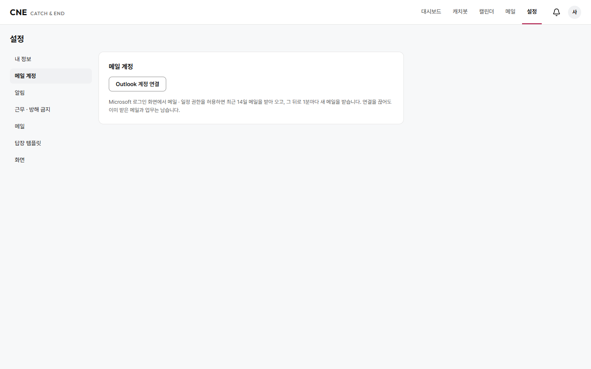

2. **Outlook 계정 연결**을 누릅니다. 버튼이 **Microsoft로 이동 중…**으로 바뀌고 Microsoft 로그인 화면이 열립니다.
3. 쓰는 Outlook 계정으로 로그인하고, 메일 · 일정 권한을 **허용**합니다.
4. CNE로 돌아오면 연결됐다는 안내가 뜹니다. **최근 14일 메일**을 받아 오고, 그 뒤로 **1분마다** 새 메일을 받습니다.

- 메일을 받은 뒤 AI가 한 통씩 읽어 업무를 뽑습니다. 한 통에 수십 초가 걸려 메일이 많으면 대시보드가 다 채워지기까지 몇 분 걸립니다. 다 되면 **분류를 마쳤어요 · 새 업무 N건** 안내가 뜹니다.
- 연결된 계정 옆의 **지금 받기**로 바로 새 메일을 받고, **연결 끊기**로 연결을 풉니다. 연결을 끊어도 이미 받은 메일과 업무는 남습니다. 로그인이 풀렸으면 **다시 연결**을 누릅니다.
- 개인 Outlook.com과 회사 · 학교 계정을 모두 받습니다. 회사 계정은 그 회사 관리자가 외부 앱을 막아 두었으면 연결되지 않습니다(8장).

### 시연 데이터로 둘러보기

발표 · 시연용 주소(팀이 따로 알려 드립니다)를 열면 가상 회사의 팀장 메일함(메일 115통)으로 들어갑니다. 내 메일을 연결하지 않고 기능을 둘러볼 때 씁니다. **이 시연 화면에는 본인 Outlook을 연결하지 마세요.** 주소를 아는 사람이 모두 같은 화면을 봅니다.

## 1. 화면 한눈에 보기

위쪽에 메뉴 다섯 개와 🔔이 있습니다.

| 메뉴 | 여기서 하는 일 |
|---|---|
| **대시보드** | 메일 속 업무를 급한 순 · 유형별로 모아 보고, 체크 한 번으로 끝냅니다 |
| **캐치봇** | "금요일로 미뤄" 같은 말 · 글로 일을 시키고, 리마인더를 처리합니다 |
| **캘린더** | 기한 · 회의 · 일정을 달력으로 봅니다 |
| **메일** | Outlook처럼 메일을 읽고 답장합니다. 요약 · 번역 · 업무가 메일 위에 함께 보입니다 |
| **설정** | 메일 계정 · 알림 · 근무 시간 · 서명 · 템플릿 · 화면 |
| 🔔 | 리마인더와 알림을 모아 봅니다 |

- 어느 화면에서나 **Ctrl+J**(맥은 **⌘J**)를 누르면 캐치봇 입력칸으로 갑니다.
- 위쪽 오른쪽의 **동기화 HH:MM**은 마지막으로 메일을 받은 시각입니다.

### 업무 상태 4가지

AI가 메일에서 뽑은 할 일 하나하나를 **업무**라고 부릅니다. 업무는 늘 넷 중 하나입니다.

| 상태 | 뜻 | 만드는 법 |
|---|---|---|
| 미처리 | 아직 할 일 | 새로 뽑힌 업무 |
| 완료 | 끝냄 | 둥근 체크, 캐치봇 "이거 완료", 답장 뒤 **예** |
| 나중에 | 정한 시각까지 숨겼다가 그때 다시 알림 | **나중에 ▾**, 캐치봇 "금요일로 미뤄" |
| 제외 | 업무가 아님(AI가 잘못 뽑음 등) | **제외**, 캐치봇 "이건 빼" |

어떤 상태로 바꿔도 화면 아래 안내의 **되돌리기**나 캐치봇 **기록**의 **실행 취소**로 되돌릴 수 있습니다. CNE는 사용자가 고르기 전에는 업무를 스스로 완료하지 않습니다.

## 2. 대시보드

메일이 아니라 **업무**를 모아 보여 주는 첫 화면입니다.

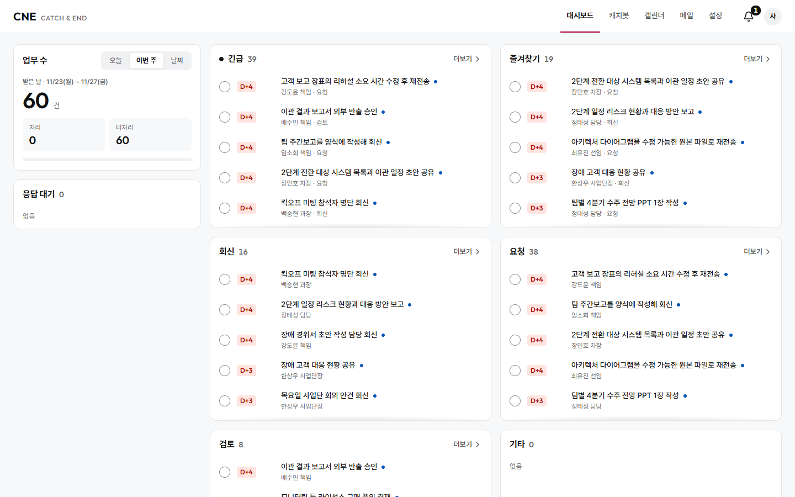

| 자리 | 칸 | 보이는 것 |
|---|---|---|
| 왼쪽 | **업무 수** | 받은 날 기준 업무 수. **오늘 · 이번 주**를 고르고 **전날 · 다음 날**로 날짜를 옮깁니다. 처리 · 미처리 수 |
| 왼쪽 | **응답 대기** | 내가 보낸 요청 메일 중 답이 아직 없는 것(보낸 지 N일) |
| 왼쪽 | **확인사항** | 할 일은 아니지만 한 번 볼 메일(AI가 할 일인지 확신하지 못한 메일 포함) |
| 오른쪽 | **긴급** | 기한이 지났거나 · ASAP · 오늘 마감인 미처리 업무 |
| 오른쪽 | **즐겨찾기** | 즐겨찾기한 사람이 보낸 메일의 업무 |
| 오른쪽 | **회신 · 요청 · 검토 · 기타** | 업무 유형별 미처리 업무 |

- 업무 줄 왼쪽의 **둥근 체크**를 누르면 완료됩니다. 아래에 **업무 1건을 완료로 바꿨어요 [되돌리기]**가 잠깐 뜹니다.
- 업무 글자를 누르면 그 업무가 나온 메일이 열리고, 근거가 된 문장이 칠해져 있습니다.
- 칸이 길면 **더보기**로 옆 창에서 전체를 봅니다.
- 같은 업무가 **긴급**과 유형 칸에 함께 보일 수 있습니다. 칸 숫자를 더하면 전체 업무 수보다 많아질 수 있습니다.
- 기한 표시: 기한이 지난 업무는 `D+2`처럼 지난 날수, 오늘 마감은 `오늘 18:00`, 남은 업무는 `내일 12:00` · `11/10(화)`, 기한이 없으면 `기한 없음`.

## 3. 메일

Outlook과 같은 3단 화면입니다. 왼쪽 메일함, 가운데 목록, 오른쪽 읽기 칸입니다. **Ctrl+B**로 메일함을 접고 폅니다.

### 메일함

- 기본: **받은편지함 · 업무 · 확인사항 · 보관함 · 지운 편지함**
- 빠른 보기: **상급자 · 즐겨찾기 · 마감 · 거래처 · 응답 대기**
- 분류별 · 계정별 메일함도 있습니다. 해당 메일이 없으면 그 메일함은 보이지 않습니다.
- 목록 위 검색칸으로 메일을 찾습니다. CNE에 없는 메일은 **Outlook에서 더 찾은 메일**로 함께 보여 줍니다.
- 여러 통을 고르면 **읽음으로 표시 · 안 읽음으로 표시 · 선택 해제**를 쓸 수 있습니다.

### 메일 읽기

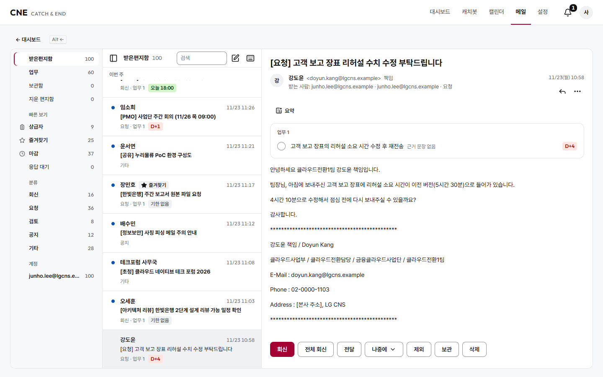

- 메일을 열면 위쪽에 이 메일에서 뽑은 **업무 N**이 보이고, 원문에서 근거 문장이 칠해져 있습니다. 근거를 찾지 못한 업무는 **근거 문장 없음**으로 표시됩니다.
- **요약**을 누르면 요지와 나에게 요청한 것을 짧게 보여 줍니다. **요약 닫기**로 접습니다.
- 외국어 메일은 **원문 | 한국어**로 번역본과 원문을 오갑니다. 영어 · 일본어를 확인했고, 그 밖의 언어는 번역에 실패하면 안내가 뜹니다.
- 요약 · 번역은 누를 때 AI를 부릅니다. 하루 사용량이 정해져 있어 많이 쓰면 그날은 안 될 수 있습니다(8장).

### 처리 버튼

읽기 칸 아래에 **회신 · 전체 회신 · 전달 · 나중에 ▾ · 제외 · 보관 · 삭제**가 있습니다.

- **나중에 ▾**: **1시간 뒤 · 오늘 오후 4시 · 내일 아침 08:30 · 다음 주 월요일 09:00** 중에서 고릅니다(이미 지난 시각은 보이지 않습니다). 그 시각까지 업무가 숨었다가 리마인더로 다시 알려 줍니다. 목록의 메일 줄에서도 나중에 아이콘을 누를 수 있습니다.

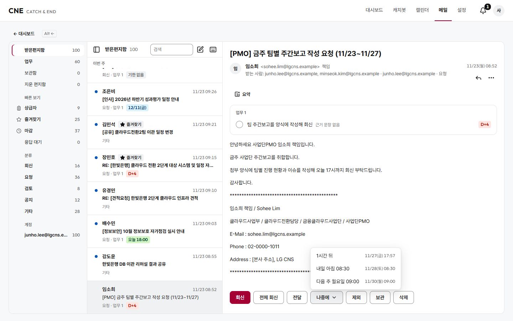

- **제외**: 업무가 아닌 메일을 업무 목록에서 뺍니다. 메일은 지워지지 않습니다.
- **보관 · 삭제**: 메일을 보관함 · 지운 편지함으로 옮깁니다.

### 답장 · 새 메일 쓰기

1. **회신 · 전체 회신 · 전달**을 누르거나 목록 위 **새 메일**(연필 아이콘)을 누릅니다.

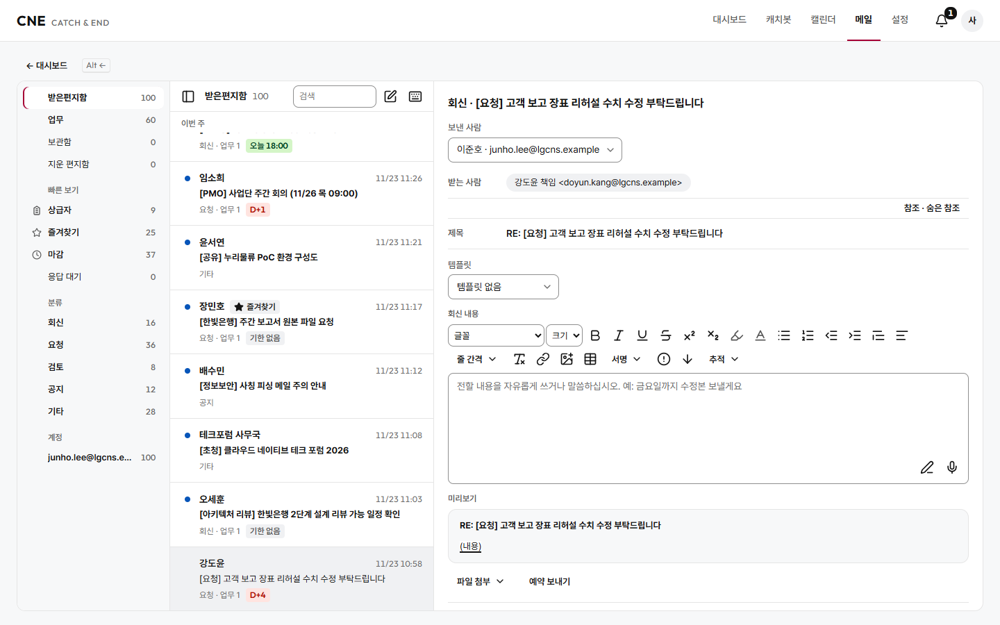

2. 받는 사람 · 참조 · 숨은 참조 · 제목 · 본문을 씁니다. 답장할 때는 **템플릿**에서 미리 만든 문구를 고를 수 있습니다. 서명은 설정대로 자동으로 붙습니다.
3. 필요하면 다음을 씁니다.
   - 첨부: **이 컴퓨터 찾아보기**(파일 합쳐 3MB 미만) 또는 **링크**
   - **중요도 높음 · 낮음**, **읽음 확인 요청 · 배달 확인 요청**
   - **격식체로 다시 쓰기**: AI가 본문을 정중한 문장으로 다듬습니다. 마음에 들지 않으면 안내의 **되돌리기**
   - 🎤 음성 입력
4. **보내기**를 누릅니다. 정한 시각에 보내려면 **예약 보내기 → 예약**을 누르고, 보내기 전에는 안내의 **예약 취소**로 취소합니다.

- **CNE는 사용자가 [보내기]를 누른 메일만 보냅니다.** AI가 스스로 메일을 보내지 않습니다.
- 답장을 보내면 **완료로 처리할까요?**가 뜹니다. 그 메일의 업무가 체크된 채로 보이고, 남길 업무는 체크를 풉니다. **예**를 누르면 완료, **아니오**면 그대로 둡니다. **오늘 다시 보지 않음**을 켜면 오늘은 묻지 않고 바로 완료합니다.
- 시연 화면에서는 **시연 모드 · 실제로 보내지 않음**이 보이고 메일이 나가지 않습니다.

### 메일 화면 단축키

`?`를 누르면 전체 목록이 보입니다. 자주 쓰는 것: `R` 회신, `Delete` 제외, `Insert` 고정 · 고정 해제, `Ctrl+B` 메일함 접기 · 펴기.

## 4. 캐치봇

CNE의 업무 비서입니다. 위쪽 메뉴 **캐치봇**에서 엽니다. 왼쪽 메뉴는 **대화** · **업무 요약 · 회고** · **기록**, 그 아래 **리마인더**(**마감** · **참석**)입니다. 입력칸은 어느 메뉴에서나 아래에 있습니다.

### 대화: 말이나 글로 시키기

입력칸(**캐치봇에게 말하기…**)에 쓰고 **Enter**를 누릅니다. 줄을 바꾸려면 **Shift+Enter**. 🎤를 누르고 말해도 됩니다.

| 이렇게 말하면 | 캐치봇이 하는 일 |
|---|---|
| "오늘 할 일 요약해줘" | 오늘 업무 · 기한 임박을 요약 |
| "한빛은행 견적 건 금요일로 미뤄" | 그 업무를 금요일까지 나중에로 |
| "기한 금요일로 바꿔줘" | 고른 업무의 기한을 바꿈 |
| "이거 완료" · "이건 빼" | 고른 업무를 완료 · 제외 |
| "방금 거 취소해" | 바로 전에 한 일을 되돌림 |
| "답 안 온 메일 뭐 있어" | 보낸 요청 중 답이 없는 메일 |
| "이번 주 회의 일정 뭐 있어" | 이번 주 일정 · 회의 · 마감 |
| "이거 왜 할 일이야" | 업무로 판단한 근거 문장 |
| "김민준 팀장 누구야" | 그 사람이 맡은 일 · 소속, 보낸 메일 · 업무 |
| "지난주 견적 메일 찾아줘" · "무슨 내용이야" | 메일 찾기 · 요약 · 내용 질문 |
| "내일 3시 회의 일정 넣어줘" | 캘린더에 일정 추가 |

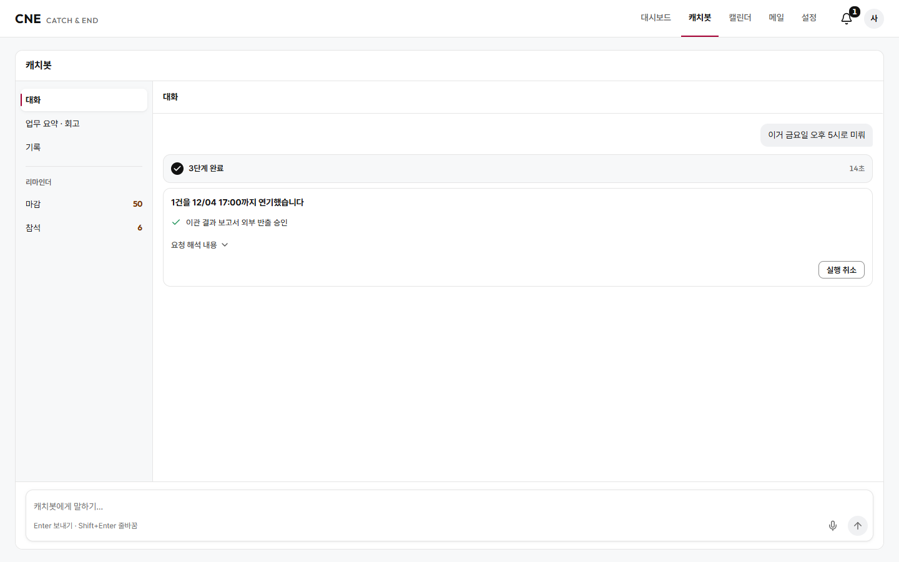

- 결과는 카드로 보입니다. 업무 하나를 바꾸는 일은 바로 실행하고 카드에 **실행 취소**가 붙습니다. **요청 해석 내용**을 펴면 캐치봇이 말을 어떻게 알아들었는지 보입니다.
- **여러 건을 한꺼번에 바꾸거나, 무엇을 말하는지 애매하거나, 메일을 보내는 일**은 먼저 확인 카드를 보여 주고, 사용자가 확인해야 실행합니다.
- 캐치봇은 정해진 일만 합니다. 못 하는 말이면 할 수 있는 일을 안내합니다. 답장 초안은 만들지 않고 메일의 답장 칸으로 안내합니다("초안은 발송되지 않습니다…").
- 음성은 브라우저 제공사(구글 · 애플 등) 서버에서 글자로 바뀔 수 있습니다. 민감한 내용은 글로 씁니다.

### 업무 요약 · 회고

- **일일 업무 요약**(근무일 08:30): 아침 브리핑입니다. 오늘 마감 · 기한 경과 · 회신 대기 업무를 한 장으로 보여 줍니다.
- **일일 업무 회고**(근무일 17:30): 오늘 끝낸 일 · 남은 일 · 내일 마감을 정리합니다. 금요일에는 **주간 업무 회고**도 나옵니다.
- **‹ ›**로 다른 날짜의 요약을 봅니다. 시각은 **설정 → 알림**에서 바꿉니다.

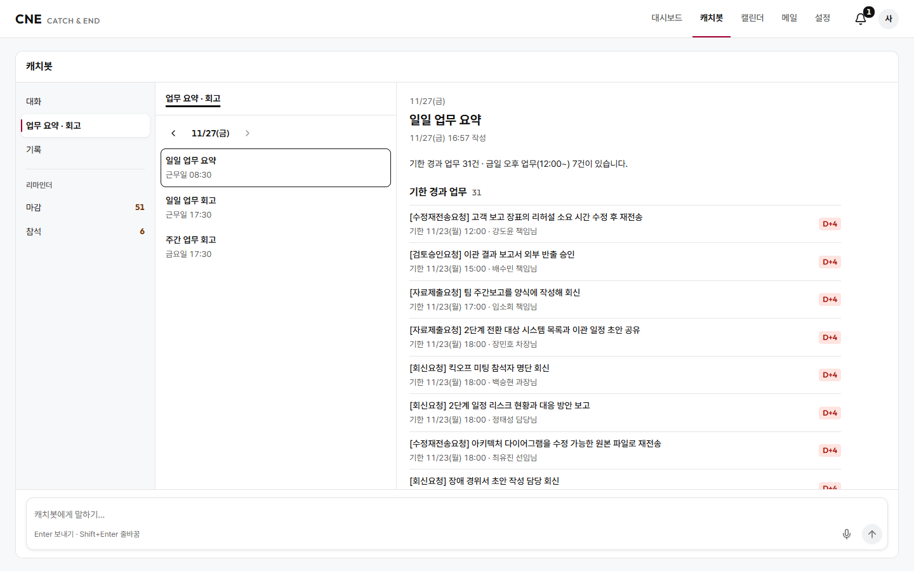

### 리마인더: 놓치기 전에 먼저 알림

CNE가 놓치기 쉬운 순간을 찾아 먼저 알려 줍니다. 리마인더는 **마감**(그때까지 끝내면 되는 일, 기한 3시간 전 알림)과 **참석**(그 시각에 가 있어야 하는 일, 30분 전 알림)으로 나뉩니다.

| 이런 알림이 옵니다 | 예 |
|---|---|
| 기한 임박 · 기한 경과 · 기한 변경 · 마감 집중 | 오늘 17:00 마감, 어제 마감이 지남, 상대가 기한을 바꿈, 하루에 마감이 몰림 |
| 회신 미수신 · 상대 약속 기한 경과 | 내가 보낸 요청에 며칠째 답이 없음, 상대가 보내 준다던 날이 지남 |
| 이행 약속 | 내가 "내일까지 보내 드리겠습니다"라고 쓴 약속 |
| 연기 업무 · 장기 미처리 · 참조 메일 내 요청 · 상급자 메일 | 미뤄 둔 시각이 됨, 오래 남은 업무, 참조로 왔지만 나를 부른 요청 |
| 회의 준비 | 곧 있을 회의 |
| 종결 추정 · 회신 발송 확인 | 다른 사람이 이미 처리한 것 같음, 답장했는데 업무가 남아 있음 |

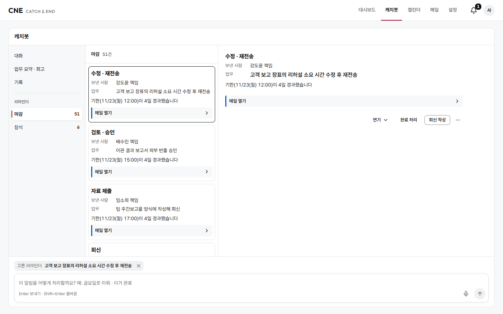

1. 왼쪽 **마감** · **참석**을 누르면 카드 목록이 나옵니다. 카드 맨 위 굵은 글자가 업무 유형(수정 · 재전송, 검토 · 승인 등)입니다.
2. 카드를 고르면 오른쪽에 **이유**와 메일 속 **근거 문장**이 보입니다.
3. 그 자리에서 처리합니다: **메일 열기** · **완료 처리** · **회신 작성** 등. **연기 ▾**로 다시 알릴 시각을 고릅니다.
4. **⋯** 메뉴: **담당 아님**(내 일이 아님) · **이 유형 알림 끄기 · 켜기** · **잘못된 알림으로 신고**.

- 같은 항목은 최대 세 번까지 알리고, 근무 시간에만 알리며, 한꺼번에 여러 건이면 묶어서 알립니다(근무 시간은 설정에서 바꿉니다).
- 리마인더를 고르면 입력칸 위에 **고른 리마인더**가 붙습니다. 이때 "금요일로 미뤄" · "이거 완료"처럼 쓰면 그 리마인더에 바로 적용됩니다.

### 기록

**기록**에서 최근 7일 동안 버튼 · 캐치봇으로 한 일이 모두 보입니다. 잘못한 일은 **실행 취소**, 취소를 다시 되돌리려면 **다시 하기**를 누릅니다. **자동**이 붙은 줄은 CNE가 메일에서 알아서 배운 것(내가 속한 메일 목록 등)입니다.

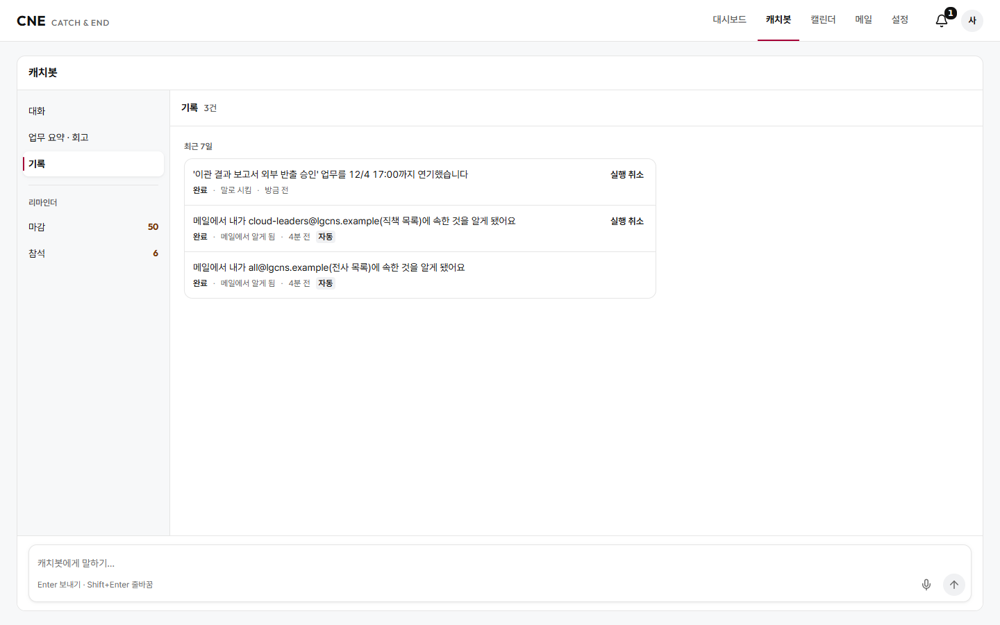

## 5. 알림 센터

위쪽 오른쪽 🔔를 누르면 알림이 모여 있습니다.

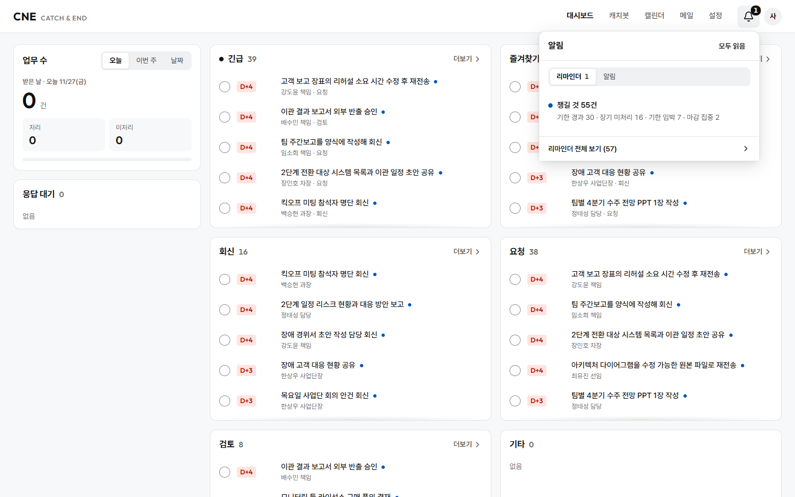

- **리마인더** 탭: 지금 챙길 리마인더. 한꺼번에 여러 건이면 **챙길 것 N건**으로 묶어 이유별 개수를 보여 줍니다. **리마인더 전체 보기**를 누르면 캐치봇 리마인더로 갑니다.
- **알림** 탭: 브리핑 · 회고 · 답장 뒤 완료 확인 같은 알림.
- **모두 읽음**으로 읽음 처리합니다.
- 알림이 없으면 **새 알림이 없어요**가 보입니다.
- 리마인더는 CNE 화면 안(🔔 · 캐치봇)에서만 보입니다. 휴대폰 푸시 알림은 없습니다.
- **설정 → 알림 → 작업 완료 시 브라우저 알림 받기**를 켜고 브라우저가 묻는 권한을 허용하면, 다른 탭을 보는 동안 캐치봇이 맡긴 일을 끝냈을 때 브라우저 알림이 뜹니다.

## 6. 캘린더

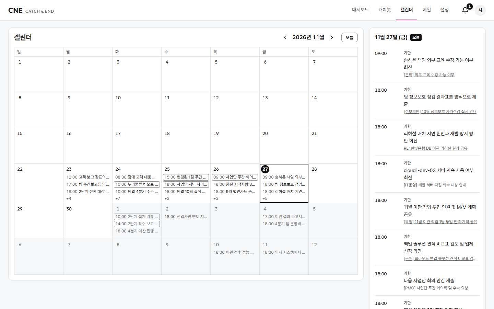

- 월 단위로 봅니다. 위쪽 **‹ ›**로 지난달 · 다음 달, **오늘**로 이번 달로 돌아옵니다.
- 날짜를 누르면 오른쪽에 그날의 기한 · 회의 · 일정이 시각 순으로 보이고, 아래 밑줄 친 메일 제목을 누르면 그 메일이 열립니다.
- 색으로 **일정 · 회의 · 기한 · 다시 알림**(나중에로 미룬 업무)을 나눕니다. 연결한 Outlook 일정도 함께 보입니다.
- 메일 속 회의는 **캘린더에 넣기**로 넣고 **빼기**로 뺍니다. CNE에서 넣은 일정은 Outlook 일정에도 만들어집니다.

## 7. 설정

바꾸면 칸을 벗어날 때 바로 저장됩니다. 답장 템플릿만 **템플릿 저장** 버튼으로 저장합니다.

| 분류 | 항목 |
|---|---|
| **내 정보** | 이름 · 부서 · 직급(보기만) |
| **메일 계정** | Outlook 연결 · 지금 받기 · 연결 끊기 · 다시 연결(0장) |
| **알림** | **일일 업무 요약** 시각(기본 오전 08:30) · **일일 업무 회고** 시각(기본 오후 05:30, 금요일엔 주간 회고도) · **답 없음 기준일**(보낸 요청에 며칠 동안 답이 없으면 '답 기다림'으로 알릴지, 1~30일, 기본 3) · **작업 완료 시 브라우저 알림 받기**(캐치봇 일이 끝나면 브라우저 알림, 이 브라우저에만 저장) |
| **근무 · 방해 금지** | 근무 시작 · 끝 시각, 근무 요일, **방해 금지 시간 사용**, **부재 중(~까지)**. 리마인더는 근무 시간에만 옵니다. 부재 중에서 돌아오면 밀린 것을 묶어 알려 줍니다 |
| **메일** | **메일 본문 읽기**(끄면 새로 받는 메일은 제목과 보낸 사람으로만 판단해 본문 속 기한 · 요청을 놓칠 수 있습니다) · **메일 내용 분석 허용**(사람별 맡은 일 · 소속을 기억해 캐치봇 답에 씀) |
| **답장 템플릿** | 서명(**서명 추가** · **서명 저장**, 기본으로 정하면 새 메일 · 회신 · 전달 끝에 자동으로 붙음), 템플릿(**템플릿 추가** · **템플릿 저장**, 최대 20개). 템플릿에 `{수신자명}` · `{발신자명}` · `{내용}`을 넣으면 보낼 때 채워집니다 |
| **화면** | **테마**(라이트 · 다크 · 시스템) · **움직임 줄이기** |

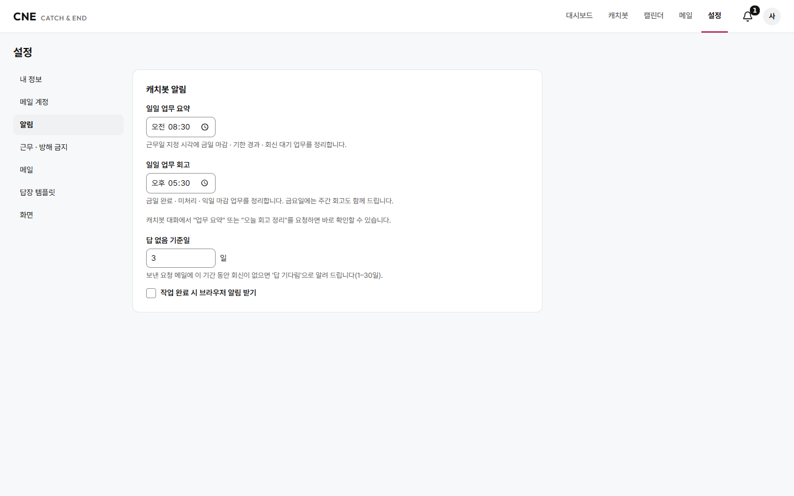

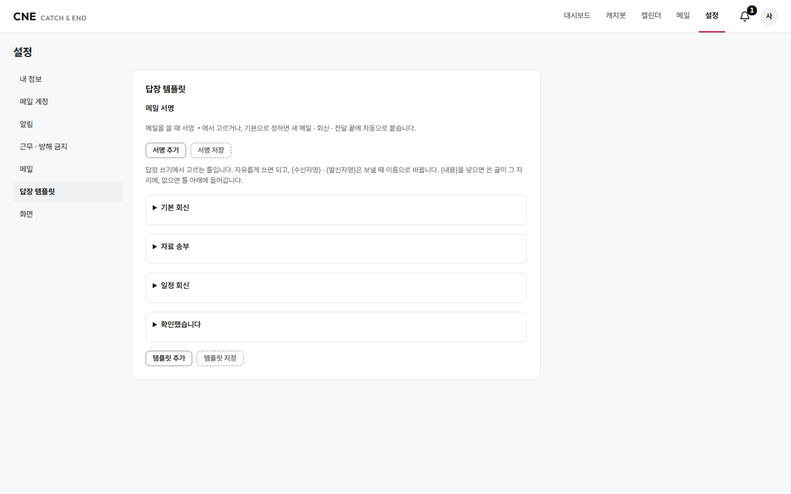

## 8. 이럴 때는

| 이런 일이 생기면 | 뜻 | 할 일 |
|---|---|---|
| 대시보드가 비어 있음 | 메일을 연결하지 않았거나 아직 분류 중 | 설정 → 메일 계정에서 연결 확인, 몇 분 기다림 |
| 새 메일이 안 들어옴 | 1분마다 받는데 아직 안 됐거나 로그인이 풀림 | **지금 받기**, 안 되면 **다시 연결** |
| 어제 쓰던 내용이 안 보임 | 다른 브라우저 · 기기이거나 쿠키가 지워져 새 사용자가 됨 | 같은 브라우저로 들어오거나, Outlook을 다시 연결 |
| 회사 계정이 연결되지 않음 | 회사 관리자가 외부 앱 허용을 막아 둠 | 회사 IT 관리자에게 앱 허용 요청, 또는 개인 Outlook.com으로 |
| 요약 · 번역 · 캐치봇이 안 됨 | AI 하루 사용량을 다 씀(키 하나에 하루 100회, 모든 사용자가 나눠 씀) | 다음 날 다시. 업무 목록 · 메일 읽기 · 버튼 처리는 그대로 됩니다 |
| **…하지 못했어요 [다시 시도]** | 연결이 끊기거나 서버가 잠깐 멈춤 | **다시 시도** |
| **설정을 변경하지 못했습니다** | 저장 실패 | 새로고침 뒤 다시 |
| **서버에 연결하지 못했습니다…** | 서버가 꺼졌거나 주소가 다름 | 잠시 뒤 새로고침, 계속되면 팀에 알림 |
| 업무가 잘못 뽑힘 · 기한이 틀림 | AI가 잘못 읽음 | 업무는 **제외**, 기한은 캐치봇 "기한 ○○로 바꿔줘". 리마인더는 **잘못된 알림으로 신고** |
| 할 일인데 대시보드에 없음 | AI가 할 일로 보지 않음 | **확인사항** 칸과 메일함 **확인사항**을 먼저 봅니다 |

## 9. 알아 두실 점

- **AI가 틀릴 수 있습니다.** 봉인 시험 메일 200통에서 할 일이 있는 메일 90통은 하나도 놓치지 않았지만, 할 일이 아닌 메일 6통을 할 일로 잡았고 기한은 105개 중 94개를 맞혔습니다. 업무를 누르면 근거 문장이 보이니, 중요한 일은 원문을 함께 확인합니다.
- **근거 문장은 메일에 실제로 있는 문장만 보여 줍니다.** AI가 지어낸 근거는 걸러 내지만, 업무 자체를 잘못 판단하는 것까지 모두 막지는 못합니다.
- **개인정보**: 메일 본문은 AI(LG AI연구원 엑사원 API)로 보내 업무를 뽑습니다. 보내기 전에 메일 주소 · 연락처에 있는 이름 · 전화번호를 가리고, 답을 받은 뒤 되돌립니다. 연락처에 없는 이름이나 "민준님"처럼 이름만 부른 것은 가리지 못합니다. 민감한 메일함은 연결하지 않거나 **설정 → 메일 → 메일 본문 읽기**를 끕니다.
- **메일은 사용자가 보내기를 눌렀을 때만 나갑니다.** 업무도 사용자가 고르기 전에는 스스로 완료하지 않습니다.
- 이 서비스는 교육 과정 프로젝트의 시연판입니다. 계정 로그인 없이 브라우저마다 사용자를 나누므로, 공용 PC에서는 쓰고 나서 Outlook **연결 끊기**를 누르고 브라우저 기록을 지웁니다.
