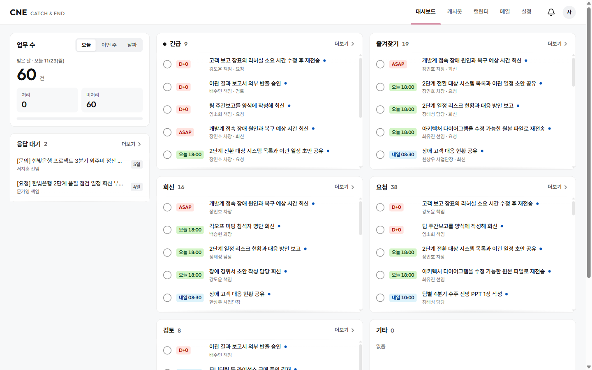
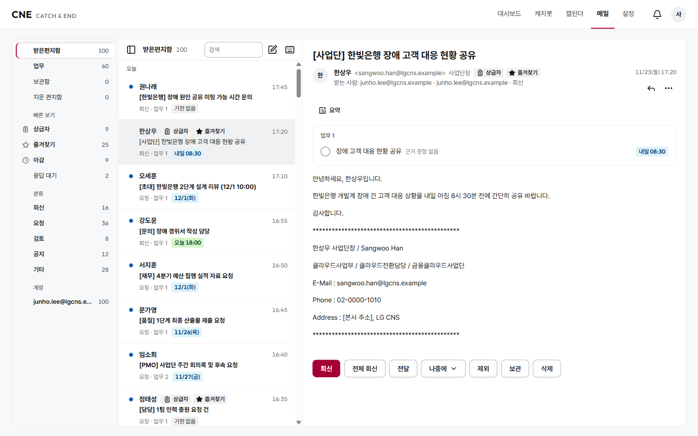

# CNE 웹 프론트엔드

대시보드 · 메일 · 캐치봇 · 캘린더 · 설정 화면입니다. React 19 + TypeScript + Vite로 만들고, 서버 데이터는 TanStack Query로 다룹니다. 패키지 매니저는 npm입니다. 서비스 전체 소개는 [저장소 README](../README.md)에 있습니다.

| 항목 | 내용 |
| --- | --- |
| 상태 | 다섯 화면 모두 backend API 연결 완료. 웹 푸시 알림은 진행 전 |
| 호출 | 같은 출처의 `/api/...`로 backend만 부릅니다. ai 서비스는 직접 부르지 않습니다 |
| 데이터 모드 | `mock`(기본, 모의 데이터) · `http`(backend 연결) |
| 테스트 | `node --test` 47개 파일 — 집계 · 기한 판정 · 응답 변환 · 캐치봇 · 단축키 · 색 대비 |
| 기준 문서 | [디자인 시스템](../docs/20_frontend/design_system.md) · [와이어프레임](../docs/20_frontend/wireframe.md) · [컴포넌트](../docs/20_frontend/components.md) · [FE 결정](../docs/20_frontend/decisions.md) |

## 기술 스택

| 영역 | 기술 | 버전 | 쓰는 곳 |
| --- | --- | --- | --- |
| UI | React | 19.3 | 화면 전체 |
| 언어 | TypeScript | 6.0 | `tsc --noEmit`로 타입 검사 |
| 빌드 · 개발 서버 | Vite (`@vitejs/plugin-react`) | 8.3 | 개발 서버 `/api` 프록시, 프로덕션 빌드 |
| 라우팅 | React Router (`createHashRouter`) | 8.5 | `#/dashboard`처럼 해시 주소 |
| 서버 데이터 | TanStack Query | 5.105 | 조회 캐시 · 다시 불러오기 · 상태 변경 뒤 갱신 |
| 접근성 기본 부품 | Base UI (`@base-ui/react`) | 1.9 | 메뉴 · 팝오버 · 시트 · 탭 · 셀렉트 |
| 아이콘 | lucide-react | 1.63 | `src/ui/Icon.tsx`에서 쓰는 것만 다시 내보냄 |
| 스타일 | CSS Modules + 디자인 토큰(`--c-*`) | — | 라이트 · 다크 · 시스템 테마 |
| 글꼴 | Pretendard Variable · Outfit Variable | 1.3.9 · 5.3.0 | 빌드에 포함(SIL OFL 1.1) |
| 음성 | 브라우저 Web Speech API | — | 캐치봇 음성 입력 |
| 테스트 | Node 내장 `node --test` (TS 타입 제거) | Node 22.22+ | 별도 테스트 프레임워크 없음 |
| 배포 | Docker(node 22 빌드) → Caddy 2.10 | — | 정적 파일 + `/api` 프록시 |

## 실행

필요한 것: **Node.js 22.22 이상**(`package.json` engines, 테스트가 Node의 TS 타입 제거 기능을 씁니다), npm 10. `.npmrc`의 `engine-strict=true` 때문에 버전이 낮으면 설치가 멈춥니다. 루트 `.nvmrc`는 `22`라 낮은 22.x를 막지 않으니 `node -v`로 확인합니다.

```bash
cd frontend
npm ci                                # package-lock.json 그대로 설치 (CI와 같음)
npm run dev -- --port <배정 포트>      # http://127.0.0.1:<포트>. 쓰이고 있으면 멈춤(strictPort)
```

| 명령 | 하는 일 |
| --- | --- |
| `npm run typecheck` | 타입 검사 |
| `npm run build` | 타입 검사 + 프로덕션 빌드(`dist/`) |
| `npm test` | 단위 테스트. `TZ=UTC` · `TZ=Asia/Seoul` 둘 다 통과해야 합니다 |
| `npm run mock:check-v2` | 모의 데이터가 원본 더미 메일에서 다시 만든 결과와 같은지 (`mock:check`는 v1) |
| `npm run tokens:check` | 디자인 토큰 내보내기 파일(`cne.tokens.json`)이 `tokens.css`와 같은지 |

- backend · ai까지 한 번에 띄우려면 루트에서 `python scripts/run_dev.py`.
- 개발 서버는 `127.0.0.1`에만 열립니다. 공용 개발 서버에서는 `--port`에 내 계정 포트(`echo $PORT`)를 넣고, VS Code Remote SSH의 Ports 탭으로 전달합니다.

## 설정

`frontend/.env.example`을 `frontend/.env`로 복사합니다. `VITE_` 값은 빌드 결과에 그대로 들어가므로 **비밀값을 넣지 않습니다**.

| 이름 | 기본값 | 뜻 |
| --- | --- | --- |
| `VITE_API_MODE` | `mock` | `mock`: `src/api/mock/`의 모의 데이터. `http`: backend 호출. 그 밖의 값은 설정 오류로 화면에 알림 |
| `VITE_API_BASE` | `/api` | backend 주소 앞부분 |
| `VITE_USER_ID` | `1` | backend `AUTH_MODE=header`일 때 `X-User-Id`로 붙는 사용자 번호. 배포(`AUTH_MODE=session`)는 `POST /api/session` 쿠키를 씀 |
| `VITE_MOCK_DATASET` | `v2` | 모의 데이터 묶음(`v2` \| `v1`) |
| `VITE_STT_MODE` | (빈 값) | 음성 인식 방식. 지금은 브라우저 방식만 있음 |
| `BACKEND_PROXY_TARGET` | `http://127.0.0.1:8000` | 개발 서버가 `/api/...`를 넘길 backend 주소. `/api/health`만 `/health`로 바꿈 |

- 모의 모드에서는 주소에 `?mock=loading` · `mock=empty` · `mock=error`를 붙여 상태별 화면을 봅니다(해시 안 `#/dashboard?mock=error`도 되고, 둘 다 있으면 해시 안 값이 이깁니다).
- `http` 모드에서 실패하면 오류 화면을 보이고 모의 데이터로 대신하지 않습니다. 오류 문구는 네트워크 · HTTP · 형식 · 설정 오류로 나눕니다.

## 화면과 연동 상태

| 화면 | 주소 | 현재 상태 |
| --- | --- | --- |
| 대시보드 | `#/dashboard` | 업무 수(오늘 · 이번 주 · 날짜, 처리 · 미처리), 응답 대기, 긴급 · 즐겨찾기 · 회신 · 요청 · 검토 · 기타 칸, 칸별 더보기. API 연결 |
| 메일 | `#/mail/:box/:mailId` | 메일함 · 빠른 보기(상급자 · 즐겨찾기 · 마감 · 응답 대기) · 분류 · 계정 메뉴, 목록(기한 라벨 · 단축키), 본문(업무 카드 · 근거 문장 · 요약 · 번역), 답장 · 전체 회신 · 전달 · 새 메일 · 예약 발송, 답장 뒤 완료 확인(D48). API 연결 |
| 캐치봇 | `#/agent/*` | 대화(글 · 음성), 업무 요약 · 회고(브리핑), 기록, 리마인더 묶음(마감 · 참석 등)과 상세 · 버튼. API 연결 |
| 캘린더 | `#/calendar` | 월 보기, 날짜별 목록 — 업무 기한 · 메일 속 회의 · 미룬 업무 · Outlook 일정, [캘린더에 넣기]. API 연결 |
| 설정 | `#/settings/:section` | 내 정보 · 메일 계정(Outlook 연결) · 알림 · 근무 · 방해 금지 · 메일 · 답장 템플릿 · 화면(테마 · 움직임). API 연결 |
| 알림 센터 | 위쪽 바 종 아이콘 | 리마인더 알림 목록 · 읽음 · 답장 완료 확인. API 연결 |

| 대시보드 | 메일 |
| --- | --- |
|  |  |

- 모르는 주소는 대시보드로 보냅니다. 위쪽 바: 대시보드 · 캐치봇 · 캘린더 · 메일 · 설정 · 알림 센터.
- 어느 화면에서나 `Ctrl+J`(⌘J)로 캐치봇 입력칸으로 갑니다. 예전 오른쪽 캐치봇 패널은 11-15에 없앴습니다.

## 공통 구조

| 경로 | 역할 |
| --- | --- |
| `src/app/` | 라우터(`router.tsx`) · 공통 레이아웃 · 위쪽 바 · QueryClient |
| `src/pages/` | 주소마다 한 폴더: `dashboard/` · `mail/` · `agent/` · `calendar/` · `settings/` |
| `src/features/tasks/` | 업무 행 · 상태 변경(완료 · 나중에 · 제외 · 되돌리기) · 집계 · 기한 판정 · 토스트 |
| `src/features/mail/` | 목록 · 본문 · 작성(리치 편집기) · 근거 문장 칠하기 · 첨부 · 예약 발송 · 단축키 · 답장 후 완료 확인 |
| `src/features/agent/` | 캐치봇 입력 · 결과 카드 · 진행 단계 · 기록 · 세션 |
| `src/features/reminders/` | 리마인더 목록 · 상세 · 버튼 · 브리핑 모델 |
| `src/features/notifications/` | 알림 센터(종) · 브라우저 알림 |
| `src/features/calendar/` | 달력 모델 · 일정 넣기 |
| `src/features/voice/` | 음성 입력 (`adapters/browserStt.ts`) |
| `src/api/` | backend 호출(`httpClient.ts`) · 응답 변환(`adapter.ts`) · 세션 · 모의 클라이언트(`mockClient.ts`, `mock/`) |
| `src/ui/` | 공용 부품: Button · Chip · DueLabel · Menu · Popover · Sheet · Tabs · Toast … (`index.ts`에서 내보냄) |
| `src/lib/` | 단축키 · 미루기 시각 · 토스트 문구 · 테마 · 모션 |
| `src/styles/` | 디자인 토큰(`tokens.css`) · 테마(`theme.css`) · 대비 · 토큰 테스트 |
| `scripts/` | 모의 데이터 추출(`extract-mock*.mjs`) · 토큰 내보내기 |

## 지키는 규칙

- **응답 변환은 `src/api/adapter.ts` 한 곳에서** 합니다. 화면에서 `fetch`를 직접 쓰지 않습니다. 시간대가 없는 시각은 오류로 거절합니다(D47 `+09:00`). 업무가 가리키는 메일이 응답에 없으면 '메일 정보 확인 필요'로 따로 보입니다.
- **버튼과 캐치봇은 같은 길을 탑니다.** 같은 API · 같은 화면 갱신을 쓰고, 행동 직후 대시보드 숫자를 다시 불러옵니다.
- **상태 변경 토스트는 `features/tasks/useTaskActions.ts` 한 곳에서** 띄웁니다. 문구는 `lib/toastPolicy.ts`('~해요' 체). 성공은 [되돌리기] 버튼과 함께 8초, 실패는 연결 실패 · 시간 초과 · 서버 오류일 때만 [다시 시도]. 자기 결과 줄이 있는 화면(캐치봇 카드 · 기록)은 `{ toast: false }`로 부릅니다.
- **색은 `src/styles/tokens.css` 한 곳에서** 관리합니다. 무채색 면 60 · 보조 35 · 포인트 5 비율이고, 포인트 LG Heritage Red `--c-point`(#A50034)는 채운 주 버튼 · 에이전트 버튼 · 선택 표시선에만 씁니다. 글자 4.5:1 · 상태 표시 3:1 대비는 `styles/contrast.test.ts`가 실제 토큰 값으로 검사합니다.
- **시각은 서버 기준**입니다. 기한 라벨 · 리마인더는 backend가 준 `as_of`로 계산해, 서비스 시각(시연용 `CLOCK_START`)과 화면이 어긋나지 않습니다.

## 배포

`Dockerfile`이 Node 22로 빌드(`VITE_API_MODE=http`)한 뒤 Caddy 이미지에 담습니다. `Caddyfile`은 `/api/health`를 backend `/health`로, `/api/*`를 `{$BACKEND_URL}`로 넘기고, 나머지는 빌드 결과(SPA)로 응답합니다. Railway `web` 서비스 설정은 [infra/railway_setup.md](../infra/railway_setup.md)에 있습니다.
